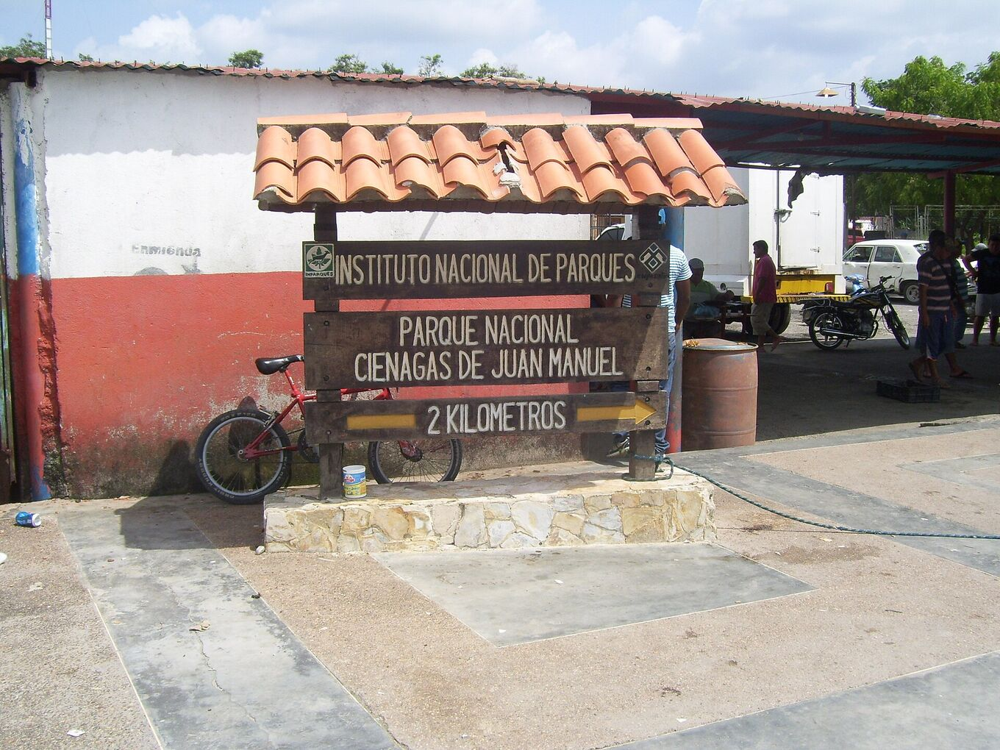

## Mit Auto und Boot

Die meisten Ausflüge starten mit dem Boot in Puerto Concha, nahe Santa Bárbara del Zulia, Richtung Ologá. Der nächste Flughafen ist El Vigía; Maracaibo liegt mehrere Autostunden entfernt. Viele Agenturen bieten die Tour ab Mérida an.

Von Mérida führt die Straße aus den Anden hinab in die Ebenen südlich des Sees, vorbei an Kochbananenplantagen und Rinderfarmen. Bis zur Anlegestelle sind es etwa vier Stunden. Ab Puerto Concha folgt das Boot Flussarmen und Mangroven in den Nationalpark und hinaus auf den See. Die Fahrt dauert je nach Route und Wasserstand ein bis zwei Stunden.

Hab Reisepass oder Ausweis dabei, denn auf den Straßen gibt es Polizei- und Militärkontrollen.

*[Yinette Bracho Padilla · Wikimedia Commons · CC BY-SA 4.0](https://commons.wikimedia.org/wiki/File:Entrada_al_parque_nacional.jpg)*

Transfers, Fahrpläne und Preise ändern sich mit den Routen, dem Wasserstand und der Verfügbarkeit vor Ort. Bestätige sie deshalb vor der Reise bei lokalen Anbietern.

## Bootsrouten nach Ologá

Ein Agrotourismus-Projekt aus der Region beschreibt vier Routen. Die Zeiten sind ungefähr.

| Abfahrt | Dauer | Halt |
| --- | --- | --- |
| Puerto Concha | ≈ 1 Std. | Pfahlbau von Corpozulia |
| Escalante-Kanal, ab Curva de Colón | ≈ 2 Std. | Congo Mirador |
| Fischereihafen Encontrados, über den Catatumbo | ≈ 2 Std. 30 Min. | Caña Dulce |
| Puerto La Maroma, in Concha | ≈ 2 Std. 30 Min. | Pfahlbau von Corpozulia |

Bei sehr niedrigem Wasser oder Hochwasser sind manche Routen nicht befahrbar. Wenn du am Vortag ankommst, findest du auf der Seite Unterkunft Hotels nahe dem Anleger.
