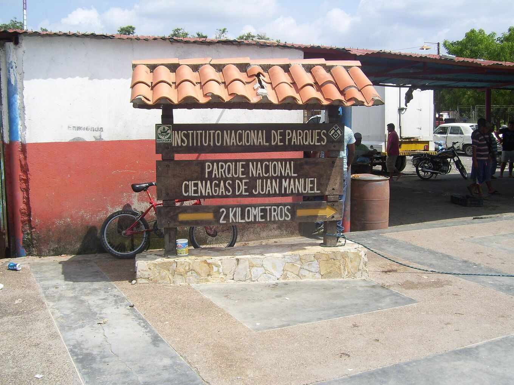
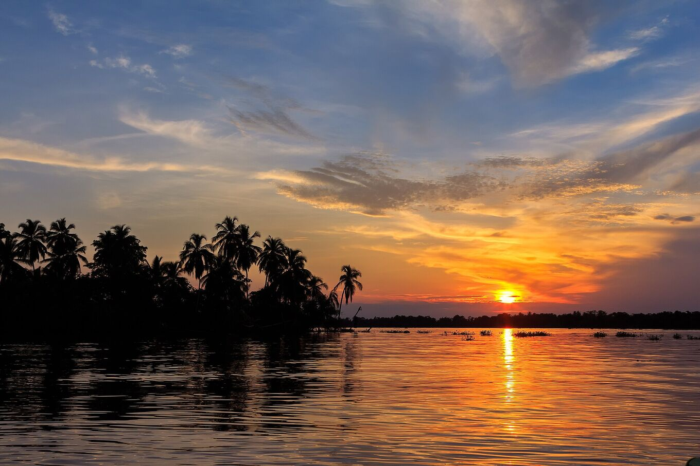
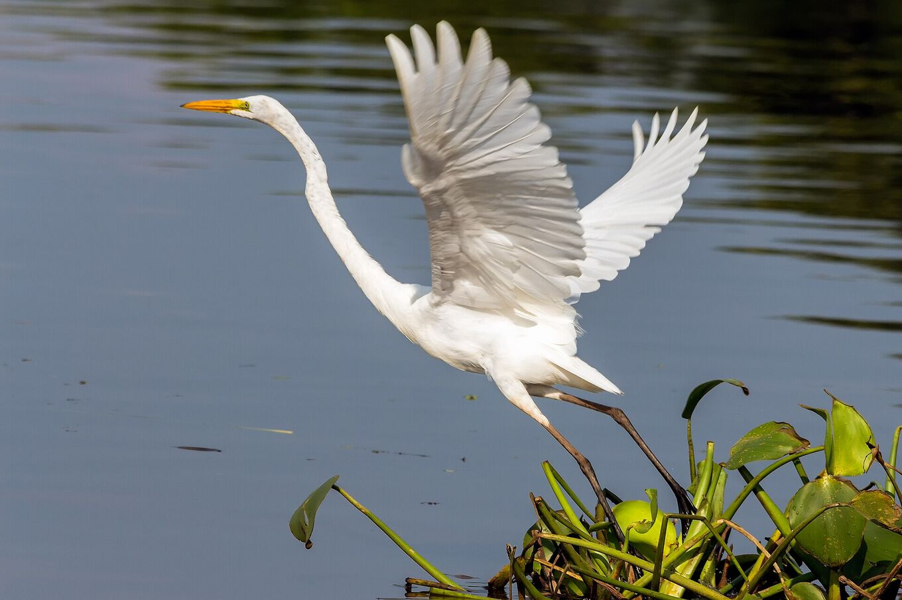

## Nimm dir Zeit. Sei vorsichtig.

### Anreise

Die meisten Ausflüge starten mit dem Boot in Puerto Concha, nahe Santa Bárbara del Zulia, Richtung Ologá. Der nächste Flughafen ist El Vigía; Maracaibo liegt mehrere Autostunden entfernt. Viele Agenturen bieten die Tour ab Mérida an.

Von Mérida führt die Straße aus den Anden hinab in die Ebenen südlich des Sees, vorbei an Kochbananenplantagen und Rinderfarmen: etwa vier Stunden bis zur Anlegestelle. Ab Puerto Concha folgt das Boot Flussarmen und Mangroven in den Nationalpark und hinaus auf den See. Die Fahrt dauert je nach Route und Wasserstand ein bis zwei Stunden.

Hab Reisepass oder Ausweis dabei: Auf den Straßen gibt es Polizei- und Militärkontrollen.

*[Yinette Bracho Padilla · Wikimedia Commons · CC BY-SA 4.0](https://commons.wikimedia.org/wiki/File:Entrada_al_parque_nacional.jpg)*

### Reisezeit

Das Gewitter beginnt in der Dämmerung und dauert meist bis in die frühen Morgenstunden. September bis November sind die aktivsten Monate. Prüfe die Wettervorhersage am Nachmittag deines Ausflugs.

April und Mai bringen einen zweiten, kleineren Höhepunkt. Januar und Februar sind am ruhigsten: weniger Gewitter, dafür trockenere Tage und ruhigeres Wasser. Komm vor Sonnenuntergang an: Die Dämmerung über dem See gehört dazu.

Im November in Maracaibo? Die Feria de la Chinita vom 11. bis 18. November füllt die Stadt mit Gaitas, Prozessionen und Menschen.

*[Fernando Flores · Wikimedia Commons · CC BY-SA 2.0](https://commons.wikimedia.org/wiki/File:Sunset_at_Congo_Mirador_%2823978940929%29.jpg)*

### Was mitnehmen

Mückenschutz, langärmelige Kleidung, eine Regenjacke, eine Stirnlampe, Bargeld, Trinkwasser und einen wasserdichten Beutel für Handy und Kamera. In den Pfahlbaudörfern sind Strom und Mobilfunkempfang begrenzt.

Außerdem: Hut und Sonnencreme für die Bootsfahrt, leichte, schnell trocknende Kleidung, eine Powerbank, Snacks und deine Medikamente. Strom kommt meist von einem Generator, und nur für einige Stunden.

### Gesundheit

Der Süden des Sees ist heiß und sehr feucht: 22–32 °C. Trink viel. In der Dämmerung kommen die Mücken.

Lass dich einige Wochen vor der Reise reisemedizinisch beraten und frag nach der Gelbfieberimpfung und Malariaprophylaxe für die Gegend. Trink kein Seewasser und bade nicht darin: Teile des Sees sind verschmutzt.

### Sicherheit

Gewitter sind gefährlich. Beachte Wetterwarnungen und die Hinweise der örtlichen Guides. Fahre nicht mit dem Boot unter dem Gewitter und suche keinen Schutz unter einzeln stehenden Bäumen. Notruf: **VEN 911**.

Auf offenem Wasser ist ein Boot der höchste Punkt weit und breit. Wenn du Donner hörst, ist das Gewitter nah genug, um dich zu treffen: runter vom Wasser und unter ein Dach. Trag bei jeder Fahrt die Schwimmweste.

Prüfe vor der Buchung die Reisehinweise deines Landes. Mehrere Länder raten von Reisen nach Venezuela oder in Gebiete nahe der Grenze zu Kolumbien ab. Schließ eine Reiseversicherung ab, die das abdeckt.

### Den Blitz fotografieren

- **Ruhige Kamera:** ein Stativ auf der Terrasse des Pfahlbaus. Vom Boot aus verwackeln die Fotos.
- **Fokus:** manuell, auf unendlich. Der Autofokus versagt im Dunkeln.
- **Belichtung:** 10–30 s, ISO 800–3200, Blende f/2,8–f/5,6. Serienbilder machen und die besten behalten.
- **Handy:** Nachtmodus, an etwas Festes gelehnt.
- **Licht:** Blitz aus, Stirnlampe auf Rot. Deine Nachbarn schauen auch zu.
- Pack die Kamera in den Beutel, wenn der Regen kommt.

### Respekt

Ologá und Congo Mirador sind Wohnorte, keine Kulissen. Frage, bevor du Menschen fotografierst, nutze lokale Angebote und nimm deinen Müll mit. Für den Nationalpark gelten Nutzungsregeln: Halte sie ein.

Die Familien in den Pfahlbauten leben vom Fischfang und von Besuchern. Kauf ihr Essen und ihr Kunsthandwerk. Sei nachts leise. Frag, bevor du eine Drohne fliegen lässt. Füttere und verfolge keine Tiere.

*[Fernando Flores · Wikimedia Commons · CC BY-SA 2.0](https://commons.wikimedia.org/wiki/File:Great_Egret_Garza_Real_%28Ardea_alba_egretta%29_%2824754473973%29.jpg)*

> Transfers, Fahrpläne und Preise ändern sich mit den Routen, dem Wasserstand und der Verfügbarkeit vor Ort. Bestätige sie vor der Reise bei lokalen Anbietern.

## Quellen und weiterführende Lektüre

- [Albrecht et al. · BAMS 2016](https://doi.org/10.1175/BAMS-D-14-00193.1)
- [Muñoz et al. · Atmospheric Research 2016 · saisonale Blitzvorhersage](https://doi.org/10.1016/j.atmosres.2015.12.018)
- [Wikipedia · Catatumbo-Gewitter](https://de.wikipedia.org/wiki/Catatumbo-Gewitter)
- [Wikipedia · Maracaibo-See](https://de.wikipedia.org/wiki/Maracaibo-See)
- [Wikipedia · Congo Mirador (Spanisch)](https://es.wikipedia.org/wiki/Congo_Mirador)
- [Blitzortung · Blitze in Echtzeit](https://www.blitzortung.org/)
