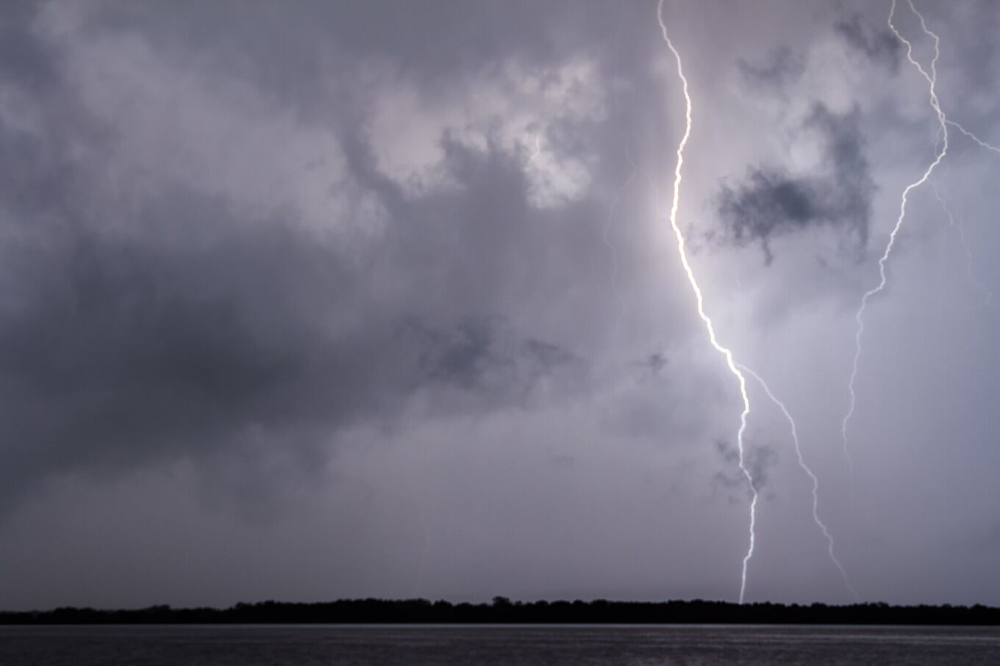
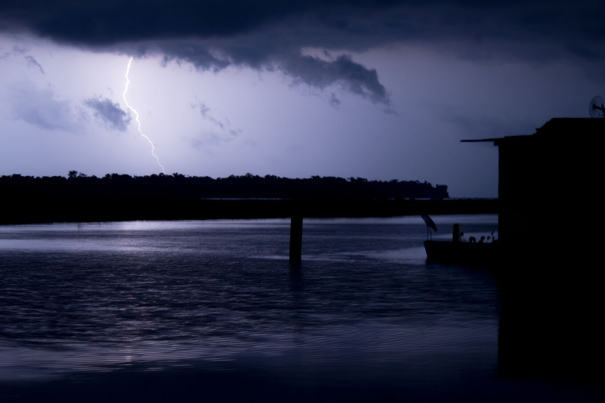

## Ein Gewitter, das fast jede Nacht wiederkehrt

Das Catatumbo-Gewitter (Relámpago del Catatumbo) entsteht nachts über dem Südwesten des Maracaibo-Sees und den Sümpfen nahe der Mündung des Río Catatumbo. Vom Ufer aus sieht es aus wie ein fast ununterbrochenes Leuchten in den Wolken, oft ohne hörbaren Donner, weil das Gewitter weit entfernt ist.

Jede Nacht ist anders. Manche Nächte sind sehr aktiv, andere ruhig. Die Aktivität hängt von Wind, Luftfeuchtigkeit und Jahreszeit ab.

*[Fernando Flores · Wikimedia Commons · CC BY-SA 2.0](https://commons.wikimedia.org/wiki/File:Catatumbo_Lightning_-_Rayo_del_Catatumbo_%2825385580334%29.jpg)*

| Zahl | Bedeutung |
| --- | --- |
| 140–160 | Nächte mit Aktivität pro Jahr |
| 16–40 | Blitze pro Minute |
| ≈ 9 h | Typische Dauer pro Nacht |
| 12–15 km | Höhe, die die Gewitterwolken erreichen |
| 232,5 | Blitze pro km² und Jahr (NASA LIS, 2016) |

## Viele Gewitter, ein Name

Forschende der Universidad del Zulia sprechen lieber von *den* Catatumbo-Blitzen, denn jede Nacht bilden sich mehrere Gewitterzellen an verschiedenen Stellen des Deltas und im Südwesten des Sees. Aus der Ferne verschmelzen sie zu einem einzigen Leuchten.

Die Wolken sind Cumulonimben, die höchsten Gewitterwolken, die bis an die Obergrenze der tropischen Troposphäre reichen. Die meisten Blitze bleiben in den Wolken oder springen zwischen ihnen und lassen sie von innen leuchten. Andere schlagen in den Boden oder ins Wasser ein.

Licht reicht viel weiter als Schall. Donner ist selten weiter als etwa 20 km zu hören, das Leuchten dagegen aus viel größerer Entfernung zu sehen. Deshalb wirkt der Blitz von Maracaibo oder vom Ufer aus stumm. Unter dem Gewitter donnert es fast ununterbrochen.

*[Fernando Flores · Wikimedia Commons · CC BY 3.0](https://commons.wikimedia.org/wiki/File:Catatumbo_Lightning_%28127737829%29.jpeg)*

## Wie es entsteht

### Feuchtigkeit

Der See ist warm und verdunstet viel Wasser. Die Passatwinde aus der Karibik treiben diese feuchte Luft in den Süden des Beckens.

### Relief

Das Becken wird im Westen von der Sierra de Perijá und im Südosten von der Cordillera de Mérida begrenzt. Die Luft ist zwischen Bergen von über 3.000 m Höhe eingeschlossen.

### Nächtliche Konvergenz

Nachts trifft kühle Luft, die von den Bergen herabströmt, auf die warme Luft über dem See. Diese Strömung zwingt die feuchte Luft nach oben und bildet Gewitterwolken fast immer am selben Ort.

### Der Nachtwind

Eine Windströmung, der nächtliche Low-Level-Jet des Maracaibo-Sees, quert das Becken bei Nacht. Ist er stark und enthält die Luft viel Gewitterenergie (was Meteorologen CAPE nennen), gibt es mehr Blitze. 2016 nutzte ein Team der Universidad del Zulia diesen Zusammenhang für die weltweit erste saisonale Blitzvorhersage, Monate im Voraus.

> Lange Zeit galt Methan aus den Sümpfen und Ölfeldern als Ursache. Neuere Studien führen das Phänomen vor allem auf Wind und Relief zurück; die Rolle des Methans ist weiterhin umstritten.

Das Methan-Modell besteht auch einen einfachen Test nicht. Es sagt mehr Blitze in der Trockenzeit voraus, die Messungen zeigen das Gegenteil.

## Quellen und weiterführende Lektüre

- [Albrecht et al. · BAMS 2016](https://doi.org/10.1175/BAMS-D-14-00193.1)
- [Muñoz et al. · Atmospheric Research 2016 · saisonale Blitzvorhersage](https://doi.org/10.1016/j.atmosres.2015.12.018)
- [Wikipedia · Catatumbo-Gewitter](https://de.wikipedia.org/wiki/Catatumbo-Gewitter)
- [Wikipedia · Maracaibo-See](https://de.wikipedia.org/wiki/Maracaibo-See)
- [Wikipedia · Congo Mirador (Spanisch)](https://es.wikipedia.org/wiki/Congo_Mirador)
- [Blitzortung · Blitze in Echtzeit](https://www.blitzortung.org/)
- [NASA Earthdata · The Maracaibo Beacon](https://www.earthdata.nasa.gov/news/feature-articles/maracaibo-beacon)
- [Video · ScienceABC · What Is The Beacon Of Maracaibo? (englisch)](https://www.youtube.com/watch?v=iPw2KFU2raw)
