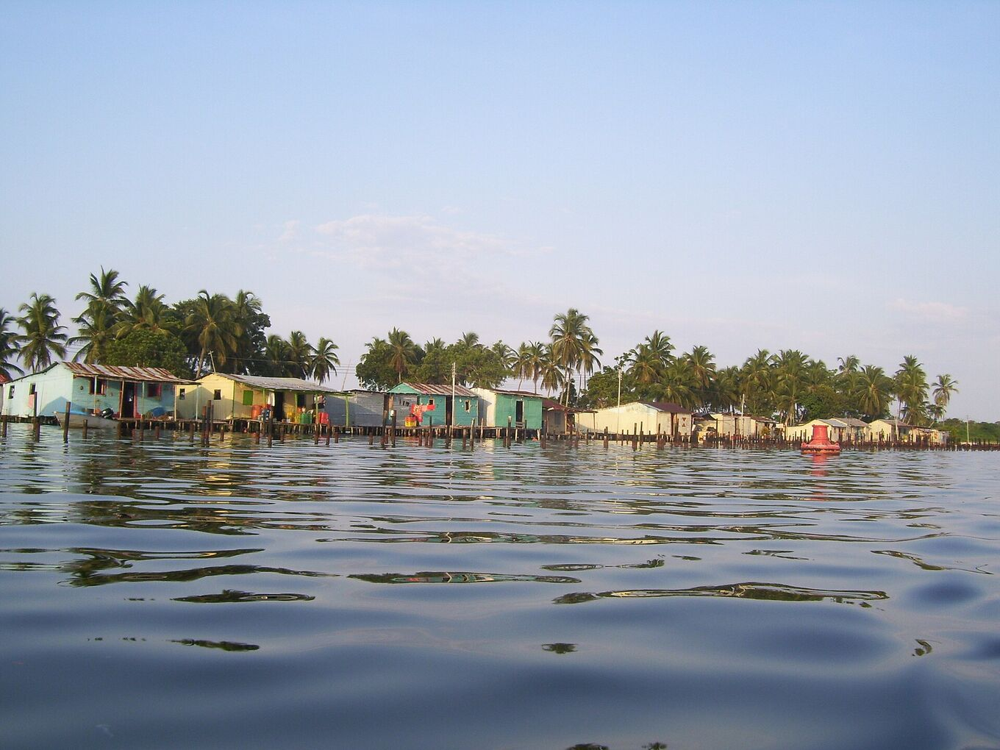
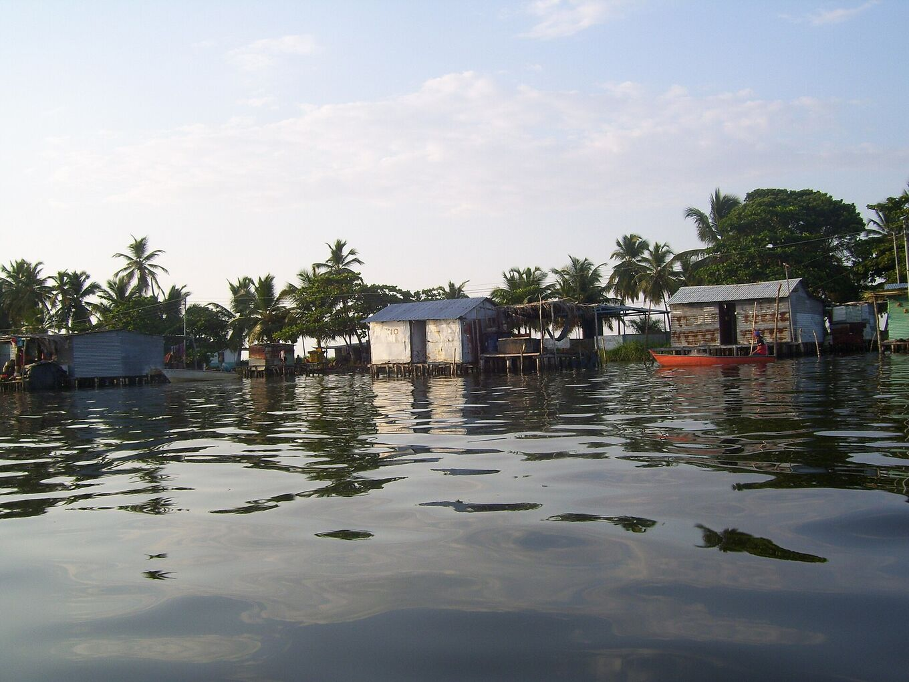
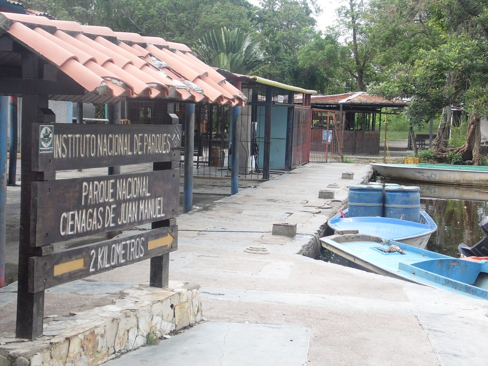
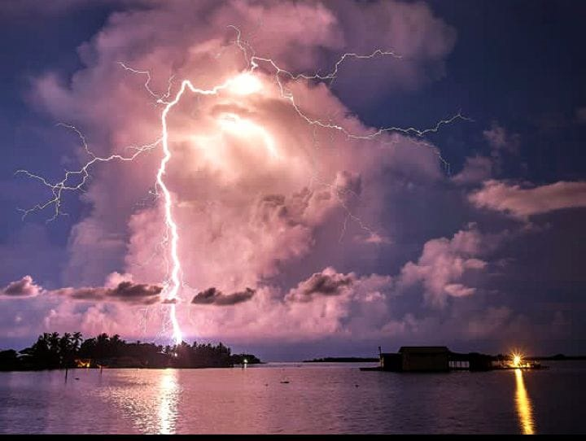

## Der Maracaibo-See

Die Pfahlbaudörfer, von denen aus man das Gewitter beobachtet, und der Anleger, an dem die Boote abfahren. Das Schutzgebiet, in dem das Gewitter entsteht, der Nationalpark Ciénagas del Catatumbo, hat eine eigene Seite.

Der Maracaibo-See ist etwa 13.500 km² groß. Im Norden ist er über eine schmale Meerenge mit der Karibik verbunden, im Süden speisen ihn Dutzende Flüsse. Der größte, der Catatumbo, liefert mehr als die Hälfte seines Wassers.

Auf dem Wasser zu leben hat hier eine lange Tradition. Die Añú, ein indigenes Volk des Sees, bauten schon Pfahlhäuser, als 1499 die Spanier kamen.

## Der Süden des Sees

### Ologá

*Seegemeinde · Pfahlbauten*

Ein Pfahlbaudorf, etwa zehn Bootsminuten von Congo Mirador entfernt. Heute ist es der wichtigste Ausgangspunkt, um den Blitz zu beobachten, mit einfachen Camps und Gästehäusern über dem Wasser.

Einige seiner Häuser stammen aus Congo Mirador. Da sie auf Pfählen stehen, ließen sie sich auf zwei Boote heben und hierher bringen.

*[Yinette Bracho Padilla · Wikimedia Commons · CC BY-SA 4.0](https://commons.wikimedia.org/wiki/File:Palafitos_del_pueblo_de_Olog%C3%A1.jpg)*

### Congo Mirador

*Seegemeinde · Pfahlbauten*

Früher das bekannteste Dorf, um den Blitz zu sehen. Die Verlandung des Sees und die Wirtschaftskrise haben es entvölkert. Bis 2018 waren rund 90 % der Bewohner fortgezogen, und viele Häuser wurden nach Ologá verlegt. [Wikipedia](https://es.wikipedia.org/wiki/Congo_Mirador)

Das Dorf ist mindestens 200 Jahre alt und lebte vom Fischfang, später auch von Besuchern. Ende der 1970er-Jahre hatte es etwa 930 Einwohner, 2013 rund tausend. Die Bewohner machen für die Verlandung einen drei Kilometer langen Kanal verantwortlich, der 1991 vom Río Bravo aus gegraben wurde, den "Caño J". 2021 lebten noch etwa fünf Menschen dort. Seine Geschichte erzählt der Dokumentarfilm *Once Upon a Time in Venezuela* (2020) von Anabel Rodríguez Ríos.

*[Yinette Bracho Padilla · Wikimedia Commons · CC BY-SA 4.0](https://commons.wikimedia.org/wiki/File:Palafitos_de_Congo_Mirador.jpg)*

### Puerto Concha

*Bootsanleger · Ausgangspunkt*

Bootsanleger nahe Santa Bárbara del Zulia, von dem die Boote nach Ologá und ins Delta abfahren. Vom Flughafen El Vigía aus ist er über die Straße erreichbar.

Santa Bárbara ist die Viehzüchterstadt im Süden des Sees, bekannt für Käse und Kochbananen. Deck dich dort mit Bargeld, Wasser und Vorräten ein, denn auf dem Wasser gibt es keine Läden.

*[Yoser Linares · Wikimedia Commons · CC BY-SA 4.0](https://commons.wikimedia.org/wiki/File:Puerto_Concha.jpg)*

## Leben auf dem Wasser

Ologá, in der Gemeinde Encontrados des Bezirks Catatumbo, ist einer der abgelegensten Orte im Süden des Sees. Von hier aus schaut die Welt auf den Blitz, doch die Menschen leben mit sehr wenig.

- Es gibt kein Trinkwassernetz und keine Abwasserentsorgung. Süßwasser kommt mit dem Boot vom Festland.
- Strom liefern private Generatoren, die nur wenige Stunden laufen, und Internet gibt es kaum.
- Die Krankenstation hat wenig Personal und wenig Medikamente. Ein Notfall bedeutet eine lange Bootsfahrt.
- Die handwerkliche Fischerei ist die wichtigste Lebensgrundlage. Zwischenhändler bestimmen den Fischpreis, und knappes, teures Benzin legt die Fischerei lahm.
- Geld aus dem Tourismus kommt saisonal und bleibt vor allem bei auswärtigen Anbietern.

Deshalb ist es wichtig, Bootsführer, Guides und Köchinnen aus dem Ort zu buchen (siehe Verantwortungsvoll reisen).

