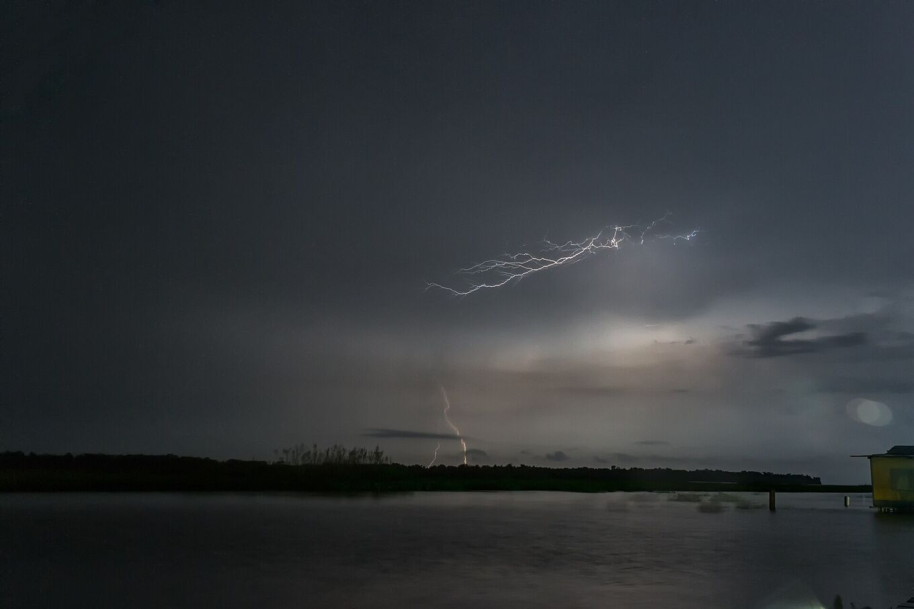

## So liest du die Vorhersage

- "Gewitter" schätzt, ob sich in der Nacht ein Gewitter bildet. Wie viele Blitze es geben wird, kann niemand vorhersagen. *Wahrscheinlich* heißt, dass das Modell in der Nacht ein Gewitter erwartet, oder viel Gewitterenergie bei wahrscheinlichem Regen. *Möglich* heißt mäßige Energie und etwas Regen.
- "Regen" ist die höchste Regenwahrscheinlichkeit zwischen 18:00 und 06:00.
- "Wind" ist der stärkste mittlere Wind der Nacht. Bei Wind wird der See unruhig und die Bootsfahrt unbequemer.
- Alle Uhrzeiten sind Ortszeit Venezuela (UTC−4).

Auch wenn die Vorhersage *unwahrscheinlich* sagt, kann der Blitz erscheinen. Er entsteht mit den nächtlichen Winden über dem See, und Wettermodelle erfassen ein so kleines Gebiet schlecht. Frag am Nachmittag des Ausflugs deinen Guide.

### Was "Gewitterenergie" heißt

Meteorologen nennen sie CAPE. Es ist die Energie, die eine aufsteigende Blase warmer, feuchter Luft gewinnen kann. Je mehr davon, desto höher können die Wolken wachsen, und hohe Wolken sind es, die Blitze erzeugen. Am Catatumbo ist CAPE zusammen mit dem Nachtwind über dem See der beste Hinweis darauf, wie aktiv eine Nacht wird.

*[Fernando Flores · Wikimedia Commons · CC BY-SA 2.0](https://commons.wikimedia.org/wiki/File:Catatumbo_Lightning-_Rayo_del_Catatumbo_%2828619470016%29.jpg)*

### Blitze in Echtzeit

Die Vorhersage sagt, was passieren kann. Was gerade passiert, zeigen Freiwilligennetze wie [Blitzortung](https://www.blitzortung.org/) auf einer Echtzeitkarte. Über Venezuela ist die Abdeckung dünner als in Europa, und manche Blitze werden nicht erfasst.

### Offizielle Warnungen

Für Warnungen vor schweren Gewittern, Hochwasser von Flüssen wie dem Catatumbo oder dem Escalante und Unwetter auf dem See schau beim [INAMEH](http://www.inameh.gob.ve/web/), dem Wetterdienst Venezuelas, und bei [MeteoZulia](https://www.instagram.com/meteozulia/) auf Instagram nach. [AccuWeather](https://www.accuweather.com/es/ve/maracaibo/356583/weather-forecast/356583) hat die Vorhersage für Maracaibo.

### Offline

Die Seite speichert auf deinem Handy die zuletzt geladene Vorhersage. Ohne Internet zeigt sie diese mit ihrem Datum. Der Rest des Führers funktioniert wie gewohnt.

### Woher die Daten kommen

Vom kostenlosen Dienst [Open-Meteo](https://open-meteo.com/), der nationale Wettermodelle kombiniert, für einen festen Punkt in Congo Mirador. Die Seite sendet deinen Standort nicht.

### Die Karte

Die Karte nutzt Daten von [OpenFreeMap](https://openfreemap.org/), basierend auf OpenStreetMap. Wenn du auf "Meinen Standort zeigen" tippst, erscheint deine Position mit ihrer Genauigkeit auf der Karte, und die Legende zeigt die Entfernung in Luftlinie (nicht über Straße oder Fluss) zu jedem Ort. Dein Standort wird nur auf deinem Handy verwendet. Offline zeigt die Karte einen vereinfachten Umriss von See und Küste, und deine Position funktioniert weiter. Die Koordinaten der Orte stammen von OpenStreetMap.
