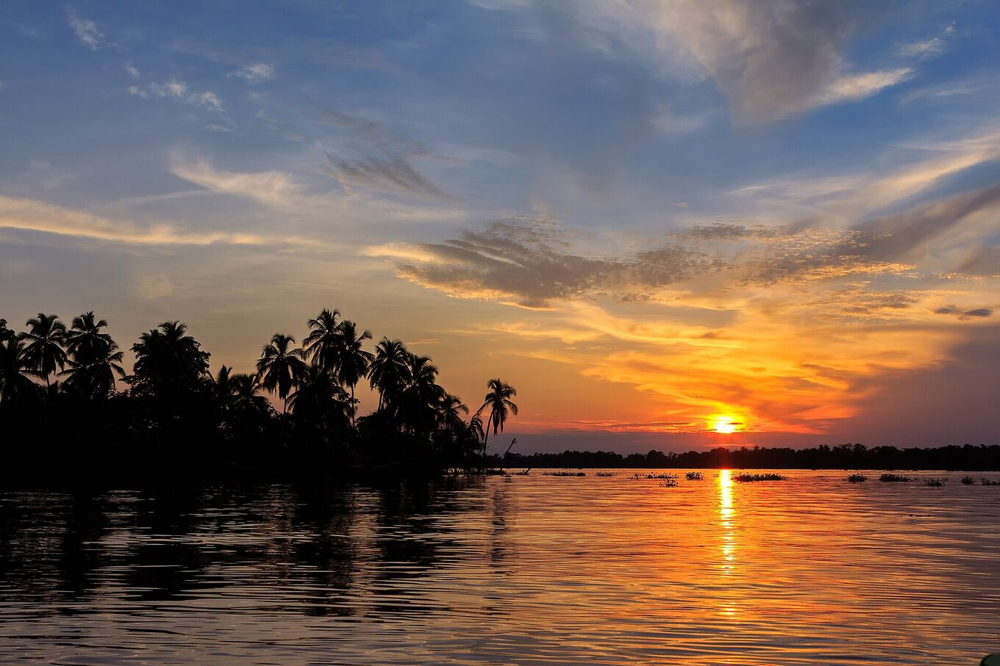
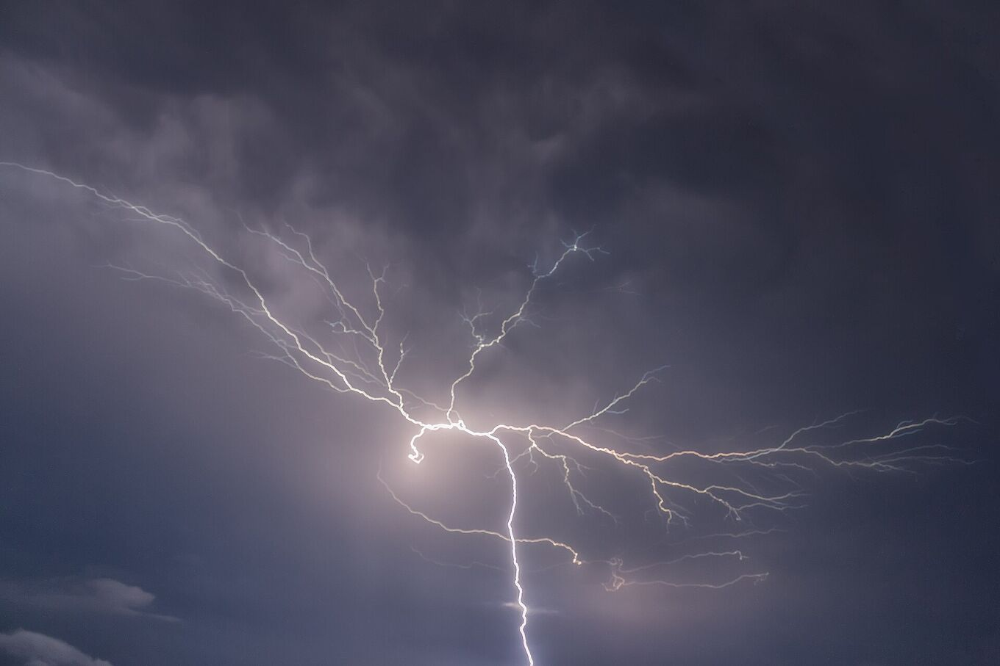

## Reisezeit

Das Gewitter beginnt in der Dämmerung und dauert meist bis in die frühen Morgenstunden. September bis November sind die aktivsten Monate. Prüfe die Wettervorhersage am Nachmittag deines Ausflugs.

April und Mai bringen einen zweiten, kleineren Höhepunkt. Januar und Februar sind am ruhigsten, mit weniger Gewittern, dafür aber trockeneren Tagen und ruhigerem Wasser. Komm vor Sonnenuntergang an, denn die Dämmerung über dem See gehört dazu.

Im November in Maracaibo? Die Feria de la Chinita vom 11. bis 18. November füllt die Stadt mit Gaitas, Prozessionen und Menschen.

*[Fernando Flores · Wikimedia Commons · CC BY-SA 2.0](https://commons.wikimedia.org/wiki/File:Sunset_at_Congo_Mirador_%2823978940929%29.jpg)*

## Das Jahr des Blitzes

Der Rhythmus folgt dem Regen. Der tropische Regengürtel wandert im Lauf des Jahres nach Norden und Süden und bringt zwei feuchtere Zeiten, eine erste im April und Mai, eine stärkere in der zweiten Jahreshälfte mit dem Höhepunkt um September und Oktober. Klimamuster wie El Niño verschieben das von Jahr zu Jahr. Die Dürre, die den Blitz von Januar bis März 2010 verlöschen ließ, fiel in ein El-Niño-Jahr.

Innerhalb einer Nacht beginnt die Aktivität meist in der Dämmerung, nimmt nach Einbruch der Dunkelheit zu und ist um Mitternacht und in den frühen Morgenstunden am stärksten. In trockeneren Monaten kann sie als Trockengewitter auftreten, ohne Regen.

*[Fernando Flores · Wikimedia Commons · CC BY-SA 2.0](https://commons.wikimedia.org/wiki/File:Catatumbo_Lightning_-_Rayo_del_Catatumbo_%2822668686290%29.jpg)*
