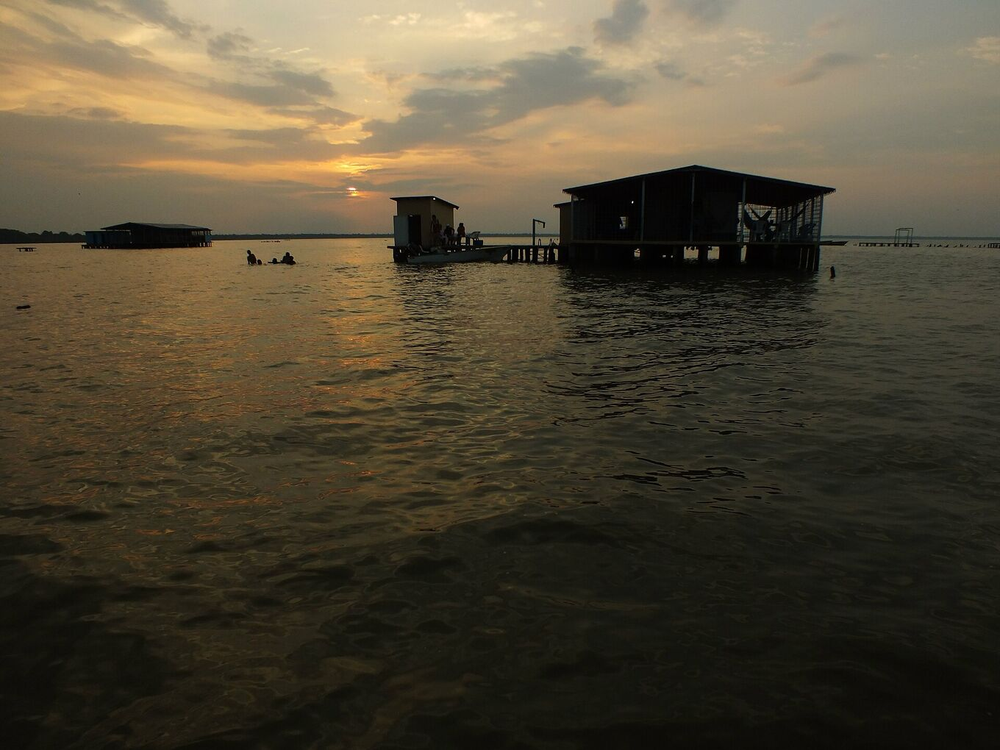
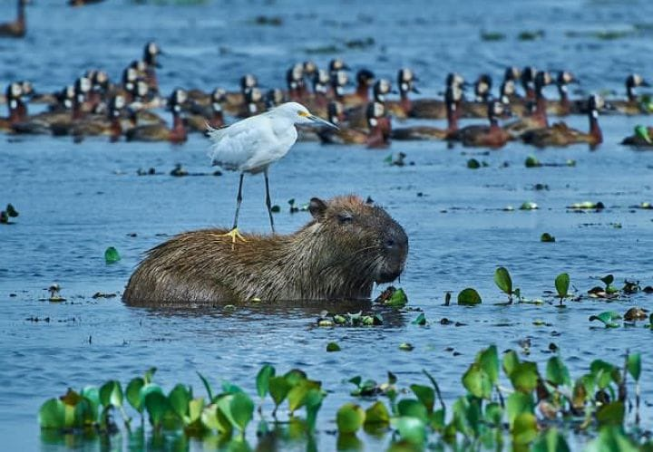

## Wo das Gewitter entsteht

Feuchtgebiete, Mangroven und Kanäle im Delta des Catatumbo, im Südwesten des Maracaibo-Sees. Über diesem Gebiet bildet sich fast jede Nacht das Gewitter. Verwaltet wird der Park vom Nationalen Parkinstitut (Inparques); Besuche finden mit zugelassenen Guides statt.

Auch Ciénagas de Juan Manuel genannt, oder Aguas Blancas und Aguas Negras. Eine flache, überflutete Ebene zwischen der Sierra de Perijá und dem See, ohne Hügel oder Gefälle, mit 22–32 °C und sehr hoher Luftfeuchtigkeit.

*[Juan Pablo Bottaro · Wikimedia Commons · CC BY-SA 4.0](https://commons.wikimedia.org/wiki/File:Lago_en_llamas.jpg)*

| Zahl | Bedeutung |
| --- | --- |
| 1991 | Jahr der Ausweisung als Nationalpark |
| ≈ 2.260 km² | Fläche, in zwei Teilen |
| 212 | Nachgewiesene Vogelarten |
| 22–32 °C | Übliche Temperatur |
| 2 m | So hoch kann das Wasser in der Regenzeit steigen |

## Flüsse und Lagunen

Der Park liegt in der Deltaebene, kaum über dem Seespiegel. Weißwasserflüsse, trüb vom Sediment aus den Bergen, durchziehen ihn, darunter der Catatumbo, der Bravo und der Santa Ana. Dazwischen liegen Schwarzwasserlagunen, dunkel von Pflanzenresten, etwa La Estrella, El Congo und Ologá.

In der Regenzeit steigt das Wasser um bis zu zwei Meter und die Ebene wird überflutet. Der größte Teil des Parks ist Sumpfgrasland. An den Ufern wachsen Rote Mangroven und Überschwemmungswald mit Palmen, entlang des Catatumbo stehen Galeriewälder.

Neben dem Park liegt ein zweites Schutzgebiet, das Wildreservat Ciénagas de Juan Manuel, Aguas Blancas y Aguas Negras. Beide sind als Key Biodiversity Areas verzeichnet.

## Tierwelt

### Vögel

Im Park sind 212 Vogelarten nachgewiesen. Vom Boot aus sieht man Silberreiher, Blaureiher, Jabirus, Enten, Möwen, Seeschwalben und Karakaras. Achte auch auf den Halsband-Wehrvogel (*Chauna chavaria*), einen großen Sumpfvogel, der nur in den Becken des Maracaibo-Sees und des Río Magdalena vorkommt, und auf den Hornwehrvogel (*Anhima cornuta*).

### Im Wasser

In den Kanälen und Lagunen leben die Seekuh (*Trichechus manatus*) und das Spitzkrokodil (*Crocodylus acutus*), beide gefährdet. Nahe der Mündung des Catatumbo sieht man Guayana-Delfine (*Sotalia guianensis*). Dazu kommen Brillenkaimane, Leguane und Fischotter.

### Am Ufer

An den Ufern sieht man Wasserschweine, die größten Nagetiere der Welt, und in den Bäumen hört man Brüllaffen. Faunaerhebungen nennen außerdem Jaguar, Ozelot und Riesenotter. Sie sind schwer zu sehen, rechne also nicht damit, ihnen zu begegnen.

## Gefahren

Ölverschmutzungen, die ans Ufer gespült werden, sind die größte Gefahr. Dazu kommen Abholzung für Bauholz und Weideland, Brände, Deiche, die die natürliche Entwässerung verändern, und Wilderei. Ein Teil des Tourismus im Park ist nicht reguliert. Wähle deshalb Anbieter, die die Parkregeln einhalten.

## Den Park besuchen

Man fährt mit dem Boot ab Puerto Concha, bei Santa Bárbara del Zulia, in den Park. Die Route folgt den Kanälen und Mangroven und führt hinaus auf den See nach Ologá. Die meisten Ausflüge zum Blitz fahren ohnehin hindurch.

- Geh immer mit einem zugelassenen Guide und trag auf jeder Fahrt die Schwimmweste.
- Nimm deinen Müll mit, denn auf dem Wasser gibt es keinen Ort dafür.
- Mach kein Feuer. Brände sind eine der Gefahren für den Park.
- Füttere und verfolge keine Tiere. Halte Abstand zu Seekühen und Krokodilen.
- Kaufe keine Wildtiere und keine Produkte daraus.

## Quellen

Fläche und Arten nach Inparques (1996), wiedergegeben von Key Biodiversity Areas. Andere Quellen nennen leicht abweichende Zahlen.

- [Wikipedia · Ciénagas del Catatumbo National Park](https://en.wikipedia.org/wiki/Ci%C3%A9nagas_del_Catatumbo_National_Park)
- [Key Biodiversity Areas · Parque Nacional Ciénagas de Juan Manuel](https://www.keybiodiversityareas.org/site/factsheet/14955)
- [Key Biodiversity Areas · Reserva de Fauna Silvestre Ciénagas de Juan Manuel](https://www.keybiodiversityareas.org/site/factsheet/14956)
- [IMMA · Maracaibo Lake System](https://www.marinemammalhabitat.org/wp-content/uploads/imma-factsheets/NorthWestAtlanticOceanWiderCaribbean/Maracaibo-Lake-System-NorthWestAtlanticOceanWiderCaribbean.pdf)
