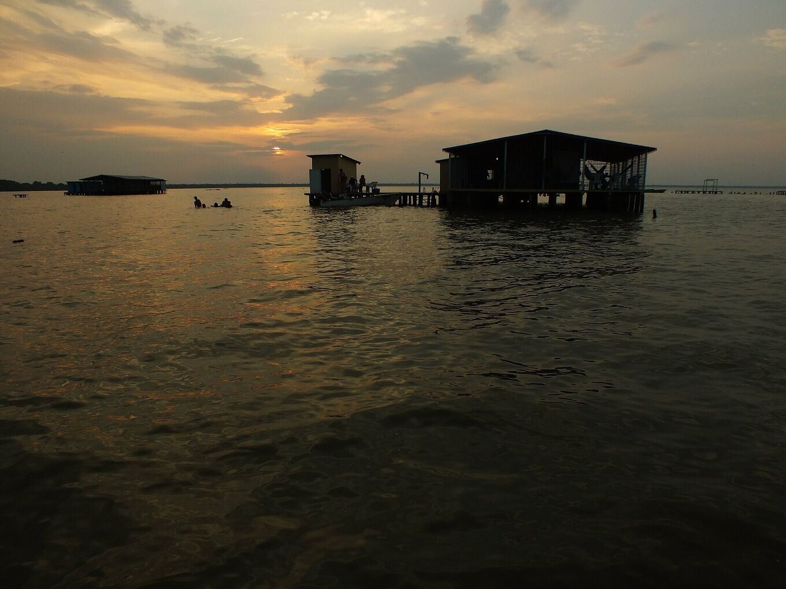
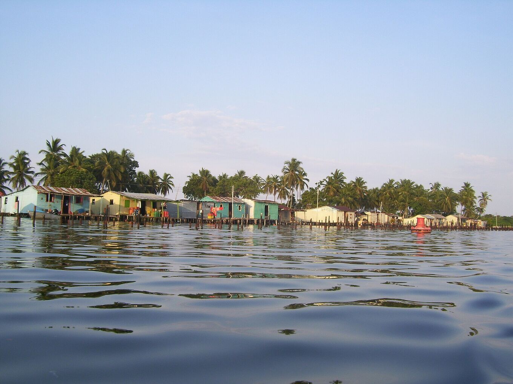
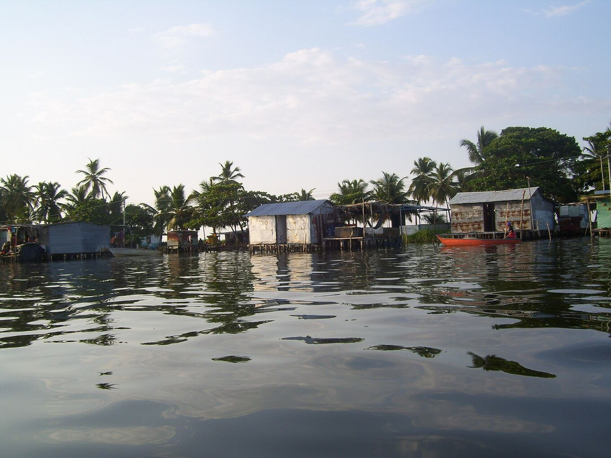
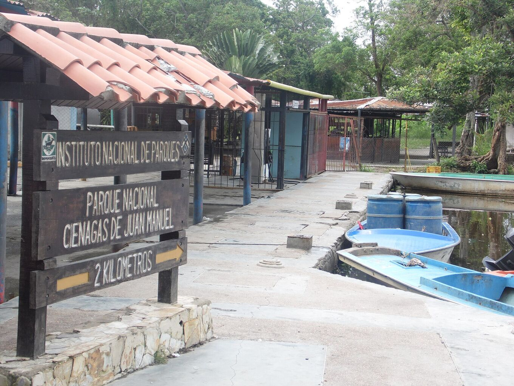
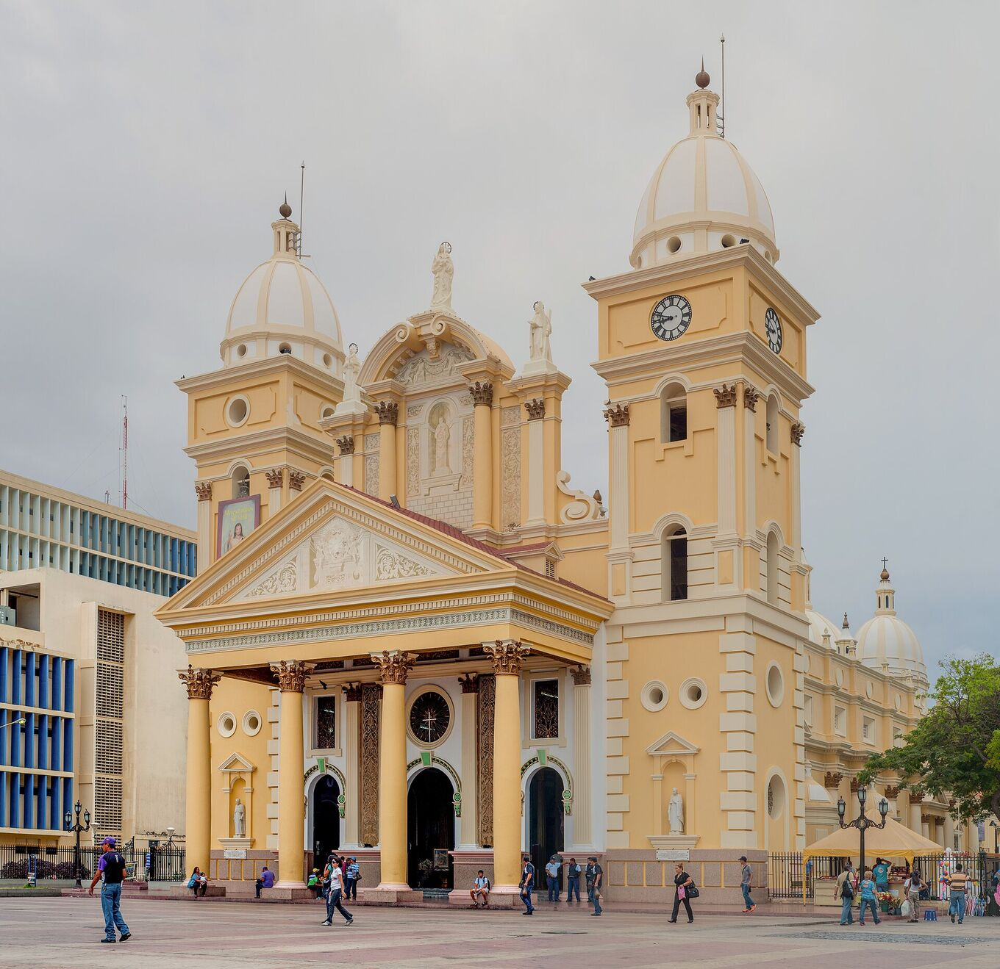
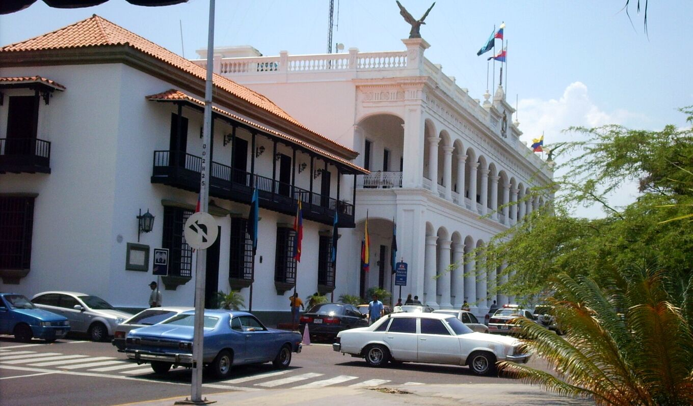
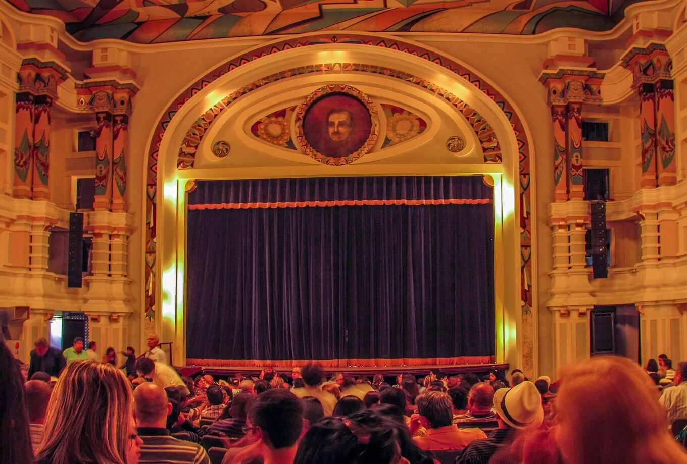
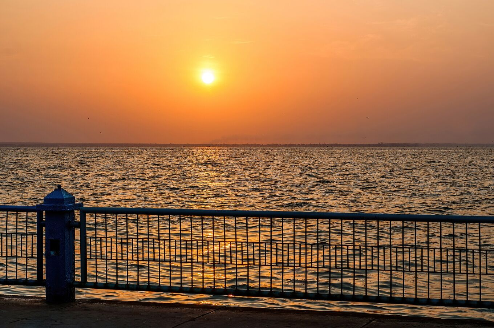
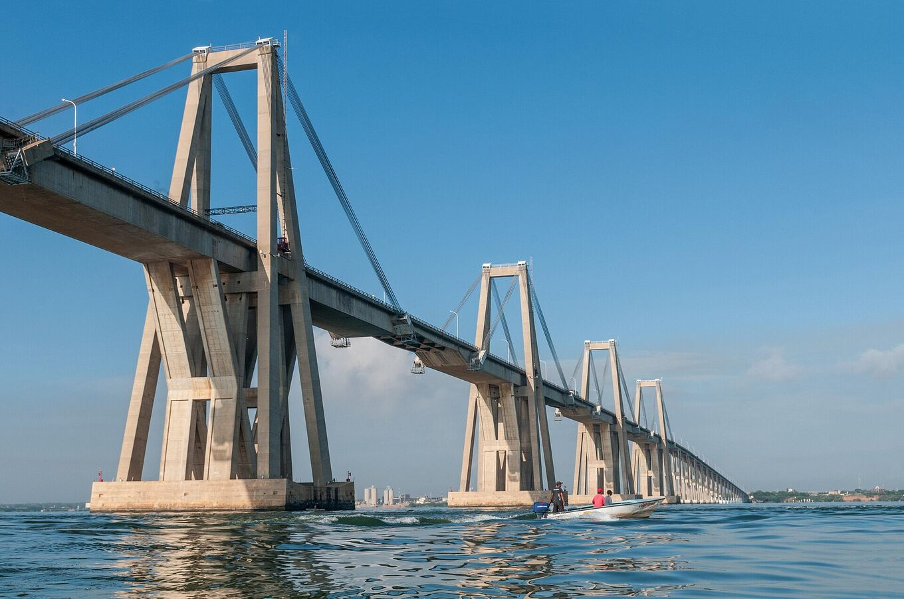
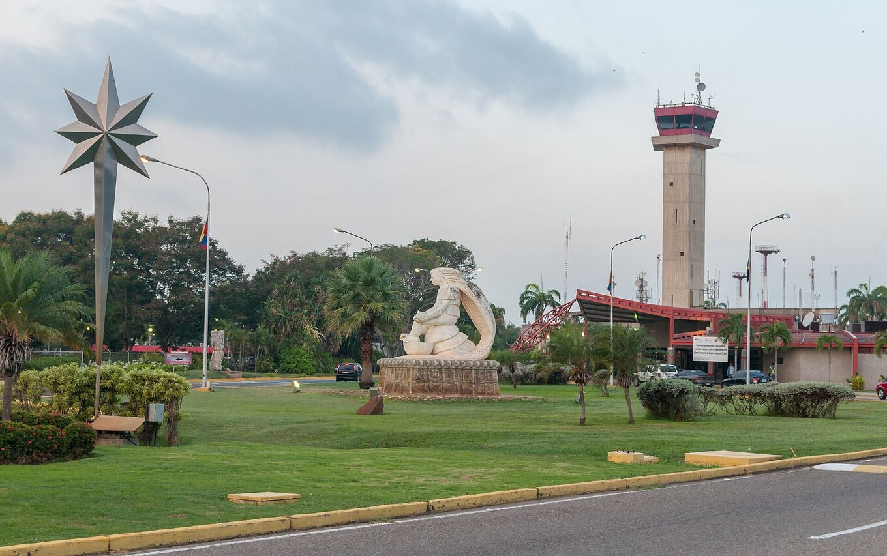

## Ein See, viele Ufer.

Die institutionellen und gemeinschaftlichen Orte, die einen Besuch prägen: das Schutzgebiet, in dem das Gewitter entsteht, die Pfahlbaudörfer, von denen aus man es beobachtet, das Erbe Maracaibos und die Ankunftsorte.

Der Maracaibo-See ist etwa 13.500 km² groß. Im Norden ist er über eine schmale Meerenge mit der Karibik verbunden, im Süden speisen ihn Dutzende Flüsse. Der größte, der Catatumbo, liefert mehr als die Hälfte seines Wassers.

## Der Süden des Sees

### Nationalpark Ciénagas de Juan Manuel

*Schutzgebiet · Inparques*

Feuchtgebiete, Mangroven und Kanäle im Delta des Catatumbo, im Südwesten des Sees. Hier entsteht das Gewitter. Verwaltet wird der Park vom Nationalen Parkinstitut (Inparques); Besuche finden mit zugelassenen Guides statt. [Wikipedia](https://es.wikipedia.org/wiki/Parque_nacional_Ci%C3%A9nagas_de_Juan_Manuel)

Auch Ciénagas del Catatumbo genannt, oder Aguas Blancas und Aguas Negras. Eine flache, überflutete Ebene zwischen der Sierra de Perijá und dem See, mit 22–32 °C und sehr hoher Luftfeuchtigkeit. Vögel sind überall: Silberreiher, Blaureiher, Jabirus, Enten, Möwen, Seeschwalben und Karakaras.

*[Juan Pablo Bottaro · Wikimedia Commons · CC BY-SA 4.0](https://commons.wikimedia.org/wiki/File:Lago_en_llamas.jpg)*

### Ologá

*Seegemeinde · Pfahlbauten*

Ein Pfahlbaudorf, etwa zehn Bootsminuten von Congo Mirador entfernt. Heute ist es der wichtigste Ausgangspunkt, um den Blitz zu beobachten, mit einfachen Camps und Gästehäusern über dem Wasser.

Einige seiner Häuser stammen aus Congo Mirador: Da sie auf Pfählen stehen, ließen sie sich auf zwei Boote heben und hierher bringen.

*[Yinette Bracho Padilla · Wikimedia Commons · CC BY-SA 4.0](https://commons.wikimedia.org/wiki/File:Palafitos_del_pueblo_de_Olog%C3%A1.jpg)*

### Congo Mirador

*Seegemeinde · Pfahlbauten*

Früher das bekannteste Dorf, um den Blitz zu sehen. Die Verlandung des Sees und die Wirtschaftskrise haben es entvölkert: Bis 2018 waren rund 90 % der Bewohner fortgezogen, und viele Häuser wurden nach Ologá verlegt. [Wikipedia](https://es.wikipedia.org/wiki/Congo_Mirador)

Das Dorf ist mindestens 200 Jahre alt und lebte vom Fischfang, später auch von Besuchern. Ende der 1970er-Jahre hatte es etwa 930 Einwohner, 2013 rund tausend. Die Bewohner machen für die Verlandung einen drei Kilometer langen Kanal verantwortlich, der 1991 vom Río Bravo aus gegraben wurde, den „Caño J“. 2021 lebten noch etwa fünf Menschen dort. Seine Geschichte erzählt der Dokumentarfilm *Once Upon a Time in Venezuela* (2020) von Anabel Rodríguez Ríos.

*[Yinette Bracho Padilla · Wikimedia Commons · CC BY-SA 4.0](https://commons.wikimedia.org/wiki/File:Palafitos_de_Congo_Mirador.jpg)*

### Puerto Concha

*Bootsanleger · Ausgangspunkt*

Bootsanleger nahe Santa Bárbara del Zulia, von dem die Boote nach Ologá und ins Delta abfahren. Vom Flughafen El Vigía aus ist er über die Straße erreichbar.

Santa Bárbara ist die Viehzüchterstadt im Süden des Sees, bekannt für Käse und Kochbananen. Deck dich dort mit Bargeld, Wasser und Vorräten ein: Auf dem Wasser gibt es keine Läden.

*[Yoser Linares · Wikimedia Commons · CC BY-SA 4.0](https://commons.wikimedia.org/wiki/File:Puerto_Concha.jpg)*

## Maracaibo

### Basilika Unserer Lieben Frau von Chiquinquirá

*Religiöses Erbe*

Das Heiligtum der „Chinita“, der Schutzpatronin des Zulia, in der Altstadt von Maracaibo. Ihr Fest im November ist das größte der Region. [Wikipedia](https://es.wikipedia.org/wiki/Bas%C3%ADlica_de_Nuestra_Se%C3%B1ora_de_Chiquinquir%C3%A1_(Maracaibo))

Sie begann 1686 als Einsiedelei aus Lehm und Stroh. Der Überlieferung nach fand 1709 eine Frau am Seeufer ein kleines Holzbrett, auf dem leuchtend das Bild der Jungfrau erschien. Die Kirche ist seit 1920 Basilica minor, das Bild wurde 1942 gekrönt. Das Fest dauert vom 11. bis 18. November, mit Gaitas, der Musik des Zulia, die ganze Nacht zum 18.

*[Wilfredor · Wikimedia Commons · CC0](https://commons.wikimedia.org/wiki/File:Bas%C3%ADlica_de_la_Chinita.jpg)*

### Plaza Bolívar und Palacio de los Cóndores

*Institution · Regierung des Bundesstaats Zulia*

Sitz der Regierung des Bundesstaats Zulia, gegenüber der Plaza Bolívar und der Kathedrale von Maracaibo. Ausgangspunkt für einen Spaziergang durch die Altstadt. [Wikipedia](https://es.wikipedia.org/wiki/Palacio_de_los_C%C3%B3ndores)

Erbaut zwischen 1841 und 1868 und 1929 umgebaut; damals erhielt er den Namen nach den Kondoren auf seinem Dach. Die Hymne des Zulia, die den Blitz erwähnt, wurde 1909 in seinem Spiegelsaal zum ersten Mal gesungen.

*[Wilfredor · Wikimedia Commons · CC0](https://commons.wikimedia.org/wiki/File:Centro_de_Maracaibo_en_Venezuela.JPG)*

### Teatro Baralt

*Kulturerbe*

Historisches Theater im Zentrum von Maracaibo, zum Nationaldenkmal erklärt. Hier finden Musik, Theater und Kulturveranstaltungen der Stadt statt. [Wikipedia](https://es.wikipedia.org/wiki/Teatro_Baralt)

Das erste Teatro Baralt stammt von 1847. Das zweite wurde am 24. Juli 1883 eröffnet und war 1896 die erste Bühne Venezuelas, auf der ein Film gezeigt wurde. Das heutige Gebäude öffnete 1932 und ist seit 1981 Nationaldenkmal.

*[Wilfredor · Wikimedia Commons · CC0](https://commons.wikimedia.org/wiki/File:Teatro_Baralt_3.jpg)*

### Vereda del Lago

*Öffentlicher Raum · Park*

Ein langgestreckter Park am Seeufer in Maracaibo, mit Wegen und freiem Blick aufs Wasser. In klaren Nächten ist manchmal ein fernes Leuchten im Süden zu sehen. [Wikipedia](https://es.wikipedia.org/wiki/Vereda_del_Lago)

*[Wilfredor · Wikimedia Commons · CC0](https://commons.wikimedia.org/wiki/File:Sunrise_on_Vereda_del_Lago.jpg)*

### Brücke General Rafael Urdaneta

*Infrastruktur · 1962*

Verbindet Maracaibo über die Meerenge des Sees mit dem Ostufer. Sie ist etwa 8,7 km lang und wurde 1962 eröffnet. Sie ist die Straßenverbindung in den Süden des Sees. [Wikipedia](https://es.wikipedia.org/wiki/Puente_General_Rafael_Urdaneta)

Entworfen vom italienischen Ingenieur Riccardo Morandi, ruht sie auf 134 Pfeilern. Ihre mittleren Schrägseilfelder sind 235 m weit und lassen Schiffe bis 45 m Höhe passieren. Präsident Rómulo Betancourt eröffnete sie am 24. August 1962.

*[Wilfredor · Wikimedia Commons · CC0](https://commons.wikimedia.org/wiki/File:General_Rafael_Urdaneta_Bridge_view_from_the_lake_to_Cabimas_side.jpg)*

### Internationaler Flughafen La Chinita

*Ankunft · Flughafen*

Der wichtigste Flughafen des Zulia, südwestlich von Maracaibo (Code MAR). Wer direkt in den Süden des Sees will, ist mit dem Flughafen El Vigía näher dran. [Wikipedia](https://es.wikipedia.org/wiki/Aeropuerto_Internacional_La_Chinita)

Eröffnet 1969 und nach der Schutzpatronin des Zulia benannt. Er gehört zu den verkehrsreichsten Flughäfen des Landes.

*[Wilfredor · Wikimedia Commons · CC0](https://commons.wikimedia.org/wiki/File:La_Chinita_International_Airport.jpg)*
