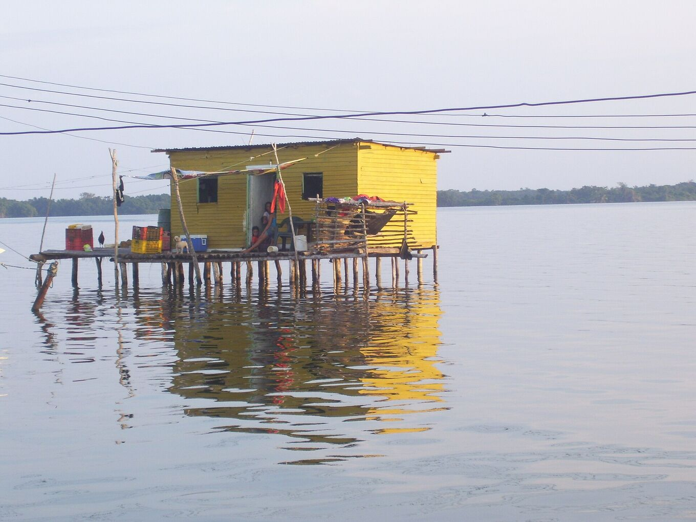
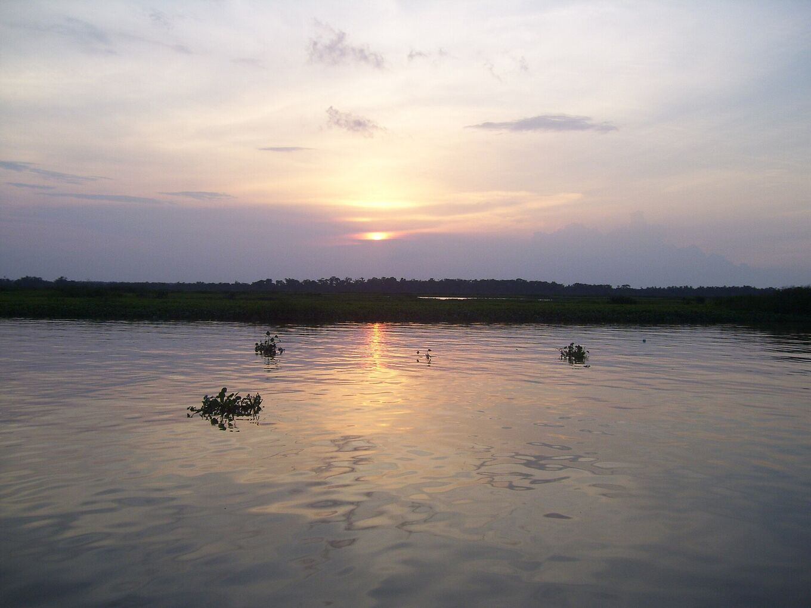

## Fahr mit Leuten, die den See kennen.

Der Ausflug dauert meist zwei oder drei Tage: Fahrt bis zur Anlegestelle, Boot über den Fluss und den See und eine Nacht in einem Pfahlbau mit Blick auf das Gewitter. Mit einem Anbieter vor Ort ist er einfacher und sicherer.

*[Yinette Bracho Padilla · Wikimedia Commons · CC BY-SA 4.0](https://commons.wikimedia.org/wiki/File:Palafito_en_medio_del_Parque_nacional.jpg)*

### Ein typischer Ausflug

Jeder Anbieter plant anders. Zwei Tage sehen oft so aus:

- **Tag 1, Vormittag:** früher Aufbruch in Mérida oder Abholung am Flughafen El Vigía. Fahrt nach Puerto Concha.
- **Tag 1, Nachmittag:** Bootsfahrt durch die Kanäle und Mangroven des Nationalparks. Reiher und andere Wasservögel am Weg. Ankunft in Ologá vor Sonnenuntergang.
- **Tag 1, Nacht:** Abendessen, oft Fisch aus dem See. Dann das Gewitter, von der Terrasse oder vom Boot aus in sicherem Abstand. Übernachtung in Hängematte oder Bett in einem Pfahlbau.
- **Tag 2:** Sonnenaufgang über dem See, Bootsfahrt zurück zur Anlegestelle und Rückfahrt am Nachmittag.

Dreitägige Touren bieten mehr Zeit auf dem Wasser, eine zweite Blitznacht oder einen Halt in den Anden.

### Vor der Buchung fragen

- **Was enthalten ist:** Transfers, Boot, Mahlzeiten, Trinkwasser und wo du schläfst (Hängematte oder Bett).
- **Wo es losgeht** und wann du zurück bist. Viele Ausflüge starten in Mérida.
- **Sicherheit:** Schwimmwesten für alle, ein Boot in gutem Zustand und was passiert, wenn das Gewitter näher kommt oder der Wind auffrischt.
- **Genehmigungen:** dass die Regeln des Nationalparks eingehalten werden und mit den Gemeinden der Pfahlbauten zusammengearbeitet wird.
- **Sprachen** des Guides und Gruppengröße.
- **Bezahlung und Stornierung:** in welcher Währung, ob Karte oder nur Bargeld, und was passiert, wenn das Wetter eine Absage erzwingt.
- **Kein Blitz:** was passiert, wenn die Nacht ruhig bleibt. Niemand kann das Gewitter versprechen.
- **Vor Ort:** Toiletten, Trinkwasser, Strom zum Laden und wie sie ohne Handyempfang Hilfe rufen.
- **Registrierung:** ob sie im nationalen Tourismusregister Venezuelas (RTN) eingetragen sind.

### Warnzeichen

- Ein Preis weit unter dem der anderen.
- Keine Schwimmwesten, oder nicht genug für die ganze Gruppe.
- Angebote, für bessere Fotos unter das Gewitter zu fahren.
- Druck, alles im Voraus bar und ohne Quittung zu zahlen.
- Kein klarer Plan für schlechtes Wetter.

### Lokale Anbieter wählen

Wer Guides, Bootsführer und Unterkünfte aus der Gegend bucht, lässt das Geld in den Gemeinden, die neben dem Blitz leben.

Frag, ob Bootsführer und Köche aus Ologá oder Nachbardörfern kommen. Iss, was die Familien kochen, und gib Guides und Bootsführern Trinkgeld, wenn der Service gut war.

*[Yinette Bracho Padilla · Wikimedia Commons · CC BY-SA 4.0](https://commons.wikimedia.org/wiki/File:Lago_de_Maracaibo_desde_el_Parque_nacional.jpg)*
