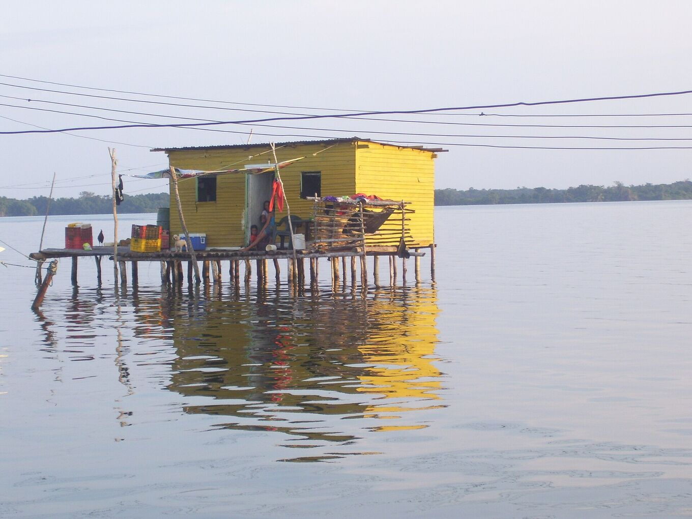

## Geführte Ausflüge

Der Ausflug dauert meist zwei oder drei Tage, mit der Fahrt zur Anlegestelle, einer Bootsfahrt über den Fluss und den See und einer Nacht in einem Pfahlbau mit Blick auf das Gewitter. Mit einem Anbieter vor Ort ist er einfacher und sicherer.

*[Yinette Bracho Padilla · Wikimedia Commons · CC BY-SA 4.0](https://commons.wikimedia.org/wiki/File:Palafito_en_medio_del_Parque_nacional.jpg)*

### Vor der Buchung fragen

- Was im Preis enthalten ist, etwa Transfers, Boot, Mahlzeiten, Trinkwasser und wo du schläfst (Hängematte oder Bett).
- Wo es losgeht und wann du zurück bist. Viele Ausflüge starten in Mérida.
- Welche Sicherheitsvorkehrungen es gibt, etwa Schwimmwesten für alle und ein Boot in gutem Zustand, und was passiert, wenn das Gewitter näher kommt oder der Wind auffrischt.
- Ob die Regeln des Nationalparks eingehalten werden und mit den Gemeinden der Pfahlbauten zusammengearbeitet wird.
- Welche Sprachen der Guide spricht und wie groß die Gruppe ist.
- In welcher Währung du zahlst, ob mit Karte oder nur bar, und was passiert, wenn das Wetter eine Absage erzwingt.
- Was passiert, wenn die Nacht ruhig bleibt und es keinen Blitz gibt. Niemand kann das Gewitter versprechen.
- Was es vor Ort gibt (Toiletten, Trinkwasser, Strom zum Laden) und wie sie ohne Handyempfang Hilfe rufen.
- Ob sie im nationalen Tourismusregister Venezuelas (RTN) eingetragen sind.

### Warnzeichen

- Ein Preis weit unter dem der anderen.
- Keine Schwimmwesten, oder nicht genug für die ganze Gruppe.
- Angebote, für bessere Fotos unter das Gewitter zu fahren.
- Druck, alles im Voraus bar und ohne Quittung zu zahlen.
- Kein klarer Plan für schlechtes Wetter.

## Institutionen und Partner

Behörden und Unternehmen, die sich für den Tourismus im Süden des Sees einsetzen:

- **Tourismus:** INATUR Zulia (Nationales Tourismusinstitut) und die Corporación Zuliana de Turismo.
- **Wissenschaft und Umwelt:** UNESUR (Universidad Nacional Experimental Sur del Lago), ICLAM (Institut zum Schutz des Maracaibo-Sees), MINEC (Ministerium für Ökosozialismus) und die [Stiftung Finnova](https://www.finnova.com/).
- **Luftverkehr:** INAC (Nationales Institut für Zivilluftfahrt).
- **Unternehmen:** YessTravels, Grupo San Simón, Junior Mall Hotel und Hotel Tibisay.
