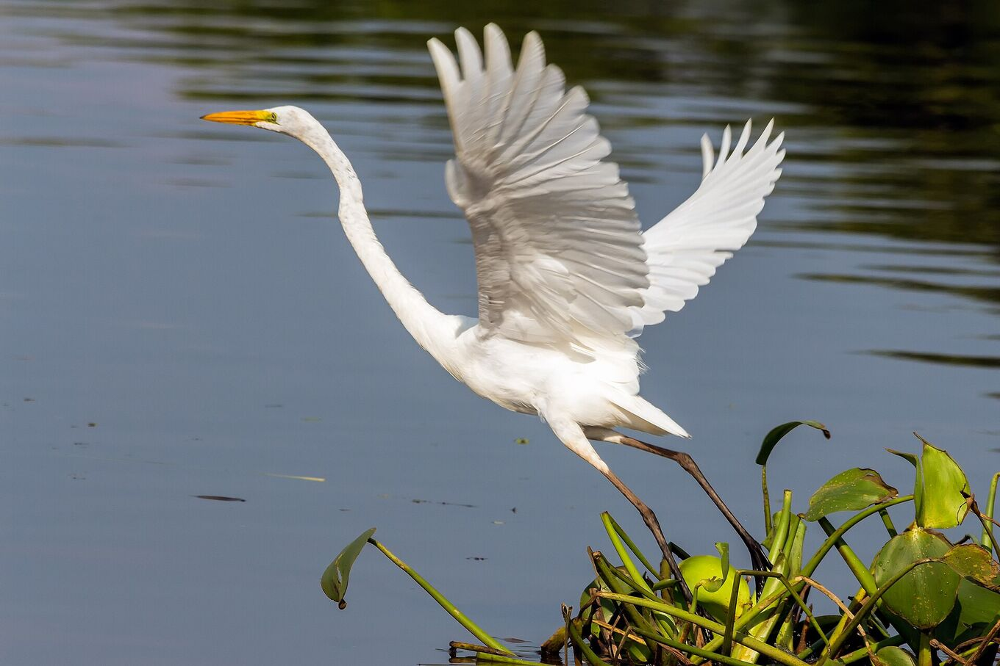

## Respekt

In Ologá und Congo Mirador leben Menschen. Frage, bevor du Menschen fotografierst, nutze lokale Angebote und nimm deinen Müll mit. Halte die Nutzungsregeln des Nationalparks ein.

Die Familien in den Pfahlbauten leben vom Fischfang und von Besuchern. Kauf ihr Essen und ihr Kunsthandwerk. Sei nachts leise. Frag, bevor du eine Drohne fliegen lässt. Füttere und verfolge keine Tiere.

*[Fernando Flores · Wikimedia Commons · CC BY-SA 2.0](https://commons.wikimedia.org/wiki/File:Great_Egret_Garza_Real_%28Ardea_alba_egretta%29_%2824754473973%29.jpg)*

## Lokale Anbieter wählen

Wer Guides, Bootsführer und Unterkünfte aus der Gegend bucht, lässt das Geld in den Gemeinden, die neben dem Blitz leben.

Frag, ob Bootsführer und Köche aus Ologá oder Nachbardörfern kommen. Iss, was die Familien kochen, und gib Guides und Bootsführern Trinkgeld, wenn der Service gut war.

## Projekte in den Dörfern

Ein Agrotourismus-Projekt, „Zum Blitz des Catatumbo, auf dem Catatumbo-Fluss“, will mit der [Stiftung Finnova](https://www.finnova.com/) das Leben in Ologá und Congo Mirador verbessern. Zu seinen Zielen gehören:

- Solarmodule auf den Pfahlbauten, die 90 % der Benzingeneratoren ersetzen.
- Biogasanlagen und Pflanzenkläranlagen für das Abwasser.
- 25 Pfahlbauten in jedem Dorf sanieren.
- Leise Boote mit geringem Tiefgang und ein Recyclingzentrum nach dem Prinzip „Zero Waste“.
- 100 Einheimische mit INATUR zu Guides ausbilden, und mindestens 30 % der Ausgaben der Besucher in den Dörfern halten.
- Eine biologische Station mit der UNESUR, die Klimawandel, Verlandung des Catatumbo und Verschmutzung untersucht.

Außerdem wurde ein Ambulanzboot für beide Dörfer angekündigt, von der Fundación Azul Ambientalistas und Venemergencia, mit Notfalltransporten und Telemedizin.

Du kannst jetzt schon helfen. Trenne deinen Müll und nimm ihn mit aufs Festland, denn auf den Pfahlbauten gibt es keine Müllabfuhr.
