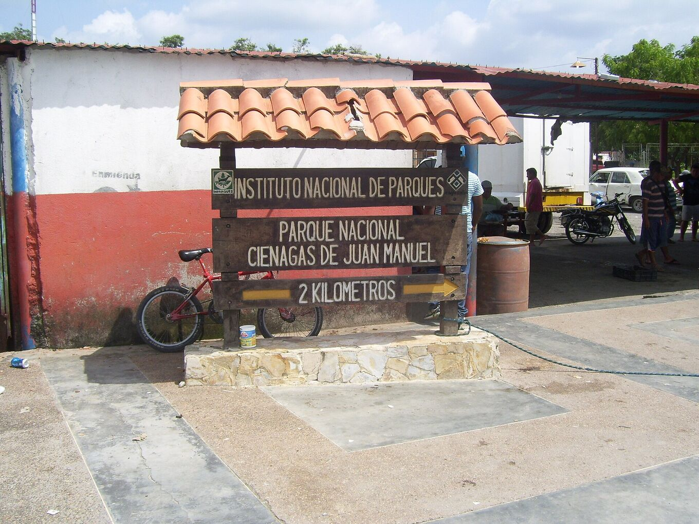

## By road and boat

Most visits leave by boat from Puerto Concha, near Santa Bárbara del Zulia, towards Ologá. The nearest airport is El Vigía; Maracaibo is several hours away by road. Many agencies run the trip from Mérida.

From Mérida the road drops from the Andes to the plains south of the lake, past plantain farms and cattle ranches. It takes about four hours to reach the landing. From Puerto Concha the boat follows river channels and mangroves into the national park and out onto the lake. The ride takes one to two hours, depending on the route and the water level.

Carry your passport or ID, because there are police and military checkpoints on the roads.

*[Yinette Bracho Padilla · Wikimedia Commons · CC BY-SA 4.0](https://commons.wikimedia.org/wiki/File:Entrada_al_parque_nacional.jpg)*

Transfers, timetables and prices change with routes, water levels and local availability, so confirm them with local operators before you travel.

## Boat routes to Ologá

A local agritourism project describes four routes. Times are approximate.

| Departure | Time | Stop |
| --- | --- | --- |
| Puerto Concha | ≈ 1 h | Corpozulia stilt house |
| Escalante channel, from Curva de Colón | ≈ 2 h | Congo Mirador |
| Encontrados fishing port, along the Catatumbo river | ≈ 2 h 30 min | Caña Dulce |
| Puerto La Maroma, in Concha | ≈ 2 h 30 min | Corpozulia stilt house |

When the river runs very low or floods, some routes cannot be navigated. If you arrive the day before, the Where to stay page lists hotels near the landing.
