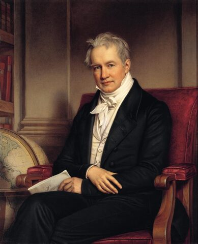
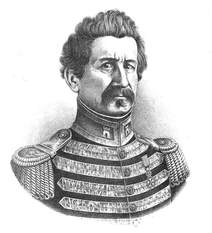
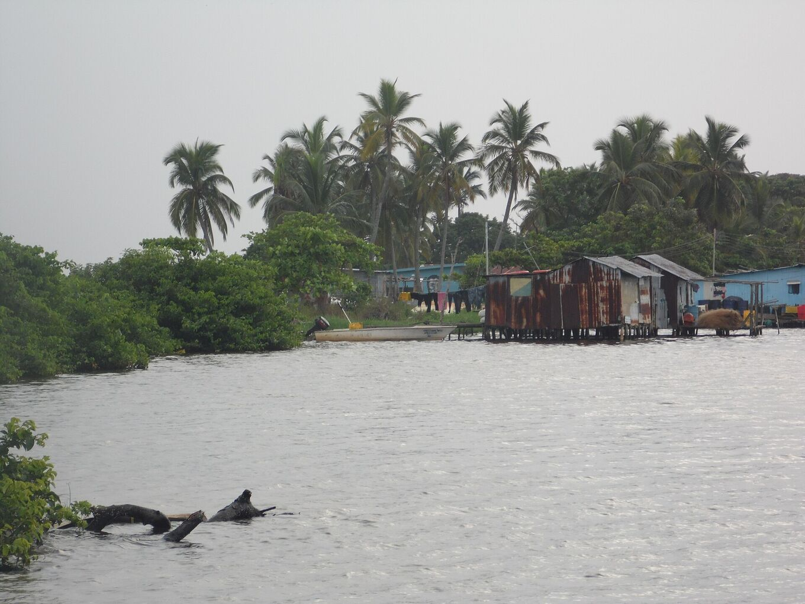
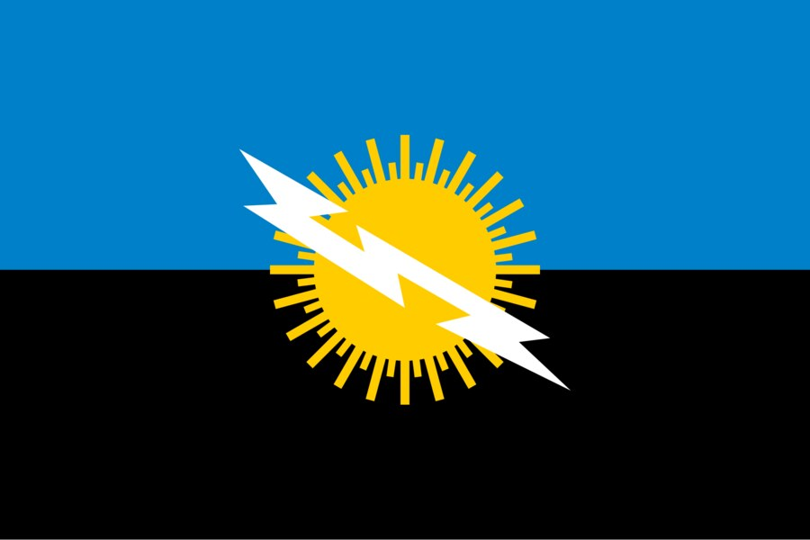

## Four centuries looking south.

Sailors, travellers and scientists left records of the glow in the south of the lake. This is a short timeline of what is documented.

### 1822 · The Maracaibo lighthouse

Alexander Walker records the names sailors used for it: “Lighthouse of Maracaibo” and “Lanterns of Saint Anthony”. The glow was a landmark for finding one’s way at night in the gulf and the lake.

### 1826 · Humboldt

Alexander von Humboldt describes the phenomenon in his travel narrative, based on reports by M. Palacios. It is one of the first descriptions to circulate in Europe.

He calls them “electrical explosions that are like phosphorescent flashes”, drawing on Palacios’ book *Viage de Varinas*.

*[Joseph Karl Stieler · Wikimedia Commons · Public domain](https://commons.wikimedia.org/wiki/File:Stieler,_Joseph_Karl_-_Alexander_von_Humboldt_-_1843.jpg)*

### 1841 · “Like a continuous lightning”

The geographer Agustín Codazzi describes it as “a continuous lightning” seen from afar over the Catatumbo river. His work fixes the phenomenon in the mapping of Venezuela.

He adds that its position, almost on the meridian of the mouth of the lake, guides navigators like a lighthouse.

*[Wikimedia Commons · Public domain](https://commons.wikimedia.org/wiki/File:Retrato_Agust%C3%ADn_Codazzi.jpg)*

### 1966–1970 · First expeditions

The scientist Andrés Zavrotsky and a team from the University of the Andes make three expeditions to Santa Bárbara del Zulia. They place the storm’s centres in the wetlands of Juan Manuel, west of the lake.

### 1997–2000 · The methane hypothesis

A University of Carabobo team led by Nelson Falcón reaches the heart of the wetlands and proposes methane as a main cause. No measurement has yet confirmed methane inside the storm clouds.

### 2005 · Natural heritage

Zulia declares the lightning part of its natural heritage on 27 September 2005. Campaigners still seek UNESCO World Heritage status for the area.

### 2010 · The silence

From January to March 2010 the lightning stopped, apparently because of a severe drought. People speculated it had ended for good; activity returned with the rains.

### 2014 · A Guinness record

On 28 January 2014, Zulia Day, Guinness World Records accredits the area as the place with the most lightning per square kilometre per year.

### 2016 · The planet’s top lightning hotspot

A study using NASA’s LIS sensor data (Albrecht et al., 2016) ranks Lake Maracaibo first in the world, with about 232.5 flashes per km² per year. Guinness had earlier listed it as the highest concentration of lightning.

The same year, a University of Zulia team publishes the first seasonal lightning forecast, based on the night wind over the lake.

### 2018 · Villages on the move

Silt surrounds the stilt houses of Congo Mirador with land. Most residents leave, and several houses are towed by boat to Ologá, which becomes the base for visitors.

*[Yoser Linares · Wikimedia Commons · CC BY-SA 4.0](https://commons.wikimedia.org/wiki/File:Comunidad_de_Olog%C3%A1.jpg)*

## The house of thunder.

In the Barí language, Catatumbo translates as “house of thunder”. A story attributed to the Barí people says the lights in the sky are cocuyos, fireflies, gathering every night to honour Sabaseba, the creator who set the world in order. It is a story, not a meteorological explanation.

The Barí live in the Catatumbo basin, on both sides of the border between Venezuela and Colombia. They resisted Spanish expeditions for centuries. Since then their land has shrunk, under pressure from settlers and oil drilling.

## Other stories of the lake.

### The fireflies of Sabaseba

*Barí story*

The lights in the sky are said to be millions of fireflies gathering over the lake to honour the creator. It is told as a story of the Barí people, who live in the Catatumbo basin.

### A sign from nature

*Wayuu tradition*

For the Wayuu people, the lightning is a sign from nature that asks for respect and gives strength. The lightning also appears on the flag and coat of arms of Zulia state.

Wayuu and Yukpa stories also see in it the spirits of fallen Wayuu, shining in the sky as a message.

*[Wikimedia Commons · Public domain](https://commons.wikimedia.org/wiki/File:Flag_of_Zulia_State.svg)*

### Drake and the lit-up night

*Legend · contradicted by the record*

It is often said that in 1595 the lightning exposed Francis Drake’s fleet off Maracaibo, and that Lope de Vega sang of it in “La Dragontea”. That glow came from burning ships at San Juan, Puerto Rico.

### The battle on the lake

*Popular story*

A widespread story says that in the Naval Battle of Lake Maracaibo, in 1823, the lightning showed the royalist ships to the patriot fleet. It is popular memory, not a documented fact.

The battle itself is documented: on 24 July 1823 José Prudencio Padilla’s fleet defeated the Spanish squadron and sealed the independence of Venezuela and New Granada. Both countries still mark the date as Navy Day.

### In songs

The lightning appears in the Zulia state anthem, by Udón Pérez, and in many gaitas, the music of Zulia.

> These stories are gathered as cultural memory, with their source where it is known. Where a story contradicts the documents, we say so.
