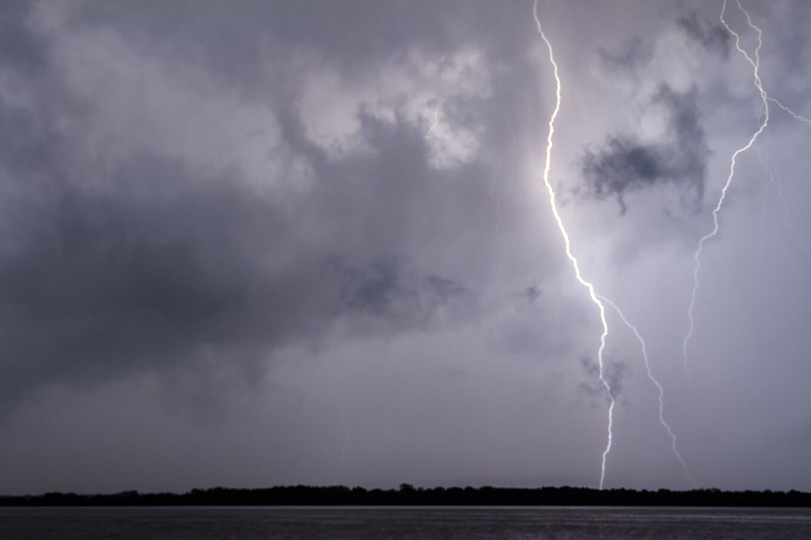
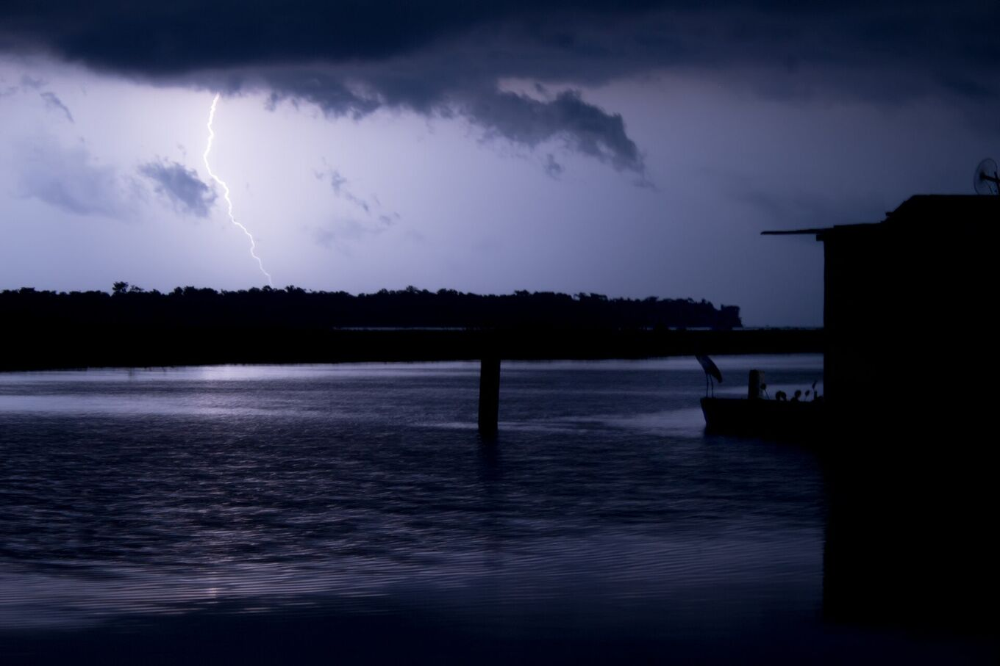
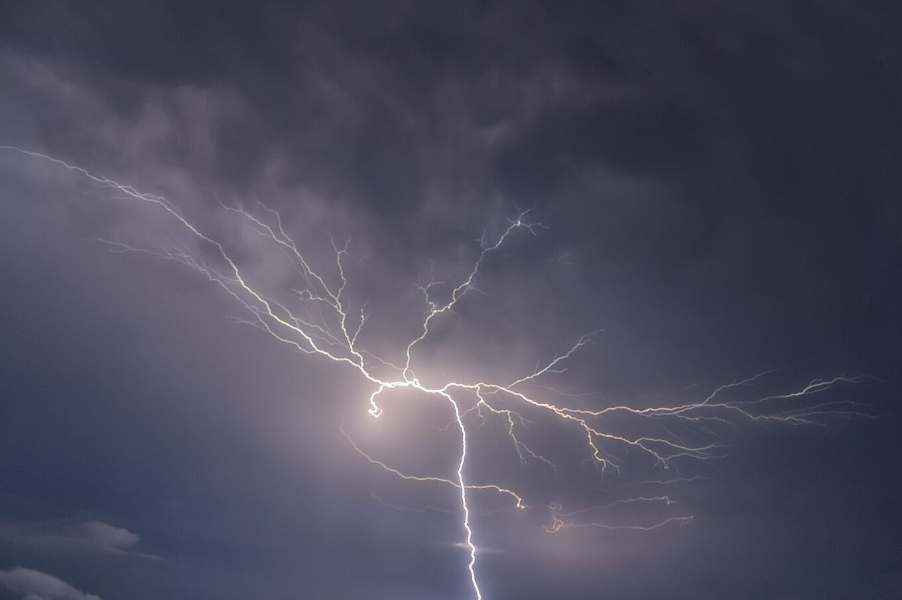

## A storm that returns almost every night.

The Catatumbo Lightning is a thunderstorm that forms at night over the south-west of Lake Maracaibo and the wetlands near the mouth of the Catatumbo river. From the shore it looks like an almost continuous glow in the clouds, often with no audible thunder because the storm is far away.

It is not a scheduled show: every night is different. Some nights bring hundreds of flashes, others are calm. Activity depends on the wind, the humidity and the season.

*[Fernando Flores · Wikimedia Commons · CC BY-SA 2.0](https://commons.wikimedia.org/wiki/File:Catatumbo_Lightning_-_Rayo_del_Catatumbo_%2825385580334%29.jpg)*

| Figure | What it means |
| --- | --- |
| 140–160 | Nights with activity per year |
| 16–40 | Flashes per minute |
| ≈ 9 h | Typical duration per night |
| 12–15 km | Height reached by the storm clouds |
| 232.5 | Flashes per km² per year (NASA LIS, 2016) |

## Many storms, one name.

Researchers at the University of Zulia prefer to speak of the Catatumbo *lightnings*: each night several storm cells form at different points of the delta and the south-west of the lake. From far away they merge into one glow.

The clouds are cumulonimbus, the tallest storm clouds, which rise to the top of the tropical troposphere. Most flashes stay inside the clouds or jump between them and light them from within. Some strike the ground or the water.

Light travels much farther than sound. Thunder rarely carries more than about 20 km, while the glow is seen from much farther away. That is why, from Maracaibo or the shore, the lightning looks silent. Under the storm, the thunder is almost constant.

*[Fernando Flores · Wikimedia Commons · CC BY 3.0](https://commons.wikimedia.org/wiki/File:Catatumbo_Lightning_%28127737829%29.jpeg)*

## How it forms.

### Moisture

The lake is warm and evaporates a lot of water. Caribbean trade winds push that humid air towards the south of the basin.

### Relief

The basin is closed in by the Sierra de Perijá to the west and the Mérida range to the south-east. The air is boxed in by mountains over 3,000 m high.

### Night convergence

At night, cool air flowing down the mountains meets the warm air over the lake. That flow forces the humid air upwards and builds storm clouds in nearly the same place.

### The night wind

A current of wind, the Lake Maracaibo nocturnal low-level jet, crosses the basin at night. When it is strong and the air holds a lot of storm energy (what meteorologists call CAPE), there is more lightning. In 2016 a University of Zulia team used this link to issue the world’s first seasonal lightning forecast, months in advance.

> For years, methane from the wetlands and the oil fields was proposed as the cause. Recent studies point mainly to wind and relief; the role of methane is still debated.

The methane model also fails a simple test: it predicts more lightning in the dry season, and the record shows the opposite.

## The lightning year.

September to November are usually the most active months; January and February the quietest. This is only a trend: in 2010 a drought switched the lightning off from January to March.

The rhythm follows the rains. As the tropical rain belt moves north and south over the year, it brings two wetter seasons: a first one in April and May, and a stronger one later in the year, peaking around September and October. Climate patterns such as El Niño shift it from year to year: the 2010 silence came during an El Niño drought.

Within a night, activity usually starts at dusk, builds after dark and is strongest around midnight and the early hours. In the drier months it can appear as dry lightning, without rain.

*[Fernando Flores · Wikimedia Commons · CC BY-SA 2.0](https://commons.wikimedia.org/wiki/File:Catatumbo_Lightning_-_Rayo_del_Catatumbo_%2822668686290%29.jpg)*

## What it is not.

### “It recharges the ozone layer”

False. Lightning makes ozone in the lower atmosphere, the troposphere. The ozone layer lies in the stratosphere, around 25 km up over the tropics. The storm’s ozone disperses and does not repair it. No study supports the claim.

### “It is silent lightning”

It is not. The thunder is there; it just does not reach a listener tens of kilometres away.

### “Uranium in the ground causes it”

A hypothesis from the 1990s that was never proven.
