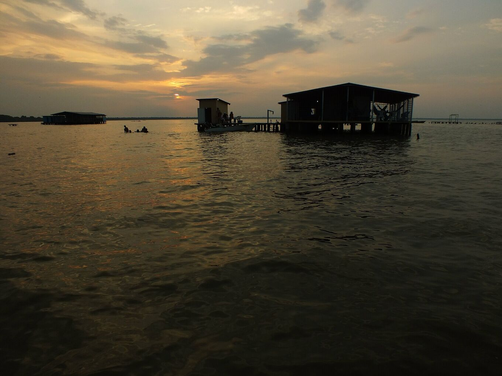
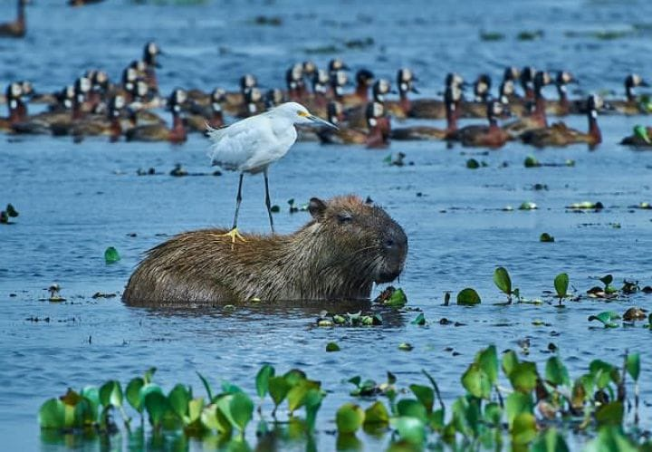

## Where the storm is born

Wetlands, mangroves and channels in the Catatumbo delta, south-west of Lake Maracaibo. The storm forms over this area almost every night. It is managed by the National Parks Institute (Inparques); visits go with authorised guides.

Also known as Ciénagas de Juan Manuel, or Aguas Blancas and Aguas Negras. A flat, flooded plain between the Sierra de Perijá and the lake, with no hills or slopes, temperatures of 22–32 °C and very high humidity.

*[Juan Pablo Bottaro · Wikimedia Commons · CC BY-SA 4.0](https://commons.wikimedia.org/wiki/File:Lago_en_llamas.jpg)*

| Figure | What it means |
| --- | --- |
| 1991 | Year it became a national park |
| ≈ 2,260 km² | Area, in two sectors |
| 212 | Bird species recorded |
| 22–32 °C | Usual temperature |
| 2 m | How far the water can rise in the rainy season |

## Rivers and lagoons

The park covers the delta plain, barely above lake level. White-water rivers, cloudy with sediment from the mountains, run through it, among them the Catatumbo, the Bravo and the Santa Ana. Between them lie black-water lagoons, dark with plant matter, such as La Estrella, El Congo and Ologá.

In the rainy season the water rises by up to two metres and the plain floods. Most of the park is marsh grassland. Red mangroves and flooded forest with palms grow along the shores, and strips of riverside forest line the Catatumbo.

Next to the park lies a second protected area, the Ciénagas de Juan Manuel, Aguas Blancas y Aguas Negras Wildlife Reserve. Both are listed as Key Biodiversity Areas.

## Wildlife

### Birds

The park has 212 recorded bird species. From the boat you will see great egrets, little blue herons, jabiru storks, ducks, gulls, terns and caracaras. Look out too for the northern screamer (*Chauna chavaria*), a large marsh bird found only in the Lake Maracaibo and Magdalena basins, and the horned screamer (*Anhima cornuta*).

### In the water

The manatee (*Trichechus manatus*) and the American crocodile (*Crocodylus acutus*), both threatened, live in the channels and lagoons. Guiana dolphins (*Sotalia guianensis*) are seen near the mouth of the Catatumbo. There are also spectacled caimans, iguanas and river otters.

### On the shore

On the banks you can see capybaras, the world's largest rodent, and hear howler monkeys in the trees. Wildlife surveys also list the jaguar, the ocelot and the giant otter. They are hard to see, so do not count on meeting them.

## Threats

Oil spills that wash ashore are the most serious threat. So are logging for building and for pasture, fires, dikes that change the natural drainage, and illegal hunting. Some of the tourism in the park is unregulated, so choose operators who follow the park's rules.

## Visiting the park

You enter by boat from Puerto Concha, near Santa Bárbara del Zulia. The route follows the park's channels and mangroves and comes out onto the lake towards Ologá. Most lightning trips already pass through it.

- Always go with an authorised guide, and wear a life jacket on every ride.
- Take your rubbish with you, because there is nowhere to leave it on the water.
- Do not light fires. Fire is one of the park's threats.
- Do not feed or chase the wildlife. Keep your distance from manatees and crocodiles.
- Do not buy wild animals or products made from them.

## Sources

Area and species figures are from Inparques (1996), as reported by Key Biodiversity Areas. Other sources give slightly different figures.

- [Wikipedia · Ciénagas del Catatumbo National Park](https://en.wikipedia.org/wiki/Ci%C3%A9nagas_del_Catatumbo_National_Park)
- [Key Biodiversity Areas · Parque Nacional Ciénagas de Juan Manuel](https://www.keybiodiversityareas.org/site/factsheet/14955)
- [Key Biodiversity Areas · Reserva de Fauna Silvestre Ciénagas de Juan Manuel](https://www.keybiodiversityareas.org/site/factsheet/14956)
- [IMMA · Maracaibo Lake System](https://www.marinemammalhabitat.org/wp-content/uploads/imma-factsheets/NorthWestAtlanticOceanWiderCaribbean/Maracaibo-Lake-System-NorthWestAtlanticOceanWiderCaribbean.pdf)
