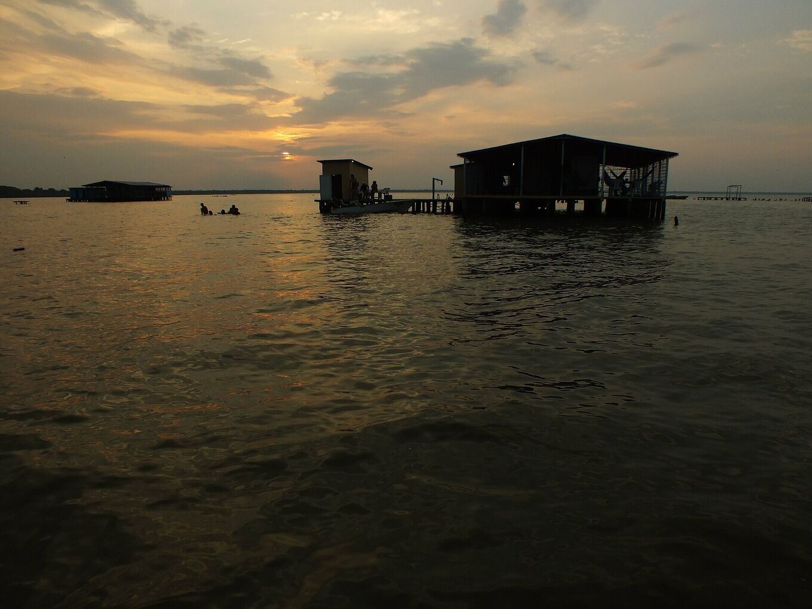
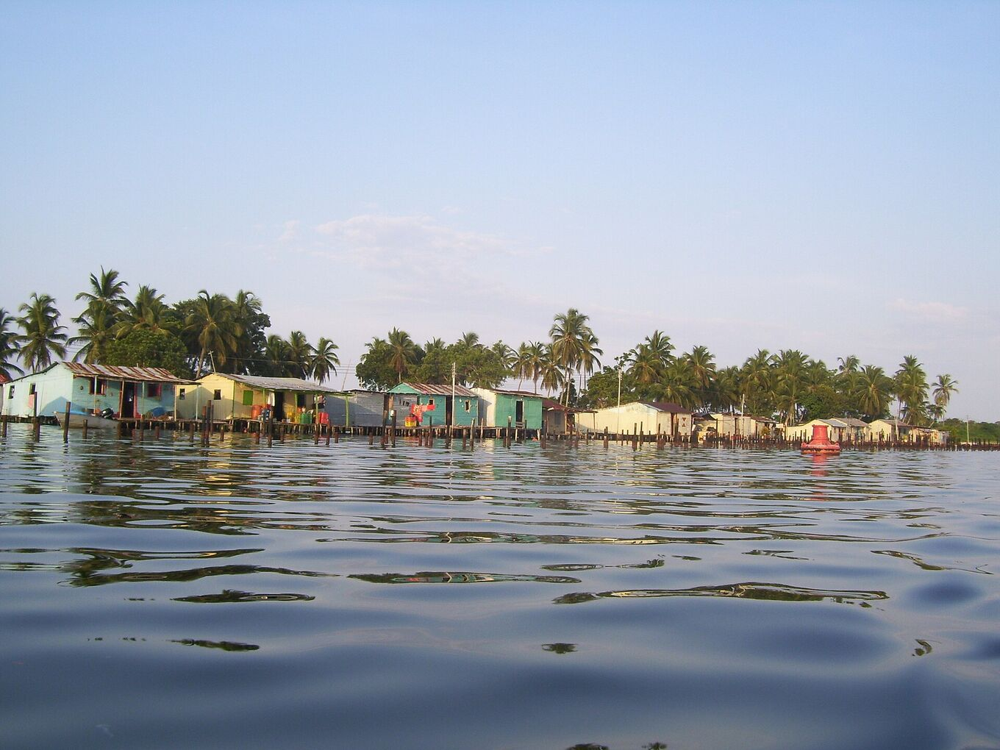
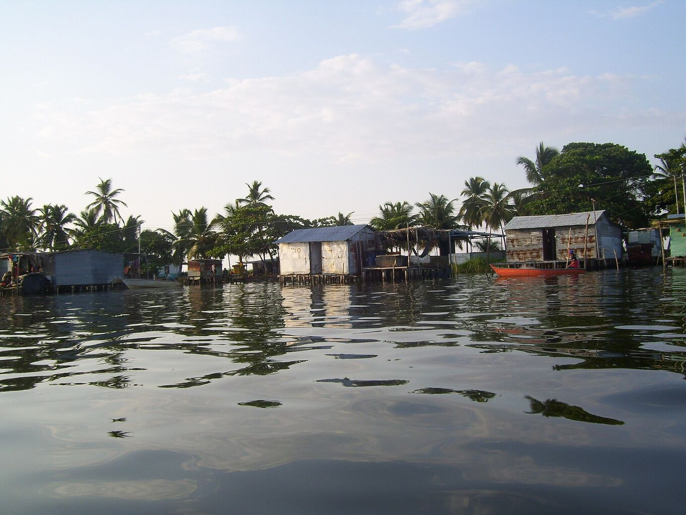
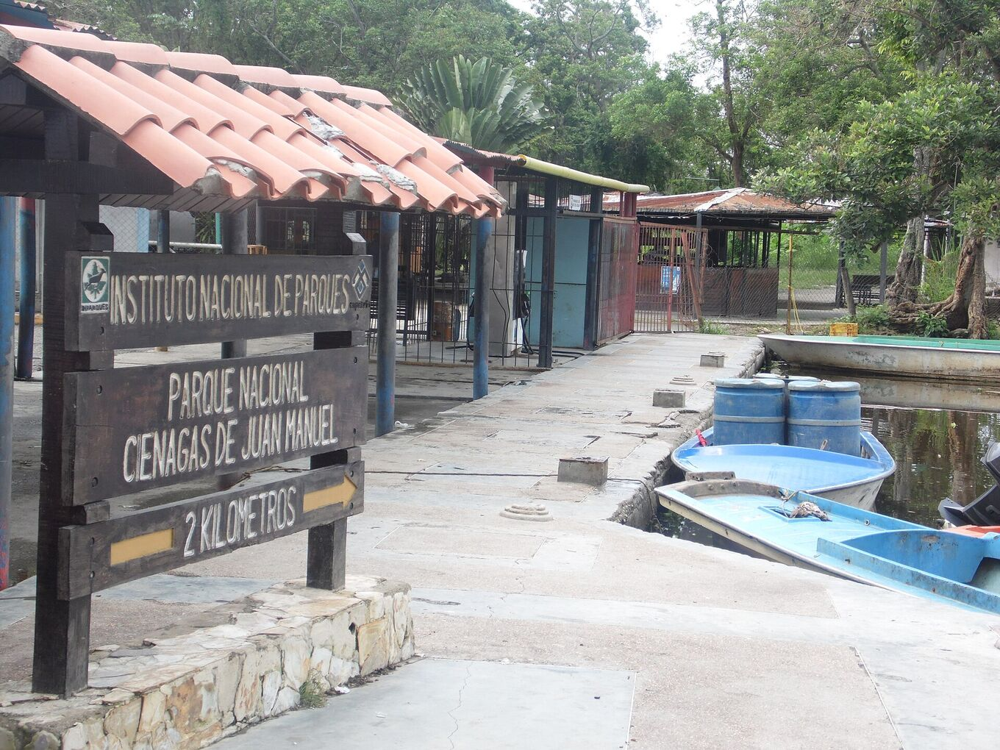
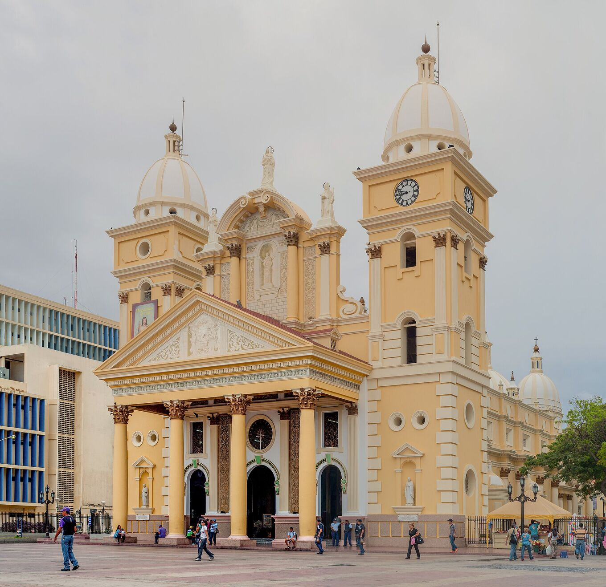
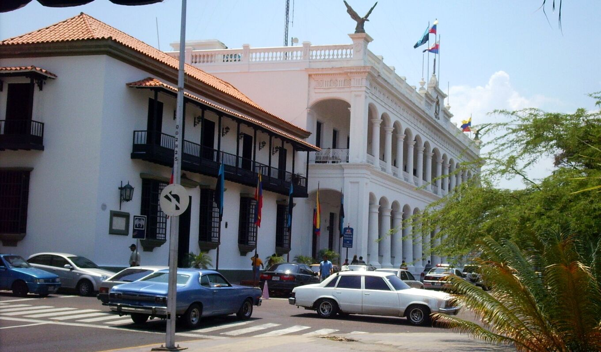
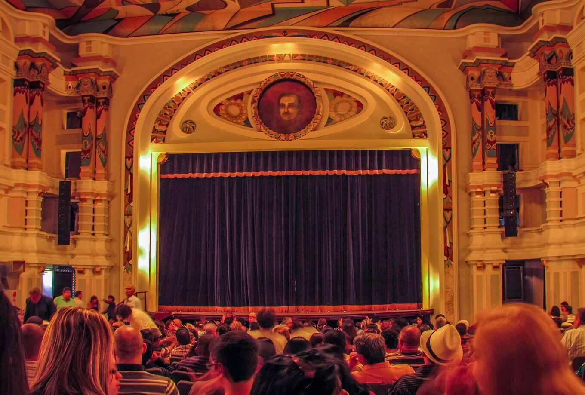
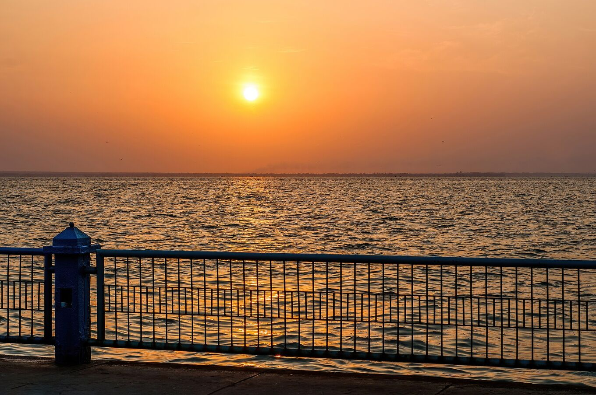
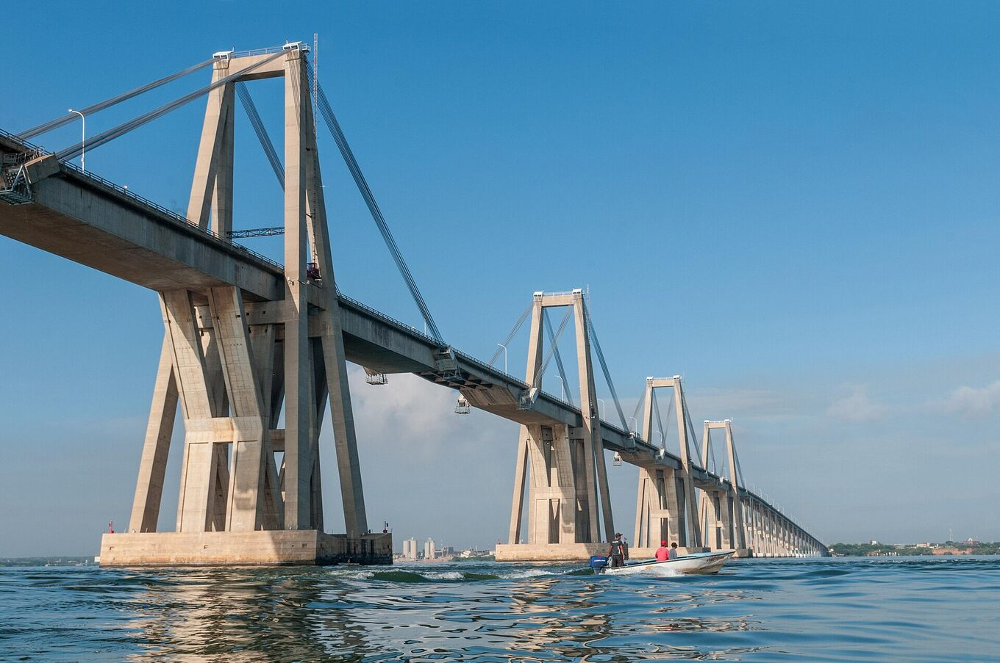
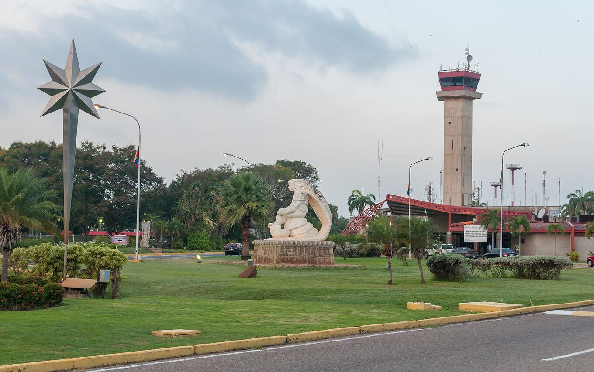

## One lake, many shores.

The institutional and community places that shape a visit: the protected area where the storm is born, the stilt villages it is watched from, Maracaibo’s heritage and the arrival points.

Lake Maracaibo covers about 13,500 km². It is linked to the Caribbean by a narrow strait in the north, and fed by dozens of rivers in the south. The largest, the Catatumbo, brings more than half of its water.

## The south of the lake

### Ciénagas de Juan Manuel National Park

*Protected area · Inparques*

Wetlands, mangroves and channels in the Catatumbo delta, south-west of the lake. This is where the storm forms. It is managed by the National Parks Institute (Inparques); visits go with authorised guides. [Wikipedia](https://es.wikipedia.org/wiki/Parque_nacional_Ci%C3%A9nagas_de_Juan_Manuel)

Also known as Ciénagas del Catatumbo, or Aguas Blancas and Aguas Negras. A flat, flooded plain between the Sierra de Perijá and the lake, with temperatures of 22–32 °C and very high humidity. Birds are everywhere: great egrets, little blue herons, jabiru storks, ducks, gulls, terns and caracaras.

*[Juan Pablo Bottaro · Wikimedia Commons · CC BY-SA 4.0](https://commons.wikimedia.org/wiki/File:Lago_en_llamas.jpg)*

### Ologá

*Lake community · stilt houses*

A stilt-house village about ten minutes by boat from Congo Mirador. Today it is the main base for watching the lightning, with simple camps and guesthouses over the water.

Some of its houses came from Congo Mirador: built on stilts, they could be lifted onto two boats and moved here.

*[Yinette Bracho Padilla · Wikimedia Commons · CC BY-SA 4.0](https://commons.wikimedia.org/wiki/File:Palafitos_del_pueblo_de_Olog%C3%A1.jpg)*

### Congo Mirador

*Lake community · stilt houses*

Once the best-known village for watching the lightning. Silting of the lake and the economic crisis emptied it: by 2018 about 90 % of its people had left, and many houses were moved to Ologá. [Wikipedia](https://es.wikipedia.org/wiki/Congo_Mirador)

The village is at least 200 years old and lived from fishing and, later, from visitors. It had about 930 people at the end of the 1970s and around a thousand in 2013. Residents blame the silt on a three-kilometre channel opened from the Bravo river in 1991, the “Caño J”. By 2021 about five people remained. Its story is told in the documentary *Once Upon a Time in Venezuela* (2020), by Anabel Rodríguez Ríos.

*[Yinette Bracho Padilla · Wikimedia Commons · CC BY-SA 4.0](https://commons.wikimedia.org/wiki/File:Palafitos_de_Congo_Mirador.jpg)*

### Puerto Concha

*Boat landing · departure point*

Boat landing near Santa Bárbara del Zulia, where boats leave for Ologá and the delta. It is reached by road from El Vigía airport.

Santa Bárbara is the cattle town of the south of the lake, known for its cheese and plantains. Fill up on cash, water and supplies there: there are no shops on the water.

*[Yoser Linares · Wikimedia Commons · CC BY-SA 4.0](https://commons.wikimedia.org/wiki/File:Puerto_Concha.jpg)*

## Maracaibo

### Basilica of Our Lady of Chiquinquirá

*Religious heritage*

The shrine of “La Chinita”, patron saint of Zulia, in the old centre of Maracaibo. Her fair, in November, is the region’s largest festival. [Wikipedia](https://es.wikipedia.org/wiki/Bas%C3%ADlica_de_Nuestra_Se%C3%B1ora_de_Chiquinquir%C3%A1_(Maracaibo))

It began as a mud-and-straw hermitage in 1686. According to tradition, in 1709 a woman found a small wooden board on the lake shore, and the image of the Virgin appeared on it, glowing. The church became a minor basilica in 1920 and the image was crowned in 1942. The fair runs from 11 to 18 November, with gaitas, the music of Zulia, playing all night on the 17th.

*[Wilfredor · Wikimedia Commons · CC0](https://commons.wikimedia.org/wiki/File:Bas%C3%ADlica_de_la_Chinita.jpg)*

### Plaza Bolívar and Palacio de los Cóndores

*Institution · Zulia state government*

Seat of the Zulia state government, facing Plaza Bolívar and Maracaibo Cathedral. A starting point for walking the historic centre. [Wikipedia](https://es.wikipedia.org/wiki/Palacio_de_los_C%C3%B3ndores)

Built between 1841 and 1868 and rebuilt in 1929, when it took the name of the condors on its roof. The Zulia state anthem, which mentions the lightning, was first sung in its hall of mirrors in 1909.

*[Wilfredor · Wikimedia Commons · CC0](https://commons.wikimedia.org/wiki/File:Centro_de_Maracaibo_en_Venezuela.JPG)*

### Teatro Baralt

*Cultural heritage*

Historic theatre in central Maracaibo, declared a National Monument. It hosts the city’s music, theatre and cultural events. [Wikipedia](https://es.wikipedia.org/wiki/Teatro_Baralt)

The first Baralt theatre dates from 1847. A second opened on 24 July 1883 and was the first stage in Venezuela to show a film, in 1896. The current building opened in 1932 and became a National Monument in 1981.

*[Wilfredor · Wikimedia Commons · CC0](https://commons.wikimedia.org/wiki/File:Teatro_Baralt_3.jpg)*

### Vereda del Lago

*Public space · park*

A linear park on the lake shore in Maracaibo, with paths and an open view of the water. On clear nights a distant glow is sometimes visible to the south. [Wikipedia](https://es.wikipedia.org/wiki/Vereda_del_Lago)

*[Wilfredor · Wikimedia Commons · CC0](https://commons.wikimedia.org/wiki/File:Sunrise_on_Vereda_del_Lago.jpg)*

### General Rafael Urdaneta Bridge

*Infrastructure · 1962*

Links Maracaibo with the eastern shore across the lake’s strait. It is about 8.7 km long and opened in 1962. It is the road route towards the south of the lake. [Wikipedia](https://es.wikipedia.org/wiki/Puente_General_Rafael_Urdaneta)

Designed by the Italian engineer Riccardo Morandi, it stands on 134 piers. Its central cable-stayed spans are 235 m long and let ships up to 45 m tall pass underneath. President Rómulo Betancourt opened it on 24 August 1962.

*[Wilfredor · Wikimedia Commons · CC0](https://commons.wikimedia.org/wiki/File:General_Rafael_Urdaneta_Bridge_view_from_the_lake_to_Cabimas_side.jpg)*

### La Chinita International Airport

*Arrival · airport*

Zulia’s main airport, south-west of Maracaibo (code MAR). To go straight to the south of the lake, El Vigía airport is closer. [Wikipedia](https://es.wikipedia.org/wiki/Aeropuerto_Internacional_La_Chinita)

Opened in 1969 and named after Zulia’s patron saint. It is one of the busiest airports in the country.

*[Wilfredor · Wikimedia Commons · CC0](https://commons.wikimedia.org/wiki/File:La_Chinita_International_Airport.jpg)*
