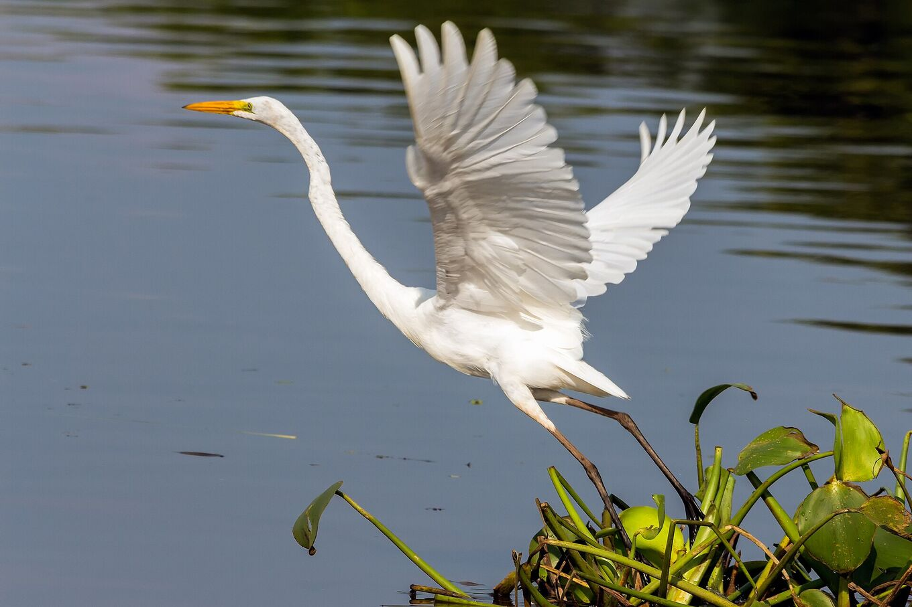

## Respect

People live in Ologá and Congo Mirador. Ask before photographing people, hire local services and take your rubbish with you. Follow the national park's rules of use.

The stilt-house families live from fishing and from visitors. Buy their meals and crafts. Keep noise down at night. Ask before flying a drone. Do not feed or chase the wildlife.

*[Fernando Flores · Wikimedia Commons · CC BY-SA 2.0](https://commons.wikimedia.org/wiki/File:Great_Egret_Garza_Real_%28Ardea_alba_egretta%29_%2824754473973%29.jpg)*

## Choose local services

Hiring guides, boatmen and lodging from the area keeps the money in the communities that live beside the lightning.

Ask whether the boatmen and cooks are from Ologá or nearby villages. Eat what the families cook, and tip guides and boatmen if the service was good.

## Community projects

An agritourism project, "To the Catatumbo Lightning, along the Catatumbo River", sets out to improve life in Ologá and Congo Mirador with the [Finnova Foundation](https://www.finnova.com/). Its goals include:

- Solar panels on the stilt houses to replace 90 % of the petrol generators.
- Biodigesters and constructed wetlands to treat wastewater.
- Restoring 25 stilt houses in each village.
- Shallow-draft, quiet boats, and a recycling centre run on "zero waste".
- Training 100 residents as guides, with INATUR, and keeping at least 30 % of visitor spending in the villages.
- A biological station, with UNESUR, to study climate change, silting of the Catatumbo and pollution.

A boat ambulance has also been announced for both villages, from the Fundación Azul Ambientalistas and Venemergencia, with emergency transfers and telemedicine.

You can help now. Sort your rubbish and take it back to the mainland, because there is no collection on the stilt houses.
