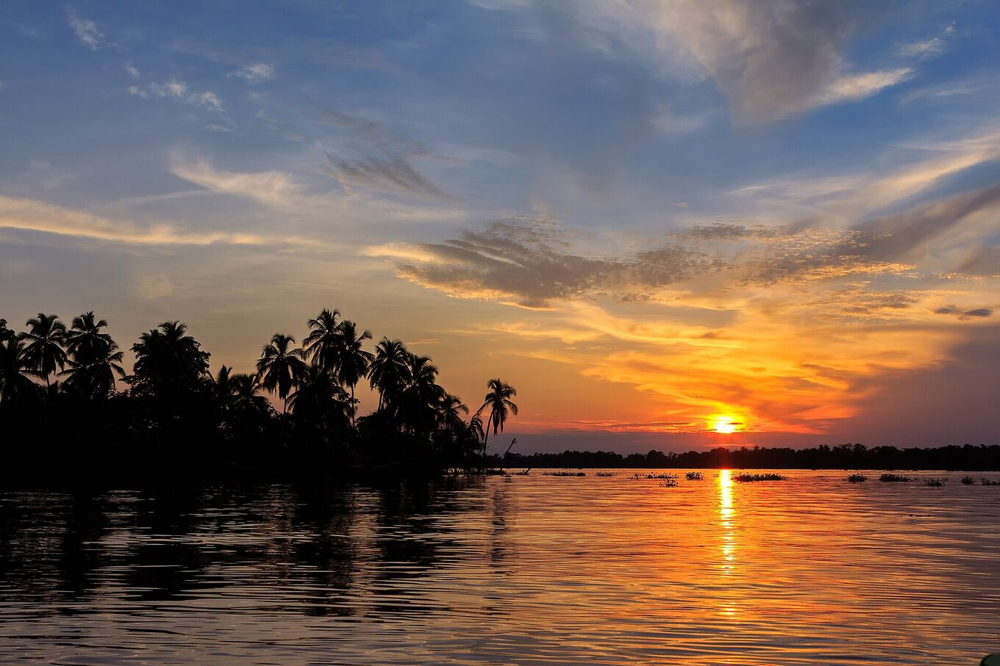
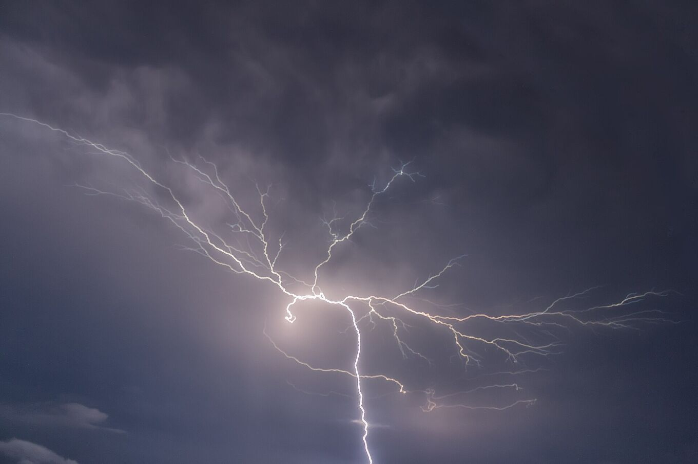

## When to go

The storm starts at dusk and usually lasts until the early hours. September to November are the most active months. Check the weather forecast on the afternoon of your trip.

April and May bring a second, smaller peak. January and February are the quietest months, with fewer storms but also drier days and calmer water. Arrive before sunset, because dusk over the lake is part of the show.

Passing through Maracaibo in November? The Feria de la Chinita, from 11 to 18 November, fills the city with gaitas, processions and crowds.

*[Fernando Flores · Wikimedia Commons · CC BY-SA 2.0](https://commons.wikimedia.org/wiki/File:Sunset_at_Congo_Mirador_%2823978940929%29.jpg)*

## The lightning year

The rhythm follows the rains. As the tropical rain belt moves north and south over the year, it brings two wetter seasons, a first one in April and May and a stronger one later in the year, peaking around September and October. Climate patterns such as El Niño shift it from year to year. The drought that switched the lightning off from January to March 2010 came with El Niño.

Within a night, activity usually starts at dusk, builds after dark and is strongest around midnight and the early hours. In the drier months it can appear as dry lightning, without rain.

*[Fernando Flores · Wikimedia Commons · CC BY-SA 2.0](https://commons.wikimedia.org/wiki/File:Catatumbo_Lightning_-_Rayo_del_Catatumbo_%2822668686290%29.jpg)*
