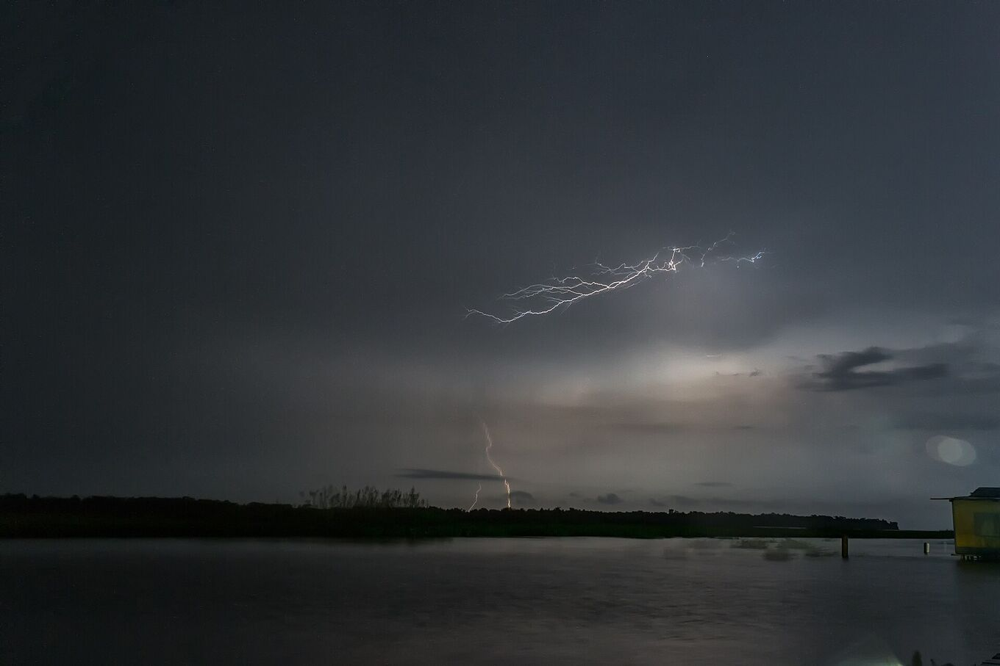

## How to read the forecast.

- **Storm** is an estimate, not a lightning forecast: nobody can know how much lightning there will be. *Likely* means the model expects a thunderstorm during the night, or a lot of storm energy with rain likely. *Possible* means moderate energy and some rain.
- **Rain** is the highest chance of rain between 18:00 and 06:00.
- **Wind** is the strongest average wind of the night. With wind the lake gets choppy and the boat ride is less comfortable.
- All times are Venezuela time (UTC−4).

Even when the forecast says *unlikely*, the lightning may appear: it forms over the lake with the night breezes, and weather models see such a small area poorly. Check with your guide on the afternoon of the trip.

### What “storm energy” means

Meteorologists call it CAPE: the energy a rising bubble of warm, humid air can gain. The more there is, the taller the clouds can grow, and tall clouds are the ones that make lightning. At the Catatumbo, CAPE together with the night wind over the lake is the best guide to how active a night will be.

*[Fernando Flores · Wikimedia Commons · CC BY-SA 2.0](https://commons.wikimedia.org/wiki/File:Catatumbo_Lightning-_Rayo_del_Catatumbo_%2828619470016%29.jpg)*

### Live lightning

The forecast says what may happen. To see what is happening, volunteer networks such as [Blitzortung](https://www.blitzortung.org/) map lightning strikes in real time. Coverage over Venezuela is thinner than in Europe, and some flashes are missed.

### Offline

The page saves the last forecast it downloaded on your phone. Without internet it shows that one, with its date. The rest of the guide works as usual.

### Where the data comes from

From the free service [Open-Meteo](https://open-meteo.com/), which combines national weather models, for a fixed point at Congo Mirador. The page does not send your location.

### The map

The map uses data from [OpenFreeMap](https://openfreemap.org/), based on OpenStreetMap. If you tap "Show my location", your position appears on the map with its accuracy, and the legend shows the straight-line distance (not by road or river) to each place. Your location is used only on your phone. Offline, the map shows a simplified outline of the lake and the coast, and your position still works. The places' coordinates come from OpenStreetMap.
