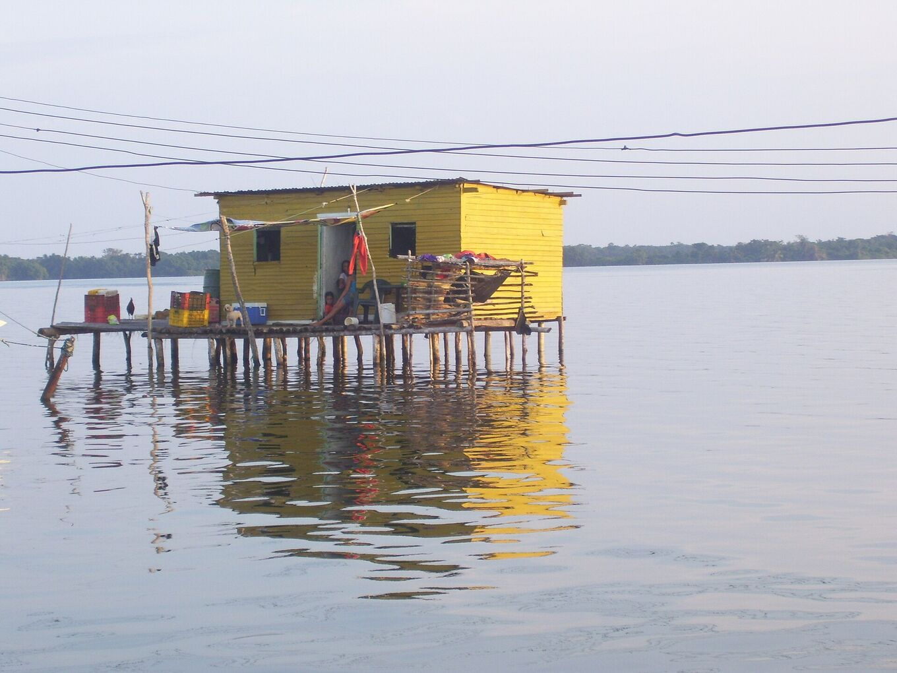

## Guided trips

The trip usually takes two or three days, with a drive to the landing, a boat ride down the river and across the lake, and a night in a stilt house facing the storm. With a local operator it is easier and safer.

*[Yinette Bracho Padilla · Wikimedia Commons · CC BY-SA 4.0](https://commons.wikimedia.org/wiki/File:Palafito_en_medio_del_Parque_nacional.jpg)*

### Before you book, ask

- What the price includes, such as transfers, boat, meals, drinking water and where you sleep (hammock or bed).
- Where it leaves from and when it gets back. Many trips leave from Mérida.
- What safety measures they take, such as life jackets for everyone and a boat in good condition, and what they do if the storm comes closer or the wind picks up.
- Whether they follow the national park rules and work with the stilt-house communities.
- Which languages the guide speaks and how big the group is.
- Which currency you pay in, whether they take cards or only cash, and what happens if the weather forces a cancellation.
- What happens if the night is calm and there is no lightning. Nobody can promise the storm.
- What there is on site (toilets, drinking water, power for charging) and how they call for help without phone signal.
- Whether they are listed in Venezuela's National Tourism Register (RTN).

### Warning signs

- A price far below everyone else's.
- No life jackets, or not enough for the whole group.
- Offers to sail under the storm for better photos.
- Pressure to pay everything in advance, in cash, with no receipt.
- No clear plan for bad weather.

## Institutions and partners

Public bodies and companies working for tourism south of the lake:

- **Tourism:** INATUR Zulia (National Tourism Institute) and the Corporación Zuliana de Turismo.
- **Science and environment:** UNESUR (Universidad Nacional Experimental Sur del Lago), ICLAM (Institute for the Conservation of Lake Maracaibo), MINEC (Ministry of Ecosocialism) and the [Finnova Foundation](https://www.finnova.com/).
- **Air transport:** INAC (National Institute of Civil Aviation).
- **Companies:** YessTravels, Grupo San Simón, Junior Mall Hotel and Hotel Tibisay.
