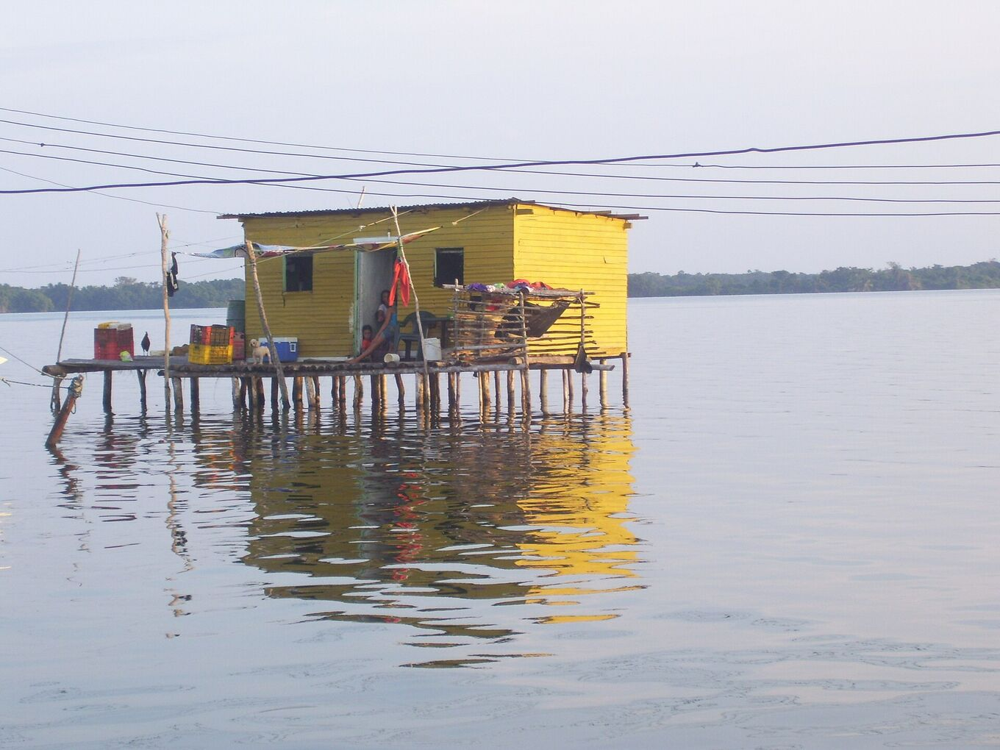
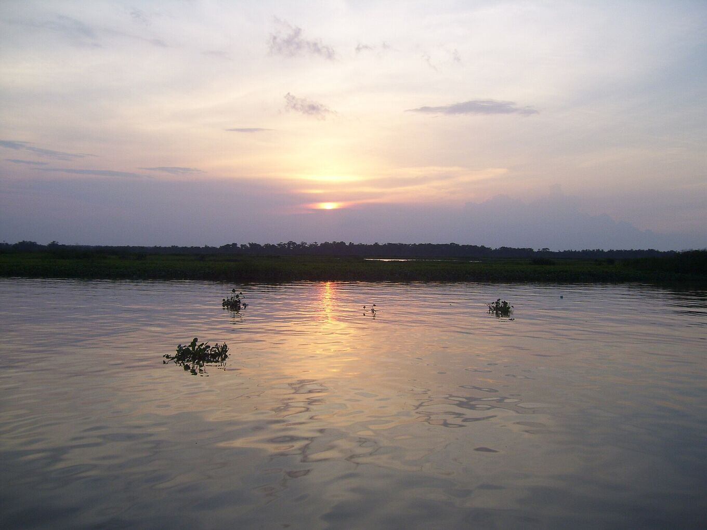

## Go with people who know the lake.

The trip usually takes two or three days: a drive to the landing, a boat ride down the river and across the lake, and a night in a stilt house facing the storm. With a local operator it is easier and safer.

*[Yinette Bracho Padilla · Wikimedia Commons · CC BY-SA 4.0](https://commons.wikimedia.org/wiki/File:Palafito_en_medio_del_Parque_nacional.jpg)*

### A typical trip

Itineraries vary. A two-day trip often looks like this:

- **Day 1, morning:** early departure from Mérida, or pick-up at El Vigía airport. Drive down to Puerto Concha.
- **Day 1, afternoon:** boat through the channels and mangroves of the national park. Herons, egrets and other water birds along the way. Arrival at Ologá before sunset.
- **Day 1, night:** dinner, often fish from the lake. Then the storm, from the deck or from the boat at a safe distance. Sleep in a hammock or a bed in a stilt house.
- **Day 2:** sunrise over the lake, boat back to the landing and drive back in the afternoon.

Three-day trips add more time on the water, a second night for the lightning, or a stop in the Andes.

### Before you book, ask

- **What is included:** transfers, boat, meals, drinking water and where you sleep (hammock or bed).
- **Where it leaves from** and when it gets back. Many trips leave from Mérida.
- **Safety:** life jackets for everyone, a boat in good condition and what they do if the storm comes closer or the wind picks up.
- **Permits:** that they follow the national park rules and work with the stilt-house communities.
- **Languages** the guide speaks and group size.
- **Payment and cancellation:** which currency, card or cash only, and what happens if the weather forces a cancellation.
- **No lightning:** what happens if the night is calm. Nobody can promise the storm.
- **On site:** toilets, drinking water, power for charging, and how they call for help without phone signal.
- **Registration:** whether they are listed in Venezuela’s National Tourism Register (RTN).

### Warning signs

- A price far below everyone else’s.
- No life jackets, or not enough for the whole group.
- Offers to sail under the storm for better photos.
- Pressure to pay everything in advance, in cash, with no receipt.
- No clear plan for bad weather.

### Choose local services

Hiring guides, boatmen and lodging from the area keeps the money in the communities that live beside the lightning.

Ask whether the boatmen and cooks are from Ologá or nearby villages. Eat what the families cook, and tip guides and boatmen if the service was good.

*[Yinette Bracho Padilla · Wikimedia Commons · CC BY-SA 4.0](https://commons.wikimedia.org/wiki/File:Lago_de_Maracaibo_desde_el_Parque_nacional.jpg)*
