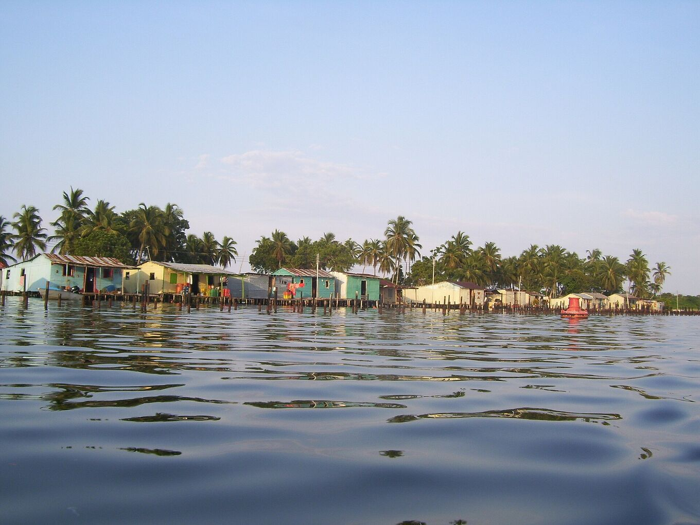
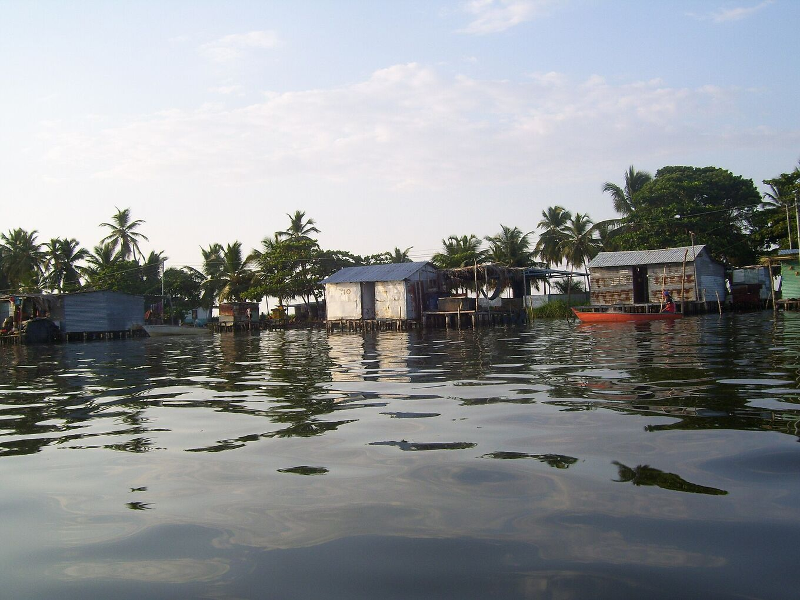
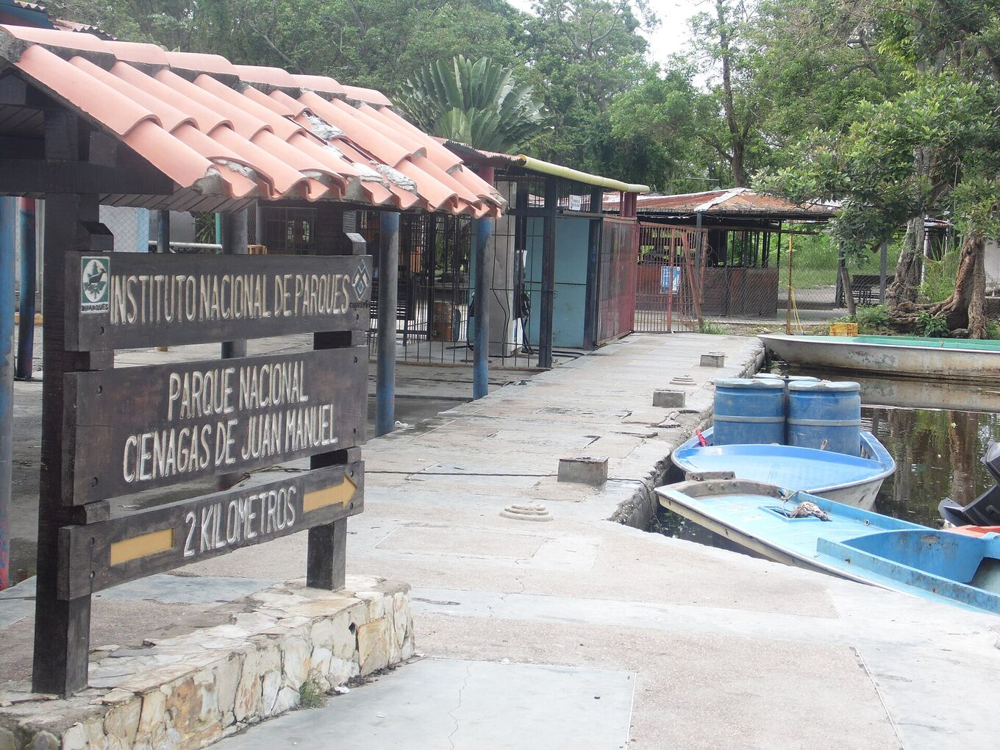
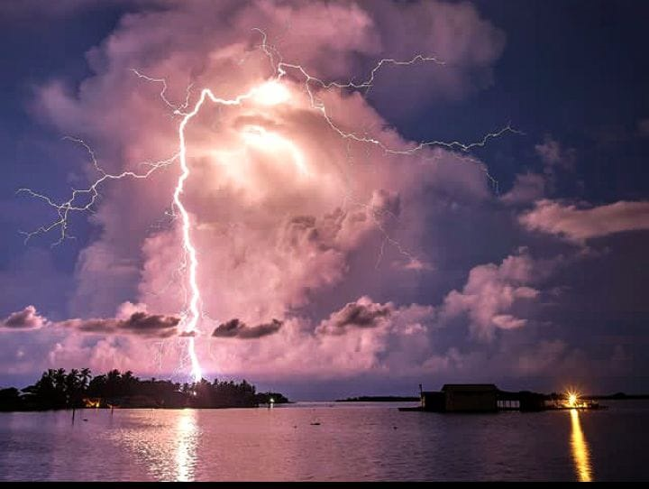

## Lake Maracaibo

The stilt villages the storm is watched from and the landing where the boats leave. The protected area where the storm is born, Ciénagas del Catatumbo National Park, has its own page.

Lake Maracaibo covers about 13,500 km². It is linked to the Caribbean by a narrow strait in the north, and fed by dozens of rivers in the south. The largest, the Catatumbo, brings more than half of its water.

Living on the water is old here. The Añú, an Indigenous people of the lake, were already building stilt houses when the Spanish arrived in 1499.

## South of the lake

### Ologá

*Lake community · stilt houses*

A stilt-house village about ten minutes by boat from Congo Mirador. Today it is the main base for watching the lightning, with simple camps and guesthouses over the water.

Some of its houses came from Congo Mirador. Built on stilts, they could be lifted onto two boats and moved here.

*[Yinette Bracho Padilla · Wikimedia Commons · CC BY-SA 4.0](https://commons.wikimedia.org/wiki/File:Palafitos_del_pueblo_de_Olog%C3%A1.jpg)*

### Congo Mirador

*Lake community · stilt houses*

Once the best-known village for watching the lightning. Silting of the lake and the economic crisis emptied it. By 2018 about 90 % of its people had left, and many houses were moved to Ologá. [Wikipedia](https://es.wikipedia.org/wiki/Congo_Mirador)

The village is at least 200 years old and lived from fishing and, later, from visitors. It had about 930 people at the end of the 1970s and around a thousand in 2013. Residents blame the silt on a three-kilometre channel opened from the Bravo river in 1991, the "Caño J". By 2021 about five people remained. Its story is told in the documentary *Once Upon a Time in Venezuela* (2020), by Anabel Rodríguez Ríos.

*[Yinette Bracho Padilla · Wikimedia Commons · CC BY-SA 4.0](https://commons.wikimedia.org/wiki/File:Palafitos_de_Congo_Mirador.jpg)*

### Puerto Concha

*Boat landing · departure point*

Boat landing near Santa Bárbara del Zulia, where boats leave for Ologá and the delta. It is reached by road from El Vigía airport.

Santa Bárbara is the cattle town south of the lake, known for its cheese and plantains. Get cash, water and supplies there, because there are no shops on the water.

*[Yoser Linares · Wikimedia Commons · CC BY-SA 4.0](https://commons.wikimedia.org/wiki/File:Puerto_Concha.jpg)*

## Life on the water

Ologá, in Encontrados parish of Catatumbo municipality, is one of the most isolated places south of the lake. It is where the world watches the lightning from, yet its people live with very little.

- There is no piped drinking water or sanitation. Fresh water comes by boat from the mainland.
- Power comes from private generators that run a few hours, and there is almost no internet.
- The health post has few staff and little medicine. An emergency means a long boat ride.
- Small-scale fishing is the main livelihood. Middlemen set the price of fish, and scarce, expensive petrol brings fishing to a halt.
- Tourism money comes in seasons and stays mostly with operators from elsewhere.

That is why it matters to hire boatmen, guides and cooks from the community (see Responsible travel).

