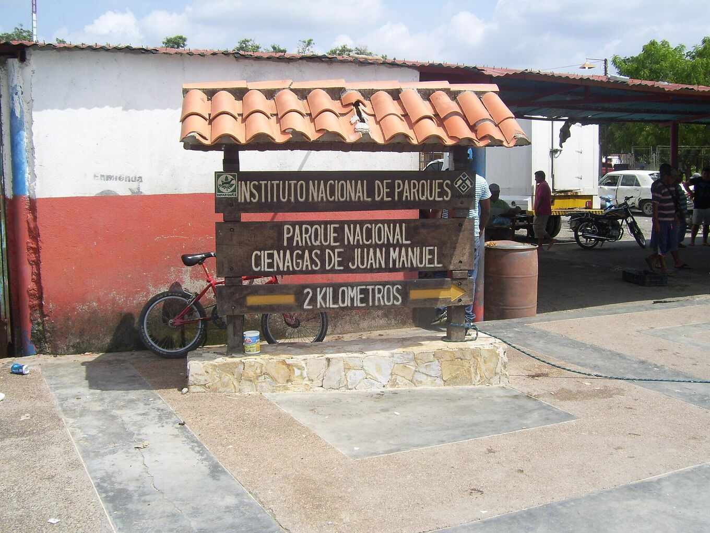
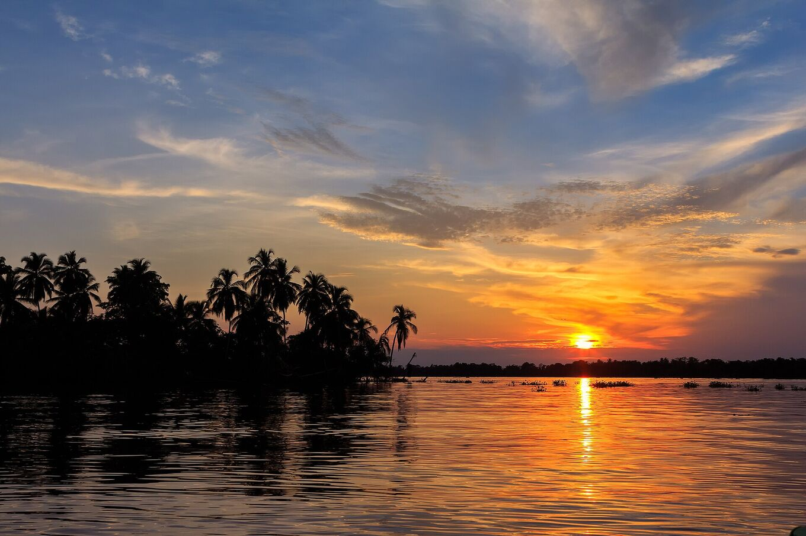
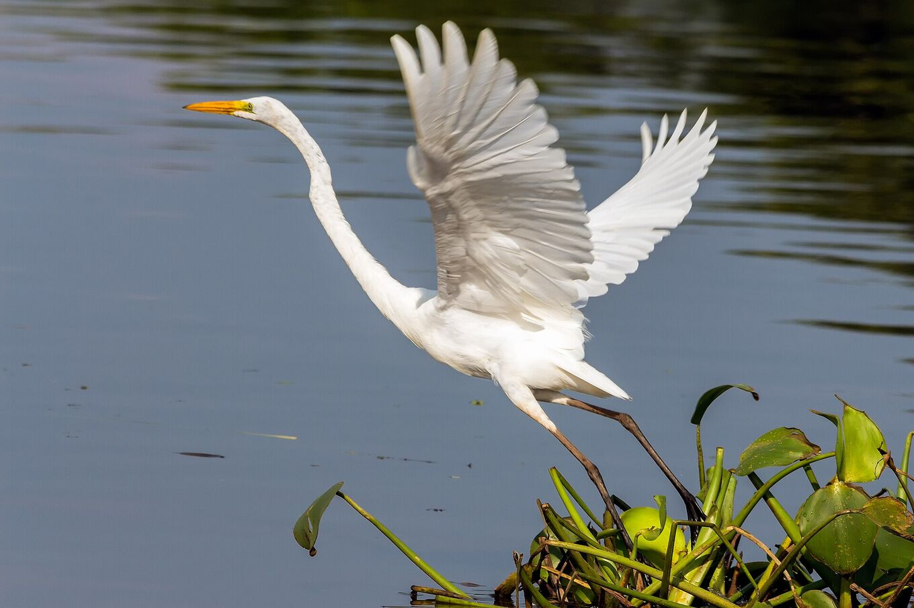

## Give it time. Take care.

### Getting there

Most visits leave by boat from Puerto Concha, near Santa Bárbara del Zulia, towards Ologá. The nearest airport is El Vigía; Maracaibo is several hours away by road. Many agencies run the trip from Mérida.

From Mérida the road drops from the Andes to the plains of the south of the lake, past plantain farms and cattle ranches: about four hours to the landing. From Puerto Concha the boat follows river channels and mangroves into the national park and out onto the lake. The ride takes one to two hours, depending on the route and the water level.

Carry your passport or ID: there are police and military checkpoints on the roads.

*[Yinette Bracho Padilla · Wikimedia Commons · CC BY-SA 4.0](https://commons.wikimedia.org/wiki/File:Entrada_al_parque_nacional.jpg)*

### When to go

The storm starts at dusk and usually lasts until the early hours. September to November are the most active months. Check the weather forecast on the afternoon of your trip.

April and May bring a second, smaller peak. January and February are the quietest months: fewer storms, but also drier days and calmer water. Arrive before sunset: dusk over the lake is part of the show.

Passing through Maracaibo in November? The Feria de la Chinita, from 11 to 18 November, fills the city with gaitas, processions and crowds.

*[Fernando Flores · Wikimedia Commons · CC BY-SA 2.0](https://commons.wikimedia.org/wiki/File:Sunset_at_Congo_Mirador_%2823978940929%29.jpg)*

### What to bring

Insect repellent, long sleeves, a rain jacket, a head torch, cash, drinking water and a dry bag for your phone and camera. Electricity and signal are limited in the stilt villages.

Also: a hat and sunscreen for the boat ride, light quick-drying clothes, a power bank, snacks and any medicine you need. Power usually comes from a generator, and only for a few hours.

### Health

The south of the lake is hot and very humid: 22–32 °C. Drink often. Mosquitoes come out at dusk.

See a travel clinic a few weeks before you go and ask about yellow fever vaccination and malaria prevention for the area. Do not drink or swim in the lake water: parts of the lake are polluted.

### Safety

Storms carry risk. Follow weather warnings and the advice of local guides. Do not travel by boat under the storm or shelter under isolated trees. Emergencies: **VEN 911**.

On open water a boat is the highest point around. If you can hear thunder, the storm is close enough to strike: get off the water and under a roof. Wear your life jacket on every ride.

Check your government’s travel advice before you book. Several countries advise against travel to Venezuela or to areas near the Colombian border. Take travel insurance that covers it.

### Photographing the lightning

- **Steady camera:** a tripod on the stilt house deck. On a boat, photos blur.
- **Focus:** manual, at infinity. Autofocus fails in the dark.
- **Exposure:** 10–30 s, ISO 800–3200, aperture f/2.8–f/5.6. Shoot continuously and keep the best frames.
- **Phone:** night mode, propped against something firm.
- **Light:** flash off, head torch on red. Your neighbours are watching too.
- Put the camera back in the dry bag when the rain comes.

### Respect

Ologá and Congo Mirador are homes, not film sets. Ask before photographing people, hire local services and take your rubbish with you. The national park has rules of use: follow them.

The stilt-house families live from fishing and from visitors. Buy their meals and crafts. Keep noise down at night. Ask before flying a drone. Do not feed or chase the wildlife.

*[Fernando Flores · Wikimedia Commons · CC BY-SA 2.0](https://commons.wikimedia.org/wiki/File:Great_Egret_Garza_Real_%28Ardea_alba_egretta%29_%2824754473973%29.jpg)*

> Transfers, timetables and prices change with routes, water levels and local availability. Confirm them with local operators before you travel.

## Sources and further reading

- [Albrecht et al. · BAMS 2016](https://doi.org/10.1175/BAMS-D-14-00193.1)
- [Muñoz et al. · Atmospheric Research 2016 · seasonal lightning forecast](https://doi.org/10.1016/j.atmosres.2015.12.018)
- [Wikipedia · Catatumbo lightning](https://en.wikipedia.org/wiki/Catatumbo_lightning)
- [Wikipedia · Lake Maracaibo](https://en.wikipedia.org/wiki/Lake_Maracaibo)
- [Wikipedia · Congo Mirador](https://en.wikipedia.org/wiki/Congo_Mirador)
- [Blitzortung · live lightning](https://www.blitzortung.org/)
