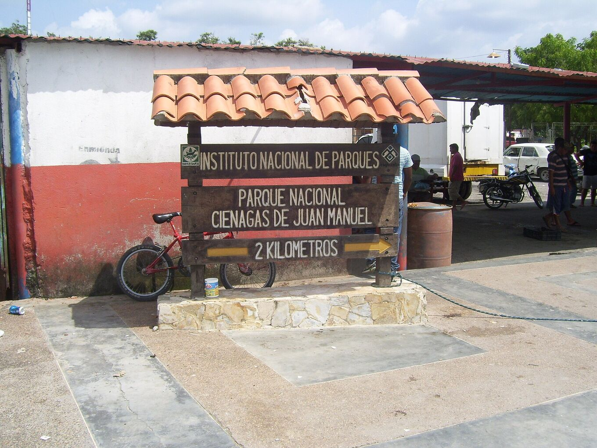

## Por carretera y en lancha

La mayoría de las visitas salen en lancha desde Puerto Concha, cerca de Santa Bárbara del Zulia, hacia Ologá. El aeropuerto más cercano es El Vigía; Maracaibo queda a varias horas por carretera. Muchas agencias organizan la excursión desde Mérida.

Desde Mérida, la carretera baja de los Andes a las llanuras del sur del lago, entre platanales y fincas ganaderas. Son unas cuatro horas hasta el embarcadero. Desde Puerto Concha, la lancha sigue canales y manglares hasta el parque nacional y sale al lago. La travesía dura de una a dos horas, según la ruta y el nivel del agua.

Lleva el pasaporte o tu documento de identidad, porque en las carreteras hay puestos de control policiales y militares.

*[Yinette Bracho Padilla · Wikimedia Commons · CC BY-SA 4.0](https://commons.wikimedia.org/wiki/File:Entrada_al_parque_nacional.jpg)*

Los traslados, horarios y precios cambian con las rutas, el nivel del agua y la disponibilidad local, así que confírmalos con operadores de la zona antes de viajar.

## Rutas en lancha hacia Ologá

Un proyecto agroturístico de la zona describe cuatro rutas. Los tiempos son aproximados.

| Salida | Tiempo | Parada |
| --- | --- | --- |
| Puerto Concha | ≈ 1 h | Palafito de Corpozulia |
| Canal Escalante, desde el sector Curva de Colón | ≈ 2 h | Congo Mirador |
| Puerto pesquero de Encontrados, por el río Catatumbo | ≈ 2 h 30 min | Caña Dulce |
| Puerto La Maroma, en Concha | ≈ 2 h 30 min | Palafito de Corpozulia |

Cuando el río baja mucho o se desborda, algunas rutas no se pueden navegar. Si llegas la víspera, en la página Dónde dormir están los hoteles cercanos al embarcadero.
