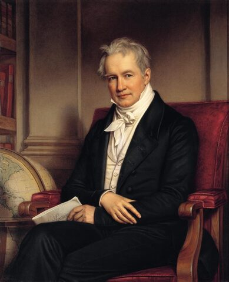
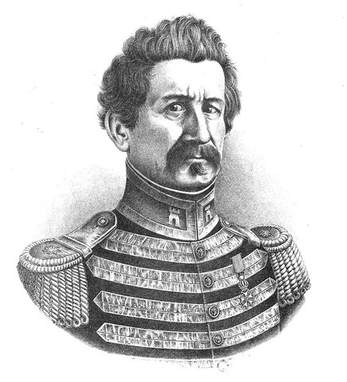
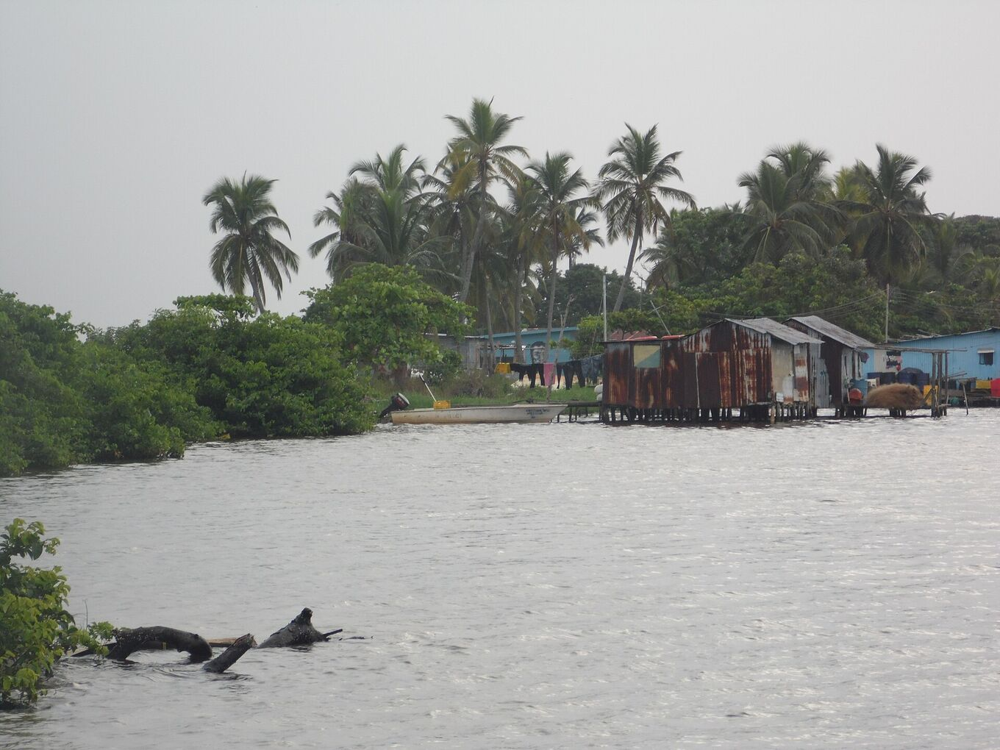
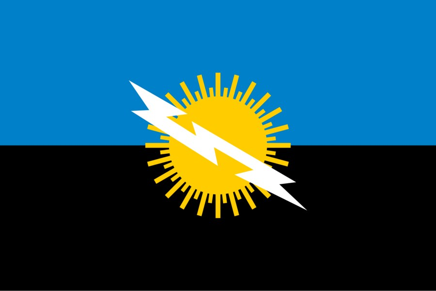

## Cuatro siglos mirando al sur.

Navegantes, viajeros y científicos dejaron constancia del resplandor del sur del lago. Esta es una cronología breve de lo documentado.

### 1822 · El faro de Maracaibo

Alexander Walker recoge los nombres con que lo conocían los navegantes: «Faro de Maracaibo» y «Linternas de San Antonio». El resplandor servía de referencia para orientarse de noche en el golfo y el lago.

### 1826 · Humboldt

Alexander von Humboldt describe el fenómeno en su relato de viaje a partir de los informes de M. Palacios. Es una de las primeras descripciones que circulan en Europa.

Lo llama «explosiones eléctricas que son como fulgores fosforescentes», a partir del libro *Viage de Varinas*, de Palacios.

*[Joseph Karl Stieler · Wikimedia Commons · Dominio público](https://commons.wikimedia.org/wiki/File:Stieler,_Joseph_Karl_-_Alexander_von_Humboldt_-_1843.jpg)*

### 1841 · «Como un relámpago continuo»

El geógrafo Agustín Codazzi lo describe como «un relámpago continuo» que se ve desde lejos sobre el río Catatumbo. Su obra fija la imagen del fenómeno en la cartografía de Venezuela.

Añade que su posición, casi en el meridiano de la boca del lago, guía a los navegantes como un faro.

*[Wikimedia Commons · Dominio público](https://commons.wikimedia.org/wiki/File:Retrato_Agust%C3%ADn_Codazzi.jpg)*

### 1966–1970 · Primeras expediciones

El científico Andrés Zavrotsky y un equipo de la Universidad de los Andes hacen tres expediciones a Santa Bárbara del Zulia. Sitúan los focos de la tormenta en las ciénagas de Juan Manuel, al oeste del lago.

### 1997–2000 · La hipótesis del metano

Un equipo de la Universidad de Carabobo dirigido por Nelson Falcón llega al interior de las ciénagas y propone el metano como una de las causas principales. Ninguna medición ha confirmado aún metano dentro de las nubes de tormenta.

### 2005 · Patrimonio natural

El Zulia declara el relámpago Patrimonio Natural del estado el 27 de septiembre de 2005. Hay quien sigue pidiendo para la zona el título de Patrimonio de la Humanidad de la UNESCO.

### 2010 · El silencio

Entre enero y marzo de 2010 el relámpago dejó de verse, al parecer por una sequía intensa. Se especuló con su desaparición; la actividad volvió cuando regresaron las lluvias.

### 2014 · Un récord Guinness

El 28 de enero de 2014, Día de la Zulianidad, Guinness World Records acredita la zona como el lugar con más relámpagos por kilómetro cuadrado al año.

### 2016 · El mayor punto de rayos del planeta

Un estudio con datos del sensor LIS de la NASA (Albrecht et al., 2016) sitúa al Lago de Maracaibo en el primer lugar mundial, con unos 232,5 destellos por km² al año. Antes, Guinness lo había registrado como la mayor concentración de rayos.

Ese mismo año, un equipo de la Universidad del Zulia publica el primer pronóstico estacional de rayos, basado en el viento nocturno del lago.

### 2018 · Pueblos que se mueven

La sedimentación rodea de tierra los palafitos de Congo Mirador. La mayoría de sus habitantes se marcha y varias casas flotan, remolcadas en lancha, hasta Ologá, que pasa a ser la base de los visitantes.

*[Yoser Linares · Wikimedia Commons · CC BY-SA 4.0](https://commons.wikimedia.org/wiki/File:Comunidad_de_Olog%C3%A1.jpg)*

## La casa del trueno.

En lengua barí, Catatumbo se traduce como «casa del trueno». Un relato que se atribuye al pueblo barí cuenta que las luces del cielo son cocuyos, luciérnagas, que se reúnen cada noche para rendir homenaje a Sabaseba, el creador que ordenó el mundo. Es un relato, no una explicación meteorológica.

Los barí viven en la cuenca del Catatumbo, a ambos lados de la frontera entre Venezuela y Colombia. Resistieron durante siglos a las expediciones españolas. Desde entonces su territorio se ha reducido, presionado por colonos y por la explotación petrolera.

## Otros relatos del lago.

### Los cocuyos de Sabaseba

*Relato barí*

Las luces del cielo serían millones de cocuyos que se reúnen sobre el lago para honrar al creador. Se cuenta como relato del pueblo barí, que habita la cuenca del Catatumbo.

### Una señal de la naturaleza

*Tradición wayuu*

Para el pueblo wayuu, el relámpago es una señal de la naturaleza que pide respeto y transmite fuerza. El relámpago figura también en la bandera y el escudo del estado Zulia.

Relatos wayuu y yukpa ven en él, además, los espíritus de los wayuu caídos, que brillan en el cielo como un mensaje.

*[Wikimedia Commons · Dominio público](https://commons.wikimedia.org/wiki/File:Flag_of_Zulia_State.svg)*

### Drake y la noche iluminada

*Leyenda · contradicha por los documentos*

Se repite que en 1595 el relámpago delató a la flota de Francis Drake ante Maracaibo, y que Lope de Vega lo cantó en «La Dragontea». Ese resplandor era el de barcos en llamas en San Juan de Puerto Rico.

### La batalla del lago

*Relato popular*

Un relato extendido dice que en la Batalla Naval del Lago, en 1823, los relámpagos mostraron la posición de los barcos realistas a la flota patriota. Es memoria popular, no un hecho documentado.

La batalla sí está documentada: el 24 de julio de 1823 la escuadra de José Prudencio Padilla derrotó a la española y consolidó la independencia de Venezuela y la Nueva Granada. Ambos países celebran esa fecha como Día de la Armada.

### En las canciones

El relámpago aparece en el himno del estado Zulia, de Udón Pérez, y en muchas gaitas zulianas.

> Estos relatos se recogen como memoria cultural, con su fuente cuando se conoce. Donde un relato contradice los documentos, lo indicamos.
