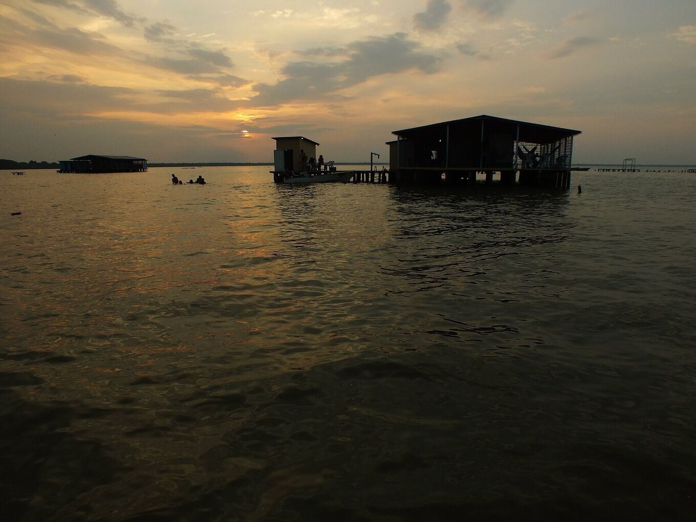
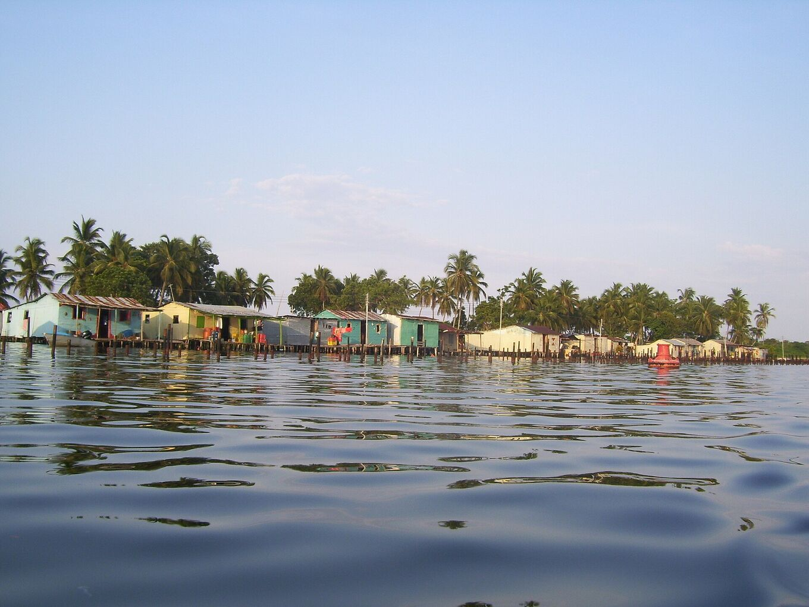
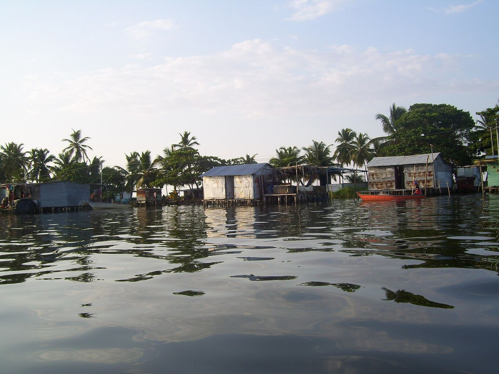
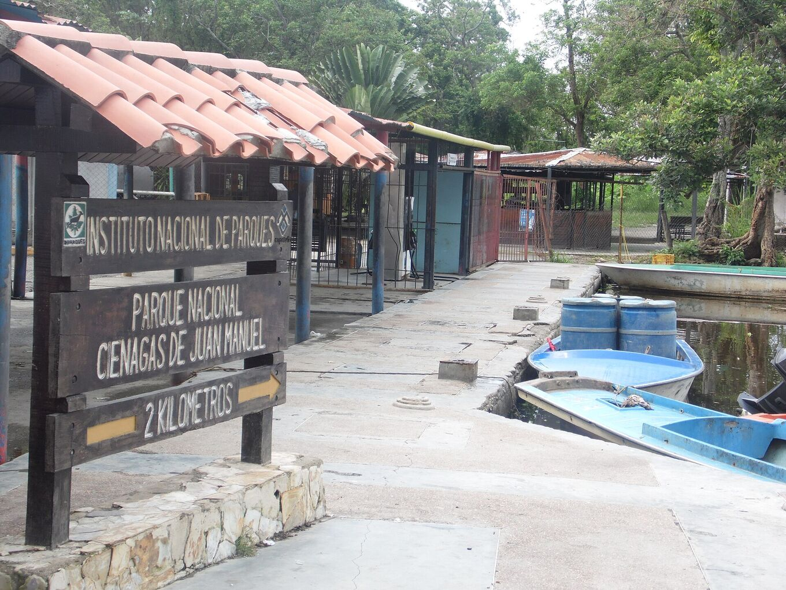

## Un lago, muchas orillas.

Los lugares institucionales y comunitarios que ordenan una visita: el área protegida donde nace la tormenta, los pueblos de palafitos desde donde se observa y el embarcadero de donde salen las lanchas.

El Lago de Maracaibo cubre unos 13.500 km². Se comunica con el Caribe por un estrecho al norte y lo alimentan decenas de ríos al sur. El mayor, el Catatumbo, aporta más de la mitad de su agua.

## El sur del lago

### Parque Nacional Ciénagas de Juan Manuel

*Área protegida · Inparques*

Humedales, manglares y caños en el delta del Catatumbo, al suroeste del lago. Es la zona donde se forma la tormenta. Lo administra el Instituto Nacional de Parques (Inparques); las visitas se hacen con guías autorizados. [Wikipedia](https://es.wikipedia.org/wiki/Parque_nacional_Ci%C3%A9nagas_de_Juan_Manuel)

También se llama Ciénagas del Catatumbo, o Aguas Blancas y Aguas Negras. Es una llanura plana e inundada entre la Sierra de Perijá y el lago, con temperaturas de 22–32 °C y una humedad muy alta. Las aves están por todas partes: garzas blancas, garzas azules, garzones soldados, patos, gaviotas, charranes y caracaras.

*[Juan Pablo Bottaro · Wikimedia Commons · CC BY-SA 4.0](https://commons.wikimedia.org/wiki/File:Lago_en_llamas.jpg)*

### Ologá

*Comunidad del lago · palafitos*

Pueblo de palafitos a unos diez minutos en lancha de Congo Mirador. Hoy es la base principal para observar el relámpago, con campamentos y posadas sencillas sobre el agua.

Algunas de sus casas vinieron de Congo Mirador: al estar sobre pilotes, se podían subir a dos lanchas y mudarlas hasta aquí.

*[Yinette Bracho Padilla · Wikimedia Commons · CC BY-SA 4.0](https://commons.wikimedia.org/wiki/File:Palafitos_del_pueblo_de_Olog%C3%A1.jpg)*

### Congo Mirador

*Comunidad del lago · palafitos*

Fue el pueblo más conocido para ver el relámpago. La sedimentación del lago y la crisis económica vaciaron el pueblo: hacia 2018 se había ido cerca del 90 % de sus habitantes y muchas casas se trasladaron a Ologá. [Wikipedia](https://es.wikipedia.org/wiki/Congo_Mirador)

El pueblo tiene al menos 200 años y vivió de la pesca y, más tarde, de los visitantes. A finales de los años setenta tenía unos 930 habitantes, y cerca de mil en 2013. Los vecinos culpan de la sedimentación a un caño de tres kilómetros abierto desde el río Bravo en 1991, el «Caño J». En 2021 quedaban unas cinco personas. Su historia se cuenta en el documental *Érase una vez en Venezuela* (2020), de Anabel Rodríguez Ríos.

*[Yinette Bracho Padilla · Wikimedia Commons · CC BY-SA 4.0](https://commons.wikimedia.org/wiki/File:Palafitos_de_Congo_Mirador.jpg)*

### Puerto Concha

*Embarcadero · punto de salida*

Embarcadero cercano a Santa Bárbara del Zulia desde donde salen las lanchas hacia Ologá y el delta. Desde el aeropuerto de El Vigía se llega por carretera.

Santa Bárbara es la ciudad ganadera del sur del lago, conocida por su queso y sus plátanos. Abastécete allí de efectivo, agua y provisiones: sobre el agua no hay tiendas.

*[Yoser Linares · Wikimedia Commons · CC BY-SA 4.0](https://commons.wikimedia.org/wiki/File:Puerto_Concha.jpg)*
