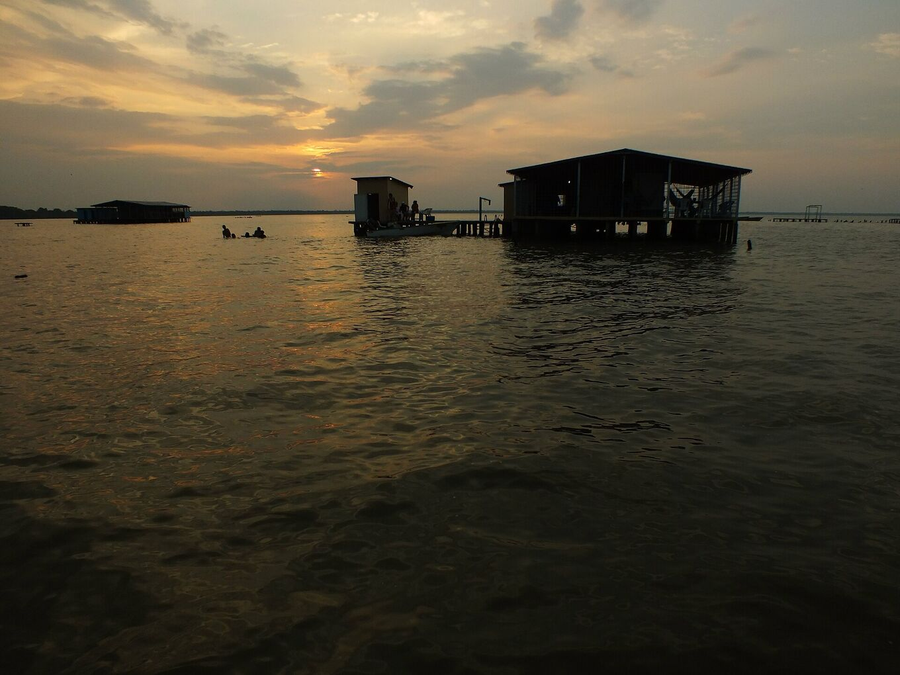
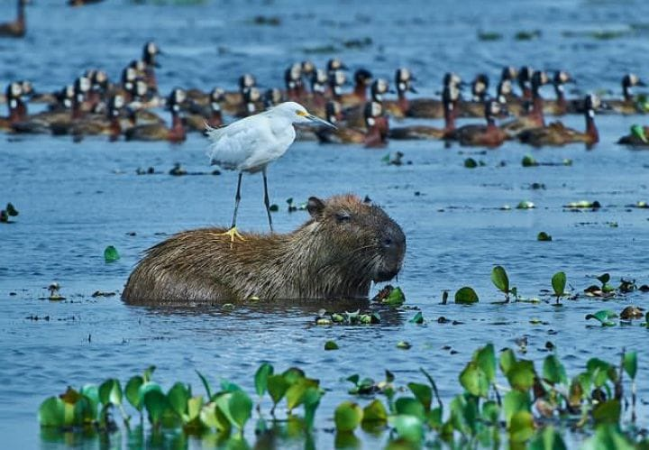

## Donde nace la tormenta

Humedales, manglares y canales en el delta del Catatumbo, al suroeste del Lago de Maracaibo. Es la zona sobre la que se forma la tormenta casi cada noche. Lo administra el Instituto Nacional de Parques (Inparques); las visitas se hacen con guías autorizados.

También se llama Ciénagas de Juan Manuel, o Aguas Blancas y Aguas Negras. Es una llanura plana e inundada entre la Sierra de Perijá y el lago, sin cerros ni desniveles, con temperaturas de 22–32 °C y una humedad muy alta.

*[Juan Pablo Bottaro · Wikimedia Commons · CC BY-SA 4.0](https://commons.wikimedia.org/wiki/File:Lago_en_llamas.jpg)*

| Cifra | Qué significa |
| --- | --- |
| 1991 | Año en que se declaró parque nacional |
| ≈ 2.260 km² | Superficie, en dos sectores |
| 212 | Especies de aves registradas |
| 22–32 °C | Temperatura habitual |
| 2 m | Lo que puede subir el agua en la temporada de lluvias |

## Ríos y lagunas

El parque ocupa la llanura del delta, casi al nivel del lago. Lo cruzan ríos de aguas blancas, turbias por el sedimento que bajan de las montañas, como el Catatumbo, el Bravo y el Santa Ana. Entre ellos hay lagunas de aguas negras, oscuras por la materia vegetal, como La Estrella, El Congo y Ologá.

En la temporada de lluvias el agua sube hasta dos metros y la llanura se inunda. La mayor parte del parque son herbazales de pantano. En las orillas crecen manglares de mangle rojo y bosques inundables con palmas, y a lo largo del Catatumbo quedan bosques ribereños.

Junto al parque está otra área protegida, la Reserva de Fauna Silvestre Ciénagas de Juan Manuel, Aguas Blancas y Aguas Negras. Las dos figuran como Áreas Clave para la Biodiversidad.

## Fauna

### Aves

Se han registrado 212 especies. Desde la lancha se ven garzas blancas, garzas azules, jabirús, patos, gaviotas, charranes y caracaras. Busca también el chavarrí (*Chauna chavaria*), un ave grande de pantano que solo vive en las cuencas del Lago de Maracaibo y del río Magdalena, y el aruco (*Anhima cornuta*).

### En el agua

En los canales y lagunas viven el manatí (*Trichechus manatus*) y el caimán de la costa (*Crocodylus acutus*), dos especies amenazadas. Cerca de la desembocadura del Catatumbo se ven delfines costeros (*Sotalia guianensis*). Hay también caimanes de anteojos, iguanas y nutrias de río.

### En la orilla

En las orillas se ven chigüires, el roedor más grande del mundo, y en los árboles se oyen los monos araguatos. Los inventarios de fauna citan además el jaguar, el ocelote y la nutria gigante. Son difíciles de ver, así que no cuentes con encontrarlos.

## Amenazas

Los derrames de petróleo que llegan a la orilla son la amenaza más grave. También la tala para construir y para abrir potreros, los incendios, los diques que cambian el drenaje natural y la caza ilegal. Parte de la actividad turística no está regulada, así que elige operadores que respeten las normas del parque.

## Visitar el parque

Se entra en lancha desde Puerto Concha, cerca de Santa Bárbara del Zulia. La ruta sigue los canales y manglares del parque y sale al lago hacia Ologá. La mayoría de las excursiones al relámpago ya lo recorren.

- Ve siempre con un guía autorizado y usa el chaleco salvavidas en cada trayecto.
- Llévate tu basura, porque sobre el agua no hay dónde dejarla.
- No hagas fuego. Los incendios son una de las amenazas del parque.
- No alimentes ni persigas a los animales. Guarda distancia con manatíes y caimanes.
- No compres animales silvestres ni productos hechos con ellos.

## Fuentes

Las cifras de superficie y especies son de Inparques (1996), según Key Biodiversity Areas. Otras fuentes dan cifras algo distintas.

- [Wikipedia · Parque nacional Ciénagas del Catatumbo](https://es.wikipedia.org/wiki/Parque_nacional_Ci%C3%A9nagas_del_Catatumbo)
- [Key Biodiversity Areas · Parque Nacional Ciénagas de Juan Manuel](https://www.keybiodiversityareas.org/site/factsheet/14955)
- [Key Biodiversity Areas · Reserva de Fauna Silvestre Ciénagas de Juan Manuel](https://www.keybiodiversityareas.org/site/factsheet/14956)
- [IMMA · Sistema del Lago de Maracaibo](https://www.marinemammalhabitat.org/wp-content/uploads/imma-factsheets/NorthWestAtlanticOceanWiderCaribbean/Maracaibo-Lake-System-NorthWestAtlanticOceanWiderCaribbean.pdf)
