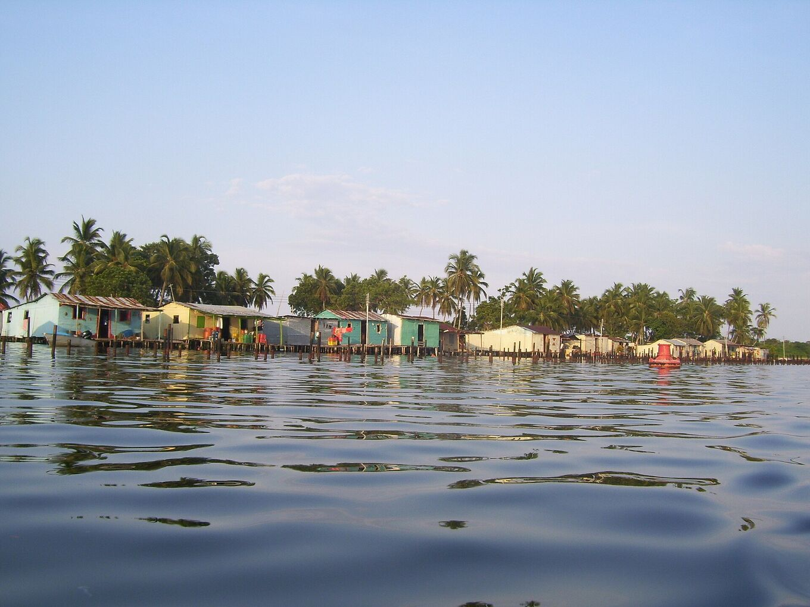
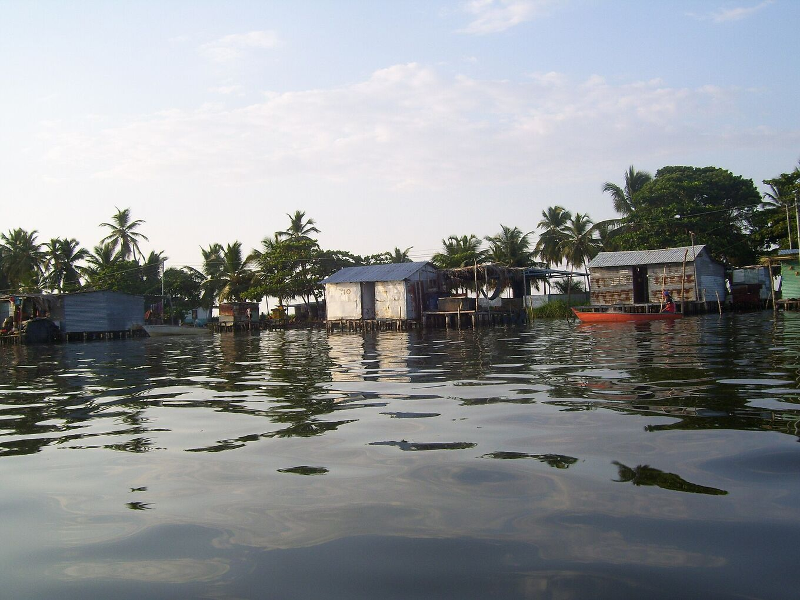
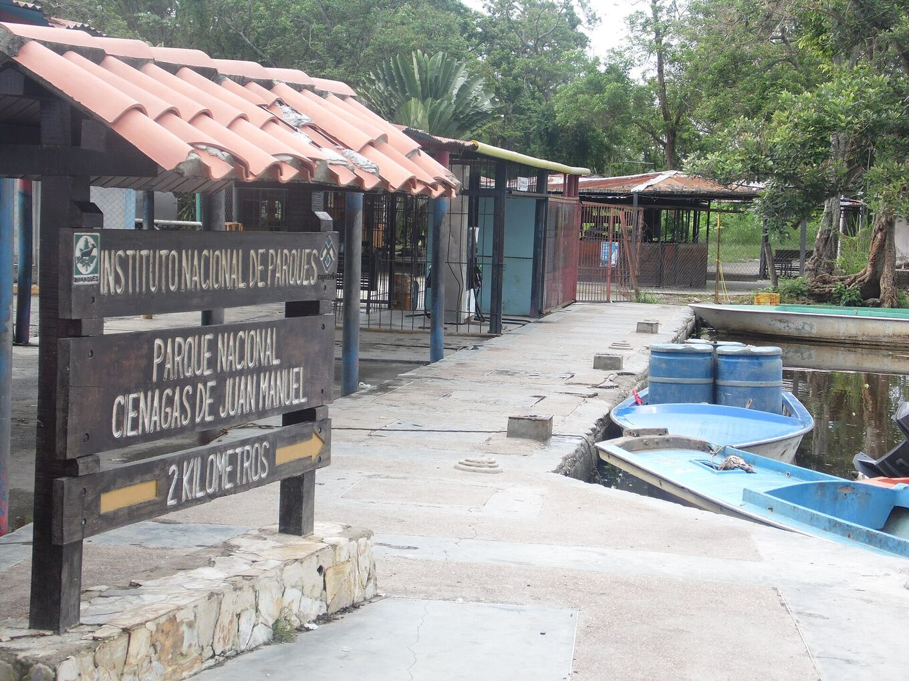
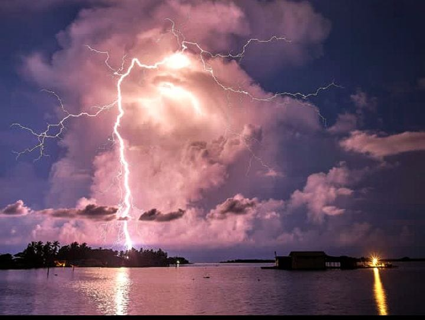

## El Lago de Maracaibo

Los pueblos de palafitos desde donde se observa la tormenta y el embarcadero de donde salen las lanchas. El área protegida donde nace la tormenta, el Parque Nacional Ciénagas del Catatumbo, tiene su propia página.

El Lago de Maracaibo cubre unos 13.500 km². Se comunica con el Caribe por un estrecho al norte y lo alimentan decenas de ríos al sur. El mayor, el Catatumbo, aporta más de la mitad de su agua.

Vivir sobre el agua es antiguo aquí. Los añú, pueblo indígena del lago, ya construían palafitos cuando llegaron los españoles en 1499.

## El sur del lago

### Ologá

*Comunidad del lago · palafitos*

Pueblo de palafitos a unos diez minutos en lancha de Congo Mirador. Hoy es la base principal para observar el relámpago, con campamentos y posadas sencillas sobre el agua.

Algunas de sus casas vinieron de Congo Mirador. Al estar sobre pilotes, se podían subir a dos lanchas y mudarlas hasta aquí.

*[Yinette Bracho Padilla · Wikimedia Commons · CC BY-SA 4.0](https://commons.wikimedia.org/wiki/File:Palafitos_del_pueblo_de_Olog%C3%A1.jpg)*

### Congo Mirador

*Comunidad del lago · palafitos*

Fue el pueblo más conocido para ver el relámpago. La sedimentación del lago y la crisis económica vaciaron el pueblo. Hacia 2018 se había ido cerca del 90 % de sus habitantes y muchas casas se trasladaron a Ologá. [Wikipedia](https://es.wikipedia.org/wiki/Congo_Mirador)

El pueblo tiene al menos 200 años y vivió de la pesca y, más tarde, de los visitantes. A finales de los años setenta tenía unos 930 habitantes, y cerca de mil en 2013. Los vecinos culpan de la sedimentación a un caño de tres kilómetros abierto desde el río Bravo en 1991, el "Caño J". En 2021 quedaban unas cinco personas. Su historia se cuenta en el documental *Érase una vez en Venezuela* (2020), de Anabel Rodríguez Ríos.

*[Yinette Bracho Padilla · Wikimedia Commons · CC BY-SA 4.0](https://commons.wikimedia.org/wiki/File:Palafitos_de_Congo_Mirador.jpg)*

### Puerto Concha

*Embarcadero · punto de salida*

Embarcadero cercano a Santa Bárbara del Zulia desde donde salen las lanchas hacia Ologá y el delta. Desde el aeropuerto de El Vigía se llega por carretera.

Santa Bárbara es la ciudad ganadera del sur del lago, conocida por su queso y sus plátanos. Abastécete allí de efectivo, agua y provisiones, porque sobre el agua no hay tiendas.

*[Yoser Linares · Wikimedia Commons · CC BY-SA 4.0](https://commons.wikimedia.org/wiki/File:Puerto_Concha.jpg)*

## La vida sobre el agua

Ologá, en la parroquia Encontrados del municipio Catatumbo, es una de las zonas más aisladas del sur del lago. Es el lugar desde donde el mundo mira el relámpago, pero sus vecinos viven con muy poco.

- No hay red de agua potable ni saneamiento. El agua dulce llega en lancha desde tierra firme.
- La electricidad sale de plantas privadas que funcionan pocas horas, y casi no hay internet.
- El ambulatorio tiene poco personal y pocas medicinas. Una emergencia obliga a un largo viaje en lancha.
- La pesca artesanal es el principal sustento. Los intermediarios fijan el precio del pescado, y la gasolina, escasa y cara, paraliza la pesca.
- El dinero del turismo llega por temporadas y se queda sobre todo en operadoras de fuera.

Por eso importa contratar lancheros, guías y cocineras de la comunidad (ver Viaje responsable).

