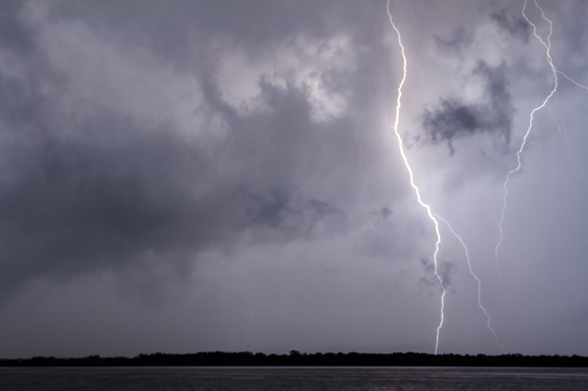
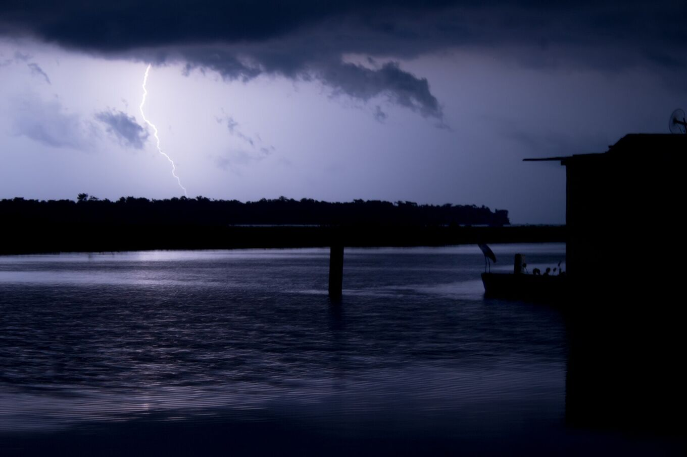
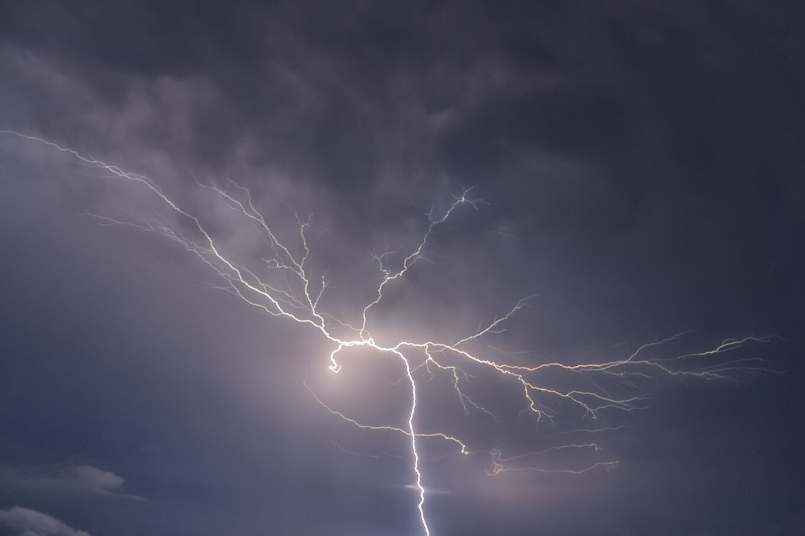

## Una tormenta que vuelve casi cada noche.

El Relámpago del Catatumbo es una tormenta eléctrica que se forma de noche sobre el suroeste del Lago de Maracaibo y las ciénagas cercanas a la desembocadura del río Catatumbo. Desde la orilla se ve como un resplandor casi continuo en las nubes, a veces sin trueno audible porque la tormenta está lejos.

No es un espectáculo programado: cada noche es distinta. Hay noches de cientos de destellos y noches tranquilas. La actividad depende del viento, la humedad y la estación.

*[Fernando Flores · Wikimedia Commons · CC BY-SA 2.0](https://commons.wikimedia.org/wiki/File:Catatumbo_Lightning_-_Rayo_del_Catatumbo_%2825385580334%29.jpg)*

| Cifra | Qué significa |
| --- | --- |
| 140–160 | Noches con actividad al año |
| 16–40 | Destellos por minuto |
| ≈ 9 h | Duración típica por noche |
| 12–15 km | Altura que alcanzan las nubes de tormenta |
| 232,5 | Destellos por km² al año (NASA LIS, 2016) |

## Muchas tormentas, un solo nombre.

Los investigadores de la Universidad del Zulia prefieren hablar de *los relámpagos* del Catatumbo: cada noche se forman varias células de tormenta en distintos puntos del delta y del suroeste del lago. De lejos se funden en un solo resplandor.

Las nubes son cumulonimbos, las nubes de tormenta más altas, que suben hasta el techo de la troposfera tropical. La mayoría de los destellos ocurre dentro de las nubes o entre ellas, y las ilumina por dentro. Otros caen a tierra o al agua.

La luz llega mucho más lejos que el sonido. El trueno rara vez se oye a más de unos 20 km, mientras que el resplandor se ve desde mucho más lejos. Por eso, desde Maracaibo o la orilla, el relámpago parece mudo. Bajo la tormenta, el trueno es casi constante.

*[Fernando Flores · Wikimedia Commons · CC BY 3.0](https://commons.wikimedia.org/wiki/File:Catatumbo_Lightning_%28127737829%29.jpeg)*

## Cómo se forma.

### Humedad

El lago es cálido y evapora mucha agua. Los alisios del Caribe empujan ese aire húmedo hacia el sur de la cuenca.

### Relieve

La cuenca está cerrada por la Sierra de Perijá al oeste y la Cordillera de Mérida al sureste. El aire queda encajonado entre montañas de más de 3.000 m.

### Convergencia nocturna

De noche, el aire frío que baja de las montañas se encuentra con el aire caliente del lago. Esa corriente obliga al aire húmedo a subir y forma nubes de tormenta casi en el mismo lugar.

### El viento de la noche

Una corriente de viento, el chorro nocturno de bajo nivel del Lago de Maracaibo, cruza la cuenca de noche. Cuando sopla fuerte y el aire tiene mucha energía para tormentas (lo que los meteorólogos llaman CAPE), hay más rayos. En 2016 un equipo de la Universidad del Zulia usó esa relación para publicar el primer pronóstico estacional de rayos del mundo, con meses de antelación.

> Durante años se propuso que el metano de las ciénagas y del petróleo explicaba el fenómeno. Los estudios recientes lo atribuyen sobre todo al viento y al relieve; el papel del metano sigue en discusión.

El modelo del metano tampoco supera una prueba sencilla: predice más rayos en la estación seca, y los registros muestran lo contrario.

## El año del relámpago.

Septiembre a noviembre suelen ser los meses más activos; enero y febrero, los más tranquilos. Es una tendencia orientativa: en 2010 la sequía apagó el relámpago de enero a marzo.

El ritmo sigue a las lluvias. La franja de lluvias tropicales se desplaza al norte y al sur a lo largo del año y trae dos temporadas húmedas: una primera en abril y mayo, y otra más fuerte en la segunda mitad del año, con el máximo hacia septiembre y octubre. Fenómenos climáticos como El Niño la alteran de un año a otro: el silencio de 2010 llegó con una sequía de El Niño.

Dentro de una noche, la actividad suele empezar al anochecer, crecer después de oscurecer y alcanzar su punto más fuerte hacia la medianoche y la madrugada. En los meses más secos puede aparecer como relámpago seco, sin lluvia.

*[Fernando Flores · Wikimedia Commons · CC BY-SA 2.0](https://commons.wikimedia.org/wiki/File:Catatumbo_Lightning_-_Rayo_del_Catatumbo_%2822668686290%29.jpg)*

## Lo que no es.

### «Regenera la capa de ozono»

Falso. Los rayos producen ozono en la parte baja de la atmósfera, la troposfera. La capa de ozono está en la estratosfera, a unos 25 km de altura sobre el trópico. El ozono de la tormenta se dispersa y no la repara. Ningún estudio respalda esa idea.

### «Es un relámpago silencioso»

No lo es. El trueno existe; solo que no llega a quien mira desde decenas de kilómetros.

### «Lo causa el uranio del subsuelo»

Una hipótesis de los años noventa que nunca se comprobó.
