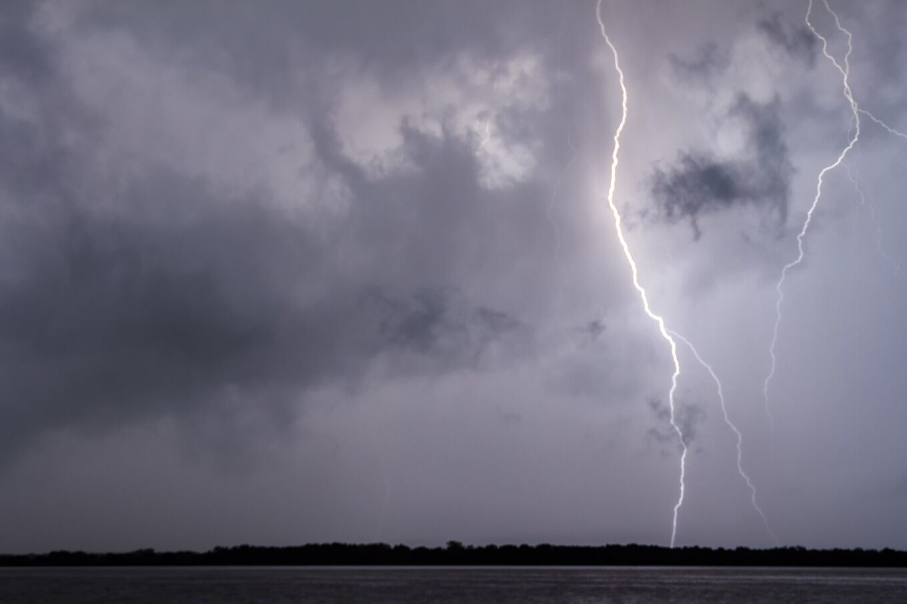
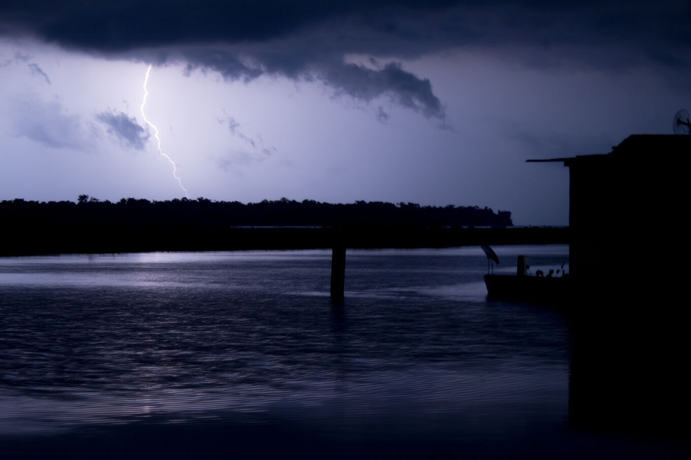

## Una tormenta que vuelve casi cada noche

El Relámpago del Catatumbo es una tormenta eléctrica que se forma de noche sobre el suroeste del Lago de Maracaibo y las ciénagas cercanas a la desembocadura del río Catatumbo. Desde la orilla se ve como un resplandor casi continuo en las nubes, a veces sin trueno audible porque la tormenta está lejos.

Cada noche es distinta. Hay noches muy activas y noches tranquilas. La actividad depende del viento, la humedad y la estación.

*[Fernando Flores · Wikimedia Commons · CC BY-SA 2.0](https://commons.wikimedia.org/wiki/File:Catatumbo_Lightning_-_Rayo_del_Catatumbo_%2825385580334%29.jpg)*

| Cifra | Qué significa |
| --- | --- |
| 140–160 | Noches con actividad al año |
| 16–40 | Destellos por minuto |
| ≈ 9 h | Duración típica por noche |
| 12–15 km | Altura que alcanzan las nubes de tormenta |
| 232,5 | Destellos por km² al año (NASA LIS, 2016) |

## Muchas tormentas, un solo nombre

Los investigadores de la Universidad del Zulia prefieren hablar de *los relámpagos* del Catatumbo, porque cada noche se forman varias células de tormenta en distintos puntos del delta y del suroeste del lago. De lejos se funden en un solo resplandor.

Las nubes son cumulonimbos, las nubes de tormenta más altas, que suben hasta el techo de la troposfera tropical. La mayoría de los destellos ocurre dentro de las nubes o entre ellas, y las ilumina por dentro. Otros caen a tierra o al agua.

La luz llega mucho más lejos que el sonido. El trueno rara vez se oye a más de unos 20 km, mientras que el resplandor se ve desde mucho más lejos. Por eso, desde Maracaibo o la orilla, el relámpago parece mudo. Bajo la tormenta, el trueno es casi constante.

*[Fernando Flores · Wikimedia Commons · CC BY 3.0](https://commons.wikimedia.org/wiki/File:Catatumbo_Lightning_%28127737829%29.jpeg)*

## Cómo se forma

### Humedad

El lago es cálido y evapora mucha agua. Los alisios del Caribe empujan ese aire húmedo hacia el sur de la cuenca.

### Relieve

La cuenca está cerrada por la Sierra de Perijá al oeste y la Cordillera de Mérida al sureste. El aire queda encajonado entre montañas de más de 3.000 m.

### Convergencia nocturna

De noche, el aire frío que baja de las montañas se encuentra con el aire caliente del lago. Esa corriente obliga al aire húmedo a subir y forma nubes de tormenta casi en el mismo lugar.

### El viento de la noche

Una corriente de viento, el chorro nocturno de bajo nivel del Lago de Maracaibo, cruza la cuenca de noche. Cuando sopla fuerte y el aire tiene mucha energía para tormentas (lo que los meteorólogos llaman CAPE), hay más rayos. En 2016 un equipo de la Universidad del Zulia usó esa relación para publicar el primer pronóstico estacional de rayos del mundo, con meses de antelación.

> Durante años se propuso que el metano de las ciénagas y del petróleo explicaba el fenómeno. Los estudios recientes lo atribuyen sobre todo al viento y al relieve; el papel del metano sigue en discusión.

El modelo del metano tampoco supera una prueba sencilla. Predice más rayos en la estación seca, y los registros muestran lo contrario.

## Fuentes y lectura adicional

- [Albrecht et al. · BAMS 2016](https://doi.org/10.1175/BAMS-D-14-00193.1)
- [Muñoz et al. · Atmospheric Research 2016 · pronóstico estacional de rayos](https://doi.org/10.1016/j.atmosres.2015.12.018)
- [Wikipedia · Relámpago del Catatumbo](https://es.wikipedia.org/wiki/Rel%C3%A1mpago_del_Catatumbo)
- [Wikipedia · Lago de Maracaibo](https://es.wikipedia.org/wiki/Lago_de_Maracaibo)
- [Wikipedia · Congo Mirador](https://es.wikipedia.org/wiki/Congo_Mirador)
- [Blitzortung · rayos en tiempo real](https://www.blitzortung.org/)
- [NASA Earthdata · The Maracaibo Beacon](https://www.earthdata.nasa.gov/news/feature-articles/maracaibo-beacon)
- [Vídeo · ScienceABC · What Is The Beacon Of Maracaibo? (en inglés)](https://www.youtube.com/watch?v=iPw2KFU2raw)
