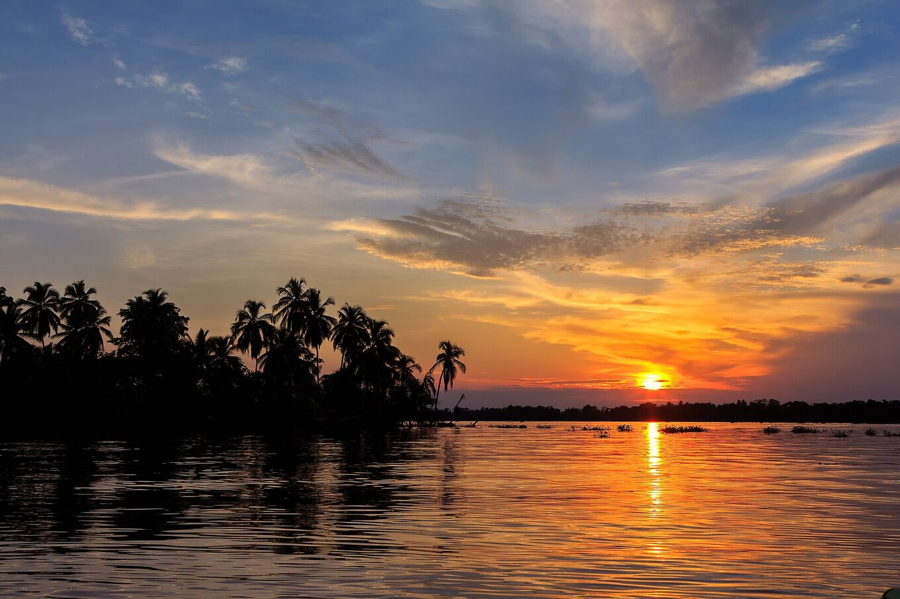
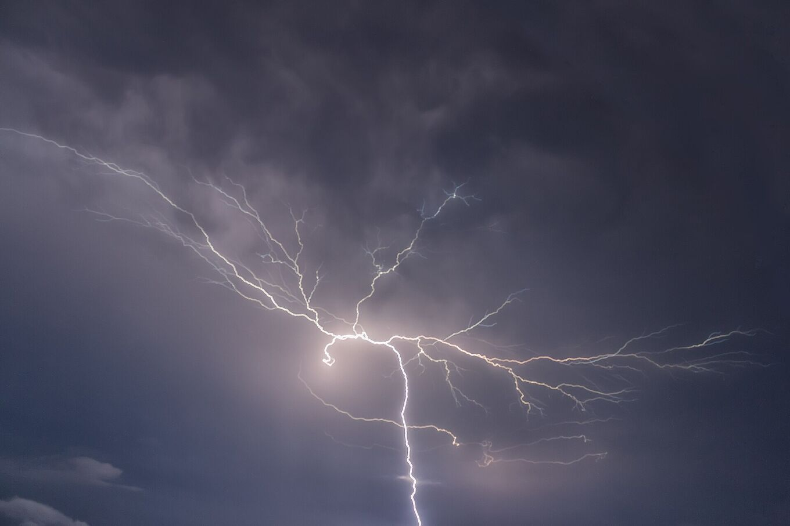

## Cuándo ir

La tormenta empieza al anochecer y suele durar hasta la madrugada. De septiembre a noviembre son los meses más activos. Consulta el pronóstico del tiempo la misma tarde de la excursión.

Abril y mayo traen un segundo máximo, más pequeño. Enero y febrero son los meses más tranquilos, con menos tormentas, pero también días más secos y agua más calma. Llega antes de la puesta de sol, porque el atardecer sobre el lago también forma parte del espectáculo.

¿Pasas por Maracaibo en noviembre? La Feria de la Chinita, del 11 al 18 de noviembre, llena la ciudad de gaitas, procesiones y gente.

*[Fernando Flores · Wikimedia Commons · CC BY-SA 2.0](https://commons.wikimedia.org/wiki/File:Sunset_at_Congo_Mirador_%2823978940929%29.jpg)*

## El año del relámpago

El ritmo sigue a las lluvias. La franja de lluvias tropicales se desplaza al norte y al sur a lo largo del año y trae dos temporadas húmedas, una primera en abril y mayo y otra más fuerte en la segunda mitad del año, con el máximo hacia septiembre y octubre. Fenómenos climáticos como El Niño la alteran de un año a otro. La sequía que apagó el relámpago de enero a marzo de 2010 llegó con El Niño.

Dentro de una noche, la actividad suele empezar al anochecer, crecer después de oscurecer y alcanzar su punto más fuerte hacia la medianoche y la madrugada. En los meses más secos puede aparecer como relámpago seco, sin lluvia.

*[Fernando Flores · Wikimedia Commons · CC BY-SA 2.0](https://commons.wikimedia.org/wiki/File:Catatumbo_Lightning_-_Rayo_del_Catatumbo_%2822668686290%29.jpg)*
