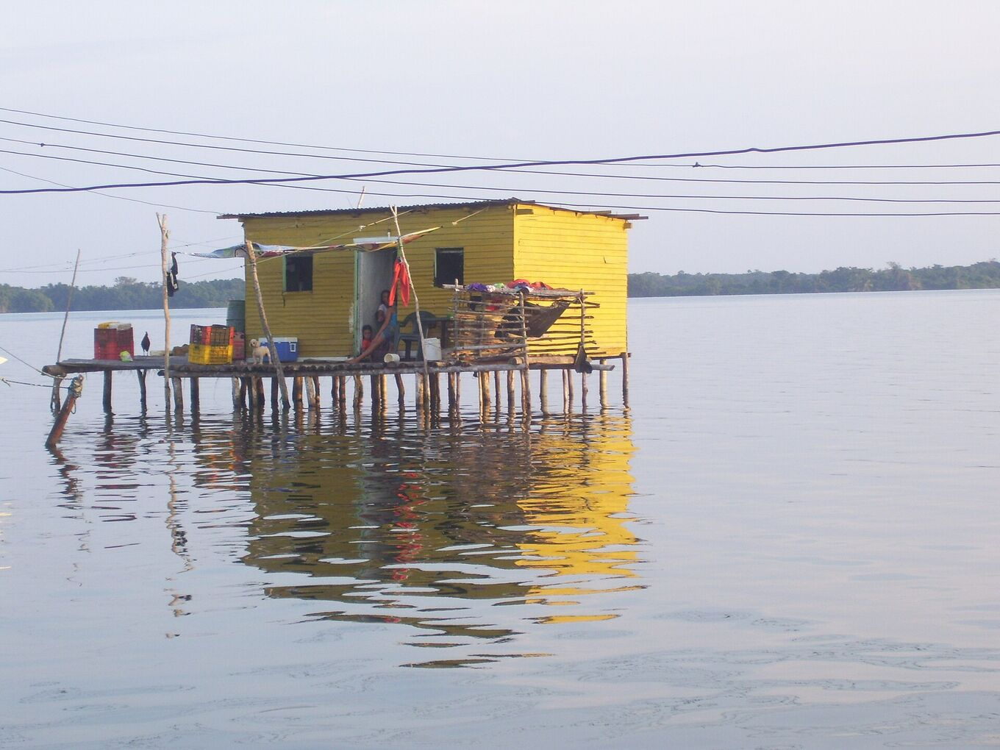

## Excursiones con guía

La excursión suele durar dos o tres días, con traslado por carretera hasta el embarcadero, lancha por el río y el lago, y noche en un palafito frente a la tormenta. Con un operador local es más sencilla y más segura.

*[Yinette Bracho Padilla · Wikimedia Commons · CC BY-SA 4.0](https://commons.wikimedia.org/wiki/File:Palafito_en_medio_del_Parque_nacional.jpg)*

### Antes de reservar, pregunta

- Qué incluye el precio, como traslados, lancha, comidas, agua potable y dónde se duerme (hamaca o cama).
- Desde dónde sale y cuándo vuelve. Muchas excursiones salen de Mérida.
- Qué medidas de seguridad tienen, como chalecos salvavidas para todos y una lancha en buen estado, y qué hacen si la tormenta se acerca o sube el viento.
- Si respetan las normas del parque nacional y trabajan de acuerdo con las comunidades de los palafitos.
- Qué idiomas habla el guía y de cuántas personas es el grupo.
- En qué moneda se paga, si aceptan tarjeta o solo efectivo, y qué pasa si el tiempo obliga a suspender.
- Qué pasa si la noche está tranquila y no hay relámpago. Nadie puede prometer la tormenta.
- Qué hay en el lugar (baños, agua potable, electricidad para cargar) y cómo piden ayuda sin señal de teléfono.
- Si están inscritos en el Registro Turístico Nacional (RTN).

### Señales de alerta

- Un precio muy por debajo del resto.
- Sin chalecos salvavidas, o sin suficientes para todo el grupo.
- Ofertas de navegar bajo la tormenta para sacar mejores fotos.
- Presión para pagar todo por adelantado, en efectivo y sin recibo.
- Ningún plan claro para el mal tiempo.

## Instituciones y aliados

Organismos y empresas que trabajan por el turismo en el sur del lago:

- **Turismo:** INATUR Zulia (Instituto Nacional de Turismo) y la Corporación Zuliana de Turismo.
- **Ciencia y ambiente:** la UNESUR (Universidad Nacional Experimental Sur del Lago), el ICLAM (Instituto para la Conservación del Lago de Maracaibo), el MINEC (Ministerio para el Ecosocialismo) y la [Fundación Finnova](https://www.finnova.com/).
- **Transporte aéreo:** el INAC (Instituto Nacional de Aeronáutica Civil).
- **Empresas:** YessTravels, Grupo San Simón, Junior Mall Hotel y Hotel Tibisay.
