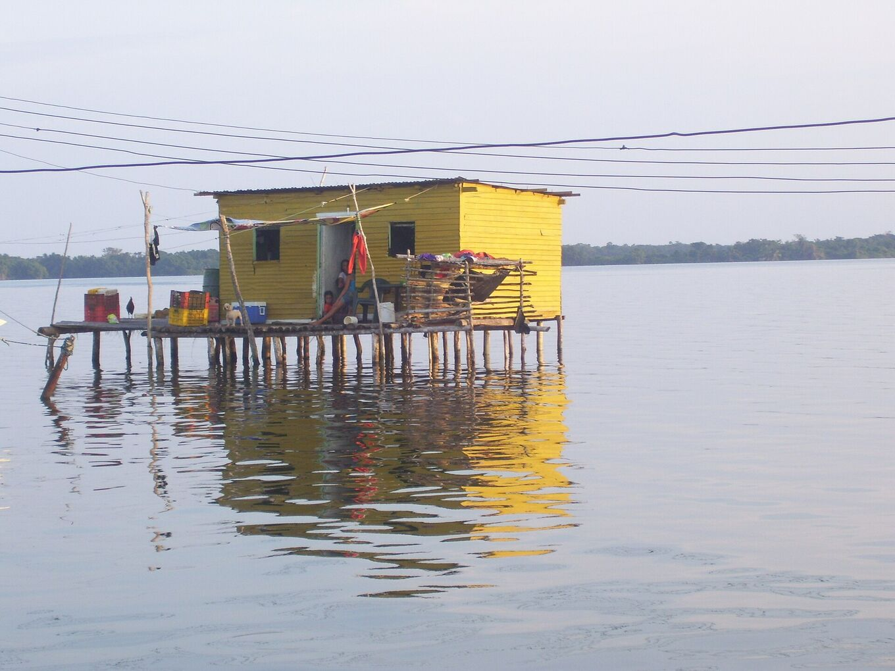
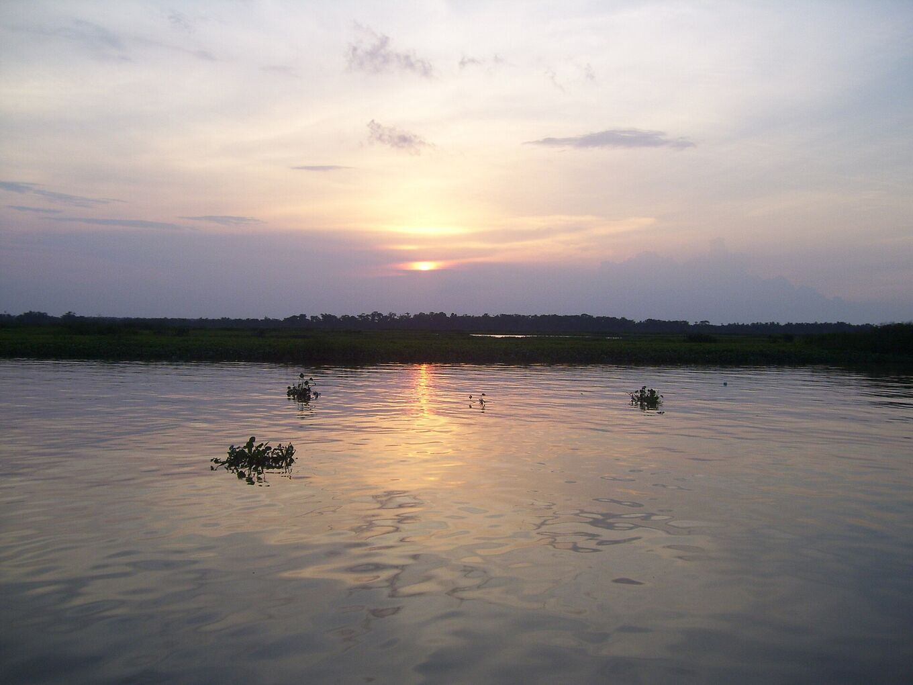

## Ve con quien conoce el lago.

La excursión suele durar dos o tres días: traslado por carretera hasta el embarcadero, lancha por el río y el lago, y noche en un palafito frente a la tormenta. Con un operador local es más sencilla y más segura.

*[Yinette Bracho Padilla · Wikimedia Commons · CC BY-SA 4.0](https://commons.wikimedia.org/wiki/File:Palafito_en_medio_del_Parque_nacional.jpg)*

### Una excursión típica

Cada operador tiene su itinerario. Uno de dos días suele ser así:

- **Día 1, mañana:** salida temprano desde Mérida, o recogida en el aeropuerto de El Vigía. Carretera hasta Puerto Concha.
- **Día 1, tarde:** lancha por los caños y manglares del parque nacional. Garzas y otras aves acuáticas por el camino. Llegada a Ologá antes del atardecer.
- **Día 1, noche:** cena, a menudo pescado del lago. Después, la tormenta, desde la terraza o desde la lancha a una distancia segura. Se duerme en hamaca o en cama, en un palafito.
- **Día 2:** amanecer sobre el lago, lancha de vuelta al embarcadero y regreso por carretera por la tarde.

Las excursiones de tres días suman más tiempo en el agua, una segunda noche de relámpagos o una parada en los Andes.

### Antes de reservar, pregunta

- **Qué incluye:** traslados, lancha, comidas, agua potable y dónde se duerme (hamaca o cama).
- **Desde dónde sale** y cuándo vuelve. Muchas excursiones salen de Mérida.
- **Seguridad:** chalecos salvavidas para todos, una lancha en buen estado y qué hacen si la tormenta se acerca o sube el viento.
- **Permisos:** que respeten las normas del parque nacional y trabajen de acuerdo con las comunidades de los palafitos.
- **Idiomas** del guía y tamaño del grupo.
- **Pago y cancelación:** en qué moneda, si aceptan tarjeta o solo efectivo, y qué pasa si el tiempo obliga a suspender.
- **Si no hay relámpago:** qué pasa si la noche está tranquila. Nadie puede prometer la tormenta.
- **En el lugar:** baños, agua potable, electricidad para cargar y cómo piden ayuda sin señal de teléfono.
- **Registro:** si están inscritos en el Registro Turístico Nacional (RTN).

### Señales de alerta

- Un precio muy por debajo del resto.
- Sin chalecos salvavidas, o sin suficientes para todo el grupo.
- Ofertas de navegar bajo la tormenta para sacar mejores fotos.
- Presión para pagar todo por adelantado, en efectivo y sin recibo.
- Ningún plan claro para el mal tiempo.

### Elige servicios locales

Contratar guías, lancheros y alojamientos de la zona deja el dinero en las comunidades que viven junto al relámpago.

Pregunta si los lancheros y quienes cocinan son de Ologá o de pueblos cercanos. Come lo que cocinan las familias y deja propina a guías y lancheros si el servicio fue bueno.

*[Yinette Bracho Padilla · Wikimedia Commons · CC BY-SA 4.0](https://commons.wikimedia.org/wiki/File:Lago_de_Maracaibo_desde_el_Parque_nacional.jpg)*
