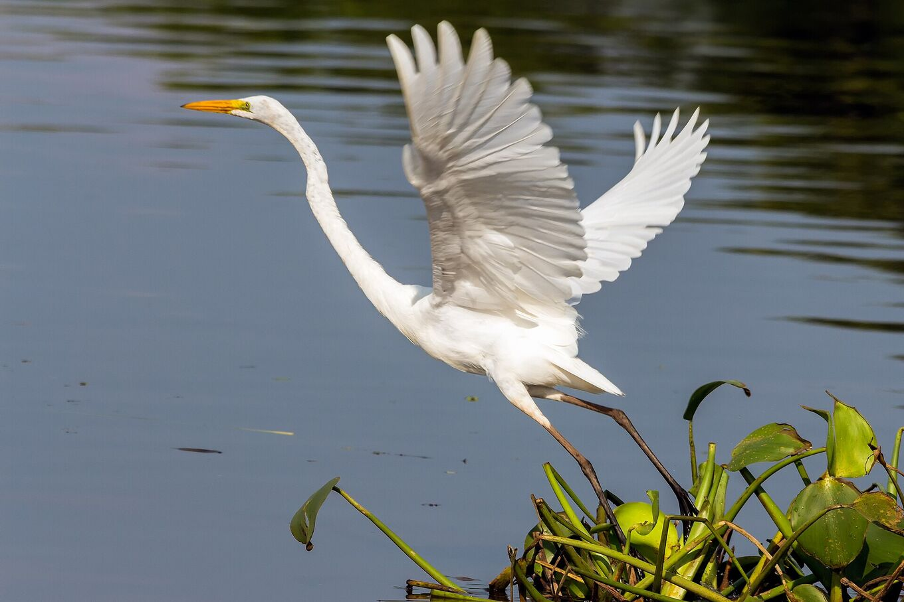

## Respeto

En Ologá y Congo Mirador vive gente. Pide permiso antes de fotografiar a las personas, contrata servicios locales y llévate tu basura. Respeta las normas de uso del parque nacional.

Las familias de los palafitos viven de la pesca y de los visitantes. Compra sus comidas y su artesanía. Guarda silencio de noche. Pide permiso antes de volar un dron. No alimentes ni persigas a los animales.

*[Fernando Flores · Wikimedia Commons · CC BY-SA 2.0](https://commons.wikimedia.org/wiki/File:Great_Egret_Garza_Real_%28Ardea_alba_egretta%29_%2824754473973%29.jpg)*

## Elige servicios locales

Contratar guías, lancheros y alojamientos de la zona deja el dinero en las comunidades que viven junto al relámpago.

Pregunta si los lancheros y quienes cocinan son de Ologá o de pueblos cercanos. Come lo que cocinan las familias y deja propina a guías y lancheros si el servicio fue bueno.

## Proyectos en las comunidades

Un proyecto agroturístico, "Al Relámpago del Catatumbo, por el río Catatumbo", propone mejorar la vida en Ologá y Congo Mirador con la [Fundación Finnova](https://www.finnova.com/). Entre sus metas:

- Paneles solares en los palafitos para dejar de usar el 90 % de las plantas eléctricas de gasolina.
- Biodigestores y humedales artificiales para tratar las aguas residuales.
- Rehabilitar 25 palafitos en cada pueblo.
- Lanchas de poco calado y poco ruido, y un centro de reciclaje con el principio de "residuo cero".
- Formar a 100 vecinos como guías, con INATUR, y que al menos el 30 % del gasto de los visitantes se quede en los pueblos.
- Una estación biológica, con la UNESUR, para estudiar el cambio climático, la sedimentación del Catatumbo y la contaminación.

También se ha anunciado una lancha ambulancia para los dos pueblos, de la Fundación Azul Ambientalistas y Venemergencia, con traslados de emergencia y telemedicina.

Tú puedes ayudar desde ya. Separa tu basura y llévatela a tierra firme, porque en los palafitos no hay recogida.
