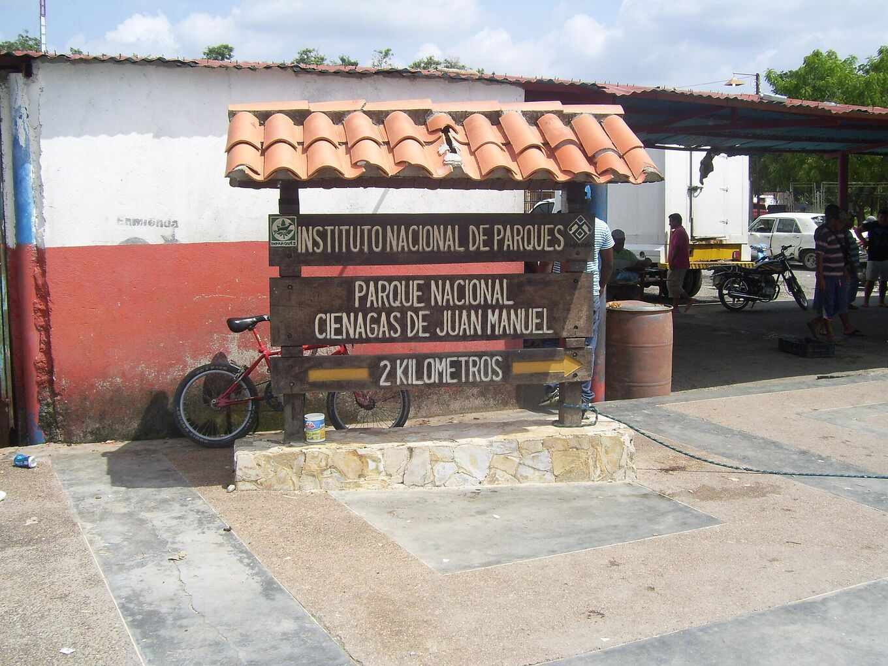
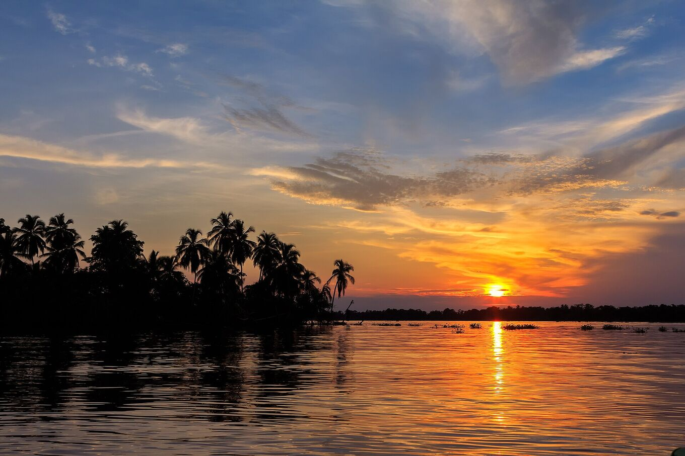
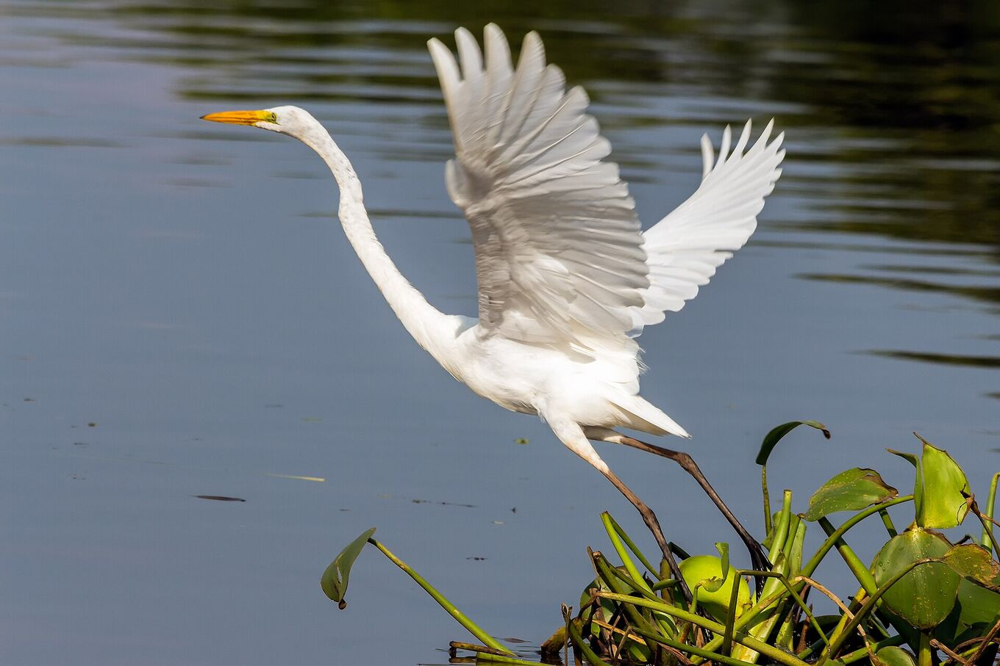

## Date tiempo. Ve con cuidado.

### Cómo llegar

La mayoría de las visitas salen en lancha desde Puerto Concha, cerca de Santa Bárbara del Zulia, hacia Ologá. El aeropuerto más cercano es El Vigía; Maracaibo queda a varias horas por carretera. Muchas agencias organizan la excursión desde Mérida.

Desde Mérida la carretera baja de los Andes a las llanuras del sur del lago, entre platanales y fincas ganaderas: unas cuatro horas hasta el embarcadero. Desde Puerto Concha la lancha sigue caños y manglares hasta el parque nacional y sale al lago. La travesía dura de una a dos horas, según la ruta y el nivel del agua.

Lleva el pasaporte o la cédula: en las carreteras hay alcabalas policiales y militares.

*[Yinette Bracho Padilla · Wikimedia Commons · CC BY-SA 4.0](https://commons.wikimedia.org/wiki/File:Entrada_al_parque_nacional.jpg)*

### Cuándo ir

La tormenta empieza al anochecer y suele durar hasta la madrugada. Septiembre a noviembre son los meses más activos. Consulta el pronóstico del tiempo la misma tarde de la excursión.

Abril y mayo traen un segundo máximo, más pequeño. Enero y febrero son los meses más tranquilos: menos tormentas, pero días más secos y agua más calma. Llega antes de la puesta de sol: el atardecer sobre el lago también forma parte del espectáculo.

¿Pasas por Maracaibo en noviembre? La Feria de la Chinita, del 11 al 18 de noviembre, llena la ciudad de gaitas, procesiones y gente.

*[Fernando Flores · Wikimedia Commons · CC BY-SA 2.0](https://commons.wikimedia.org/wiki/File:Sunset_at_Congo_Mirador_%2823978940929%29.jpg)*

### Qué llevar

Repelente, ropa de manga larga, chubasquero, linterna frontal, efectivo, agua potable y una bolsa seca para el teléfono y la cámara. En los palafitos la electricidad y la señal son limitadas.

Además: gorra y protector solar para la lancha, ropa ligera que seque rápido, una batería externa, algo de comer y tus medicamentos. La luz suele venir de una planta eléctrica, y solo unas horas.

### Salud

El sur del lago es caluroso y muy húmedo: 22–32 °C. Bebe agua a menudo. Los mosquitos salen al anochecer.

Consulta un centro de medicina del viajero unas semanas antes y pregunta por la vacuna de la fiebre amarilla y la prevención de la malaria en la zona. No bebas agua del lago ni te bañes en ella: hay partes contaminadas.

### Seguridad

Las tormentas implican riesgo. Sigue los avisos meteorológicos y las indicaciones de los guías locales. No navegues bajo la tormenta ni te refugies bajo árboles aislados. Emergencias: **VEN 911**.

En el agua abierta, una lancha es el punto más alto. Si oyes truenos, la tormenta está lo bastante cerca para alcanzarte: sal del agua y ponte bajo techo. Usa el chaleco salvavidas en cada trayecto.

Consulta las recomendaciones de viaje de tu país antes de reservar. Varios países desaconsejan viajar a Venezuela o a las zonas cercanas a la frontera con Colombia. Contrata un seguro de viaje que lo cubra.

### Fotografiar el relámpago

- **Cámara firme:** un trípode en la terraza del palafito. Desde la lancha, las fotos salen movidas.
- **Enfoque:** manual, a infinito. El autoenfoque falla en la oscuridad.
- **Exposición:** 10–30 s, ISO 800–3200, diafragma f/2,8–f/5,6. Dispara de forma continua y quédate con las mejores.
- **Teléfono:** modo noche, apoyado en algo firme.
- **Luz:** sin flash, linterna en rojo. Tus vecinos también están mirando.
- Guarda la cámara en la bolsa seca cuando llegue la lluvia.

### Respeto

Ologá y Congo Mirador son hogares, no decorados. Pide permiso antes de fotografiar a las personas, contrata servicios locales y llévate tu basura. El parque nacional tiene normas de uso: respétalas.

Las familias de los palafitos viven de la pesca y de los visitantes. Compra sus comidas y su artesanía. Guarda silencio de noche. Pide permiso antes de volar un dron. No alimentes ni persigas a los animales.

*[Fernando Flores · Wikimedia Commons · CC BY-SA 2.0](https://commons.wikimedia.org/wiki/File:Great_Egret_Garza_Real_%28Ardea_alba_egretta%29_%2824754473973%29.jpg)*

> Los traslados, horarios y precios cambian con las rutas, el nivel del agua y la disponibilidad local. Confírmalos con operadores de la zona antes de viajar.

## Fuentes y lectura adicional

- [Albrecht et al. · BAMS 2016](https://doi.org/10.1175/BAMS-D-14-00193.1)
- [Muñoz et al. · Atmospheric Research 2016 · pronóstico estacional de rayos](https://doi.org/10.1016/j.atmosres.2015.12.018)
- [Wikipedia · Relámpago del Catatumbo](https://es.wikipedia.org/wiki/Rel%C3%A1mpago_del_Catatumbo)
- [Wikipedia · Lago de Maracaibo](https://es.wikipedia.org/wiki/Lago_de_Maracaibo)
- [Wikipedia · Congo Mirador](https://es.wikipedia.org/wiki/Congo_Mirador)
- [Blitzortung · rayos en tiempo real](https://www.blitzortung.org/)
