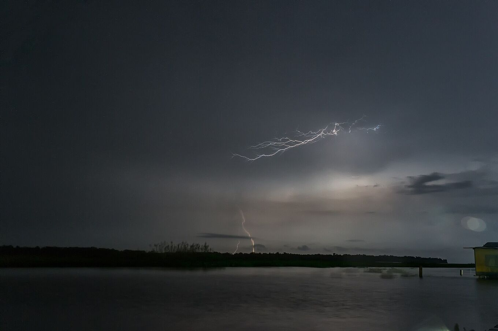

## Comment lire les prévisions.

- **Orage** est une estimation, pas une prévision de la foudre : personne ne peut savoir combien d’éclairs il y aura. *Probable* veut dire que le modèle prévoit un orage pendant la nuit, ou beaucoup d’énergie orageuse avec de la pluie probable. *Possible*, une énergie modérée et un peu de pluie.
- **Pluie** est la probabilité la plus haute entre 18:00 et 06:00.
- **Vent** est le vent moyen le plus fort de la nuit. Avec du vent, le lac s’agite et la traversée en bateau est moins confortable.
- Toutes les heures sont celles du Venezuela (UTC−4).

Même si les prévisions disent *peu probable*, la foudre peut apparaître : elle se forme au-dessus du lac avec les brises de la nuit, et les modèles météo voient mal une zone aussi petite. Confirmez avec votre guide l’après-midi de l’excursion.

### Ce que veut dire « énergie orageuse »

Les météorologues l’appellent CAPE : l’énergie que peut gagner une bulle d’air chaud et humide en montant. Plus il y en a, plus les nuages peuvent grandir, et ce sont les nuages hauts qui produisent la foudre. Au Catatumbo, la CAPE, avec le vent nocturne du lac, est le meilleur indice de l’activité d’une nuit.

*[Fernando Flores · Wikimedia Commons · CC BY-SA 2.0](https://commons.wikimedia.org/wiki/File:Catatumbo_Lightning-_Rayo_del_Catatumbo_%2828619470016%29.jpg)*

### La foudre en temps réel

Les prévisions disent ce qui peut arriver. Pour voir ce qui arrive, des réseaux bénévoles comme [Blitzortung](https://www.blitzortung.org/) cartographient les éclairs en temps réel. Au-dessus du Venezuela, la couverture est plus faible qu’en Europe et certains éclairs ne sont pas détectés.

### Hors connexion

La page garde sur votre téléphone les dernières prévisions téléchargées. Sans internet, elle les affiche avec leur date. Le reste du guide fonctionne normalement.

### D’où viennent les données

Du service gratuit [Open-Meteo](https://open-meteo.com/), qui combine des modèles météo nationaux, pour un point fixe à Congo Mirador. La page n’envoie pas votre position.

### La carte

La carte utilise les données d’[OpenFreeMap](https://openfreemap.org/), basées sur OpenStreetMap. Si vous touchez « Afficher ma position », votre position apparaît sur la carte avec sa précision, et la légende indique la distance à vol d’oiseau (pas par la route ni par le fleuve) jusqu’à chaque lieu. Votre position est utilisée seulement sur votre téléphone. Hors connexion, la carte montre un contour simplifié du lac et de la côte, et votre position fonctionne toujours. Les coordonnées des lieux viennent d’OpenStreetMap.
