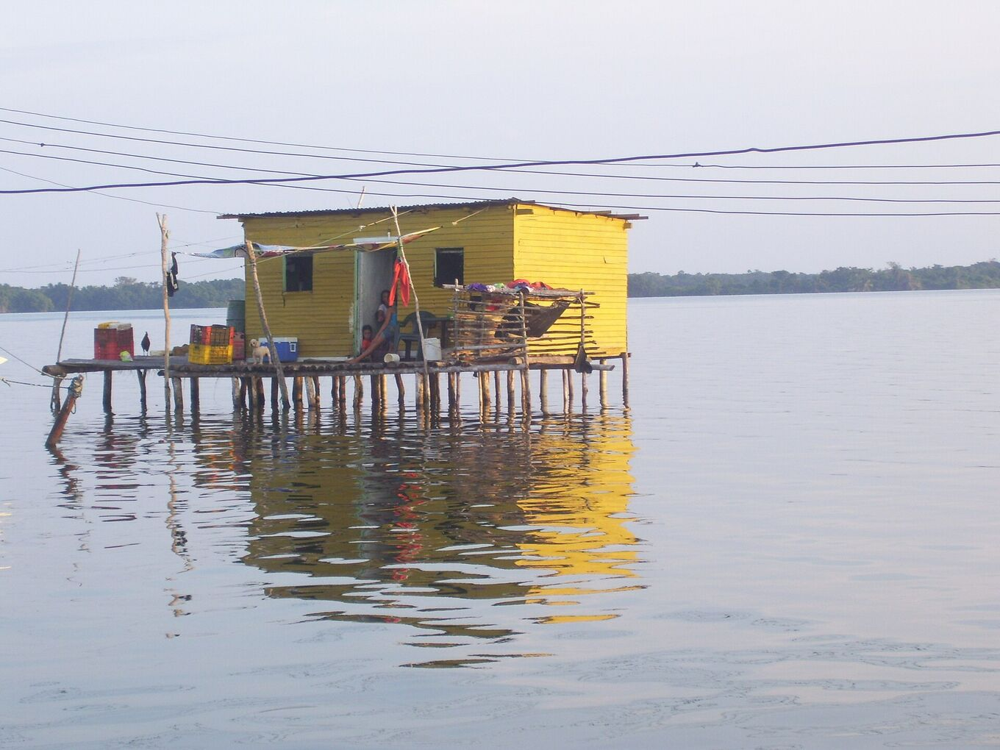
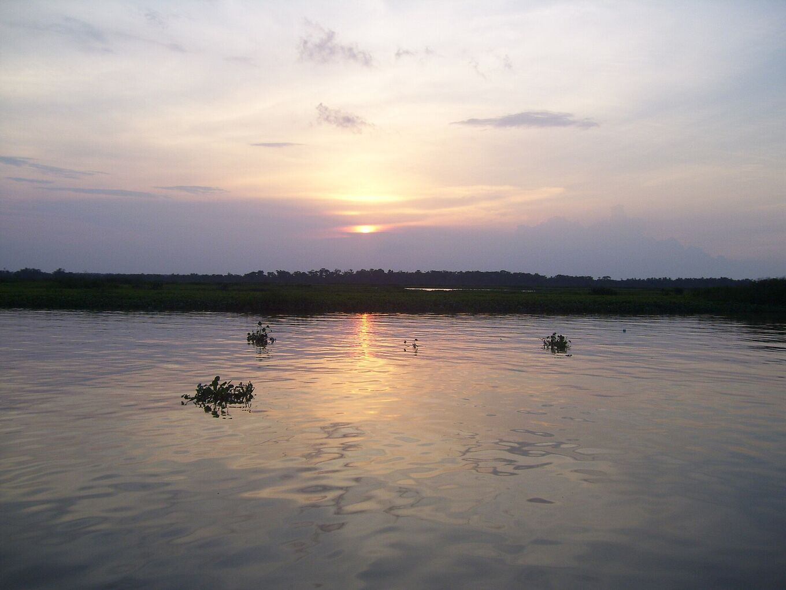

## Partez avec ceux qui connaissent le lac.

L’excursion dure en général deux ou trois jours : trajet en voiture jusqu’à l’embarcadère, bateau sur la rivière et le lac, puis une nuit dans une maison sur pilotis face à l’orage. Avec un opérateur local, elle est plus simple et plus sûre.

*[Yinette Bracho Padilla · Wikimedia Commons · CC BY-SA 4.0](https://commons.wikimedia.org/wiki/File:Palafito_en_medio_del_Parque_nacional.jpg)*

### Une excursion type

Chaque opérateur a son programme. Sur deux jours, cela ressemble souvent à ceci :

- **Jour 1, matin :** départ tôt de Mérida, ou accueil à l’aéroport d’El Vigía. Route jusqu’à Puerto Concha.
- **Jour 1, après-midi :** bateau dans les chenaux et les mangroves du parc national. Hérons, aigrettes et autres oiseaux d’eau en chemin. Arrivée à Ologá avant le coucher du soleil.
- **Jour 1, nuit :** dîner, souvent du poisson du lac. Puis l’orage, depuis la terrasse ou depuis le bateau à distance sûre. Nuit en hamac ou en lit dans une maison sur pilotis.
- **Jour 2 :** lever du soleil sur le lac, retour en bateau à l’embarcadère et route du retour l’après-midi.

Les excursions de trois jours ajoutent du temps sur l’eau, une seconde nuit d’éclairs ou une étape dans les Andes.

### Avant de réserver, demandez

- **Ce qui est inclus :** transferts, bateau, repas, eau potable et où l’on dort (hamac ou lit).
- **D’où part l’excursion** et quand elle revient. Beaucoup partent de Mérida.
- **La sécurité :** gilets de sauvetage pour tous, un bateau en bon état et ce qui est prévu si l’orage approche ou si le vent se lève.
- **Les autorisations :** que l’opérateur respecte les règles du parc national et travaille avec les communautés des maisons sur pilotis.
- **Les langues** du guide et la taille du groupe.
- **Le paiement et l’annulation :** quelle monnaie, carte ou espèces uniquement, et ce qui se passe si la météo oblige à annuler.
- **S’il n’y a pas d’éclairs :** ce qui se passe si la nuit est calme. Personne ne peut promettre l’orage.
- **Sur place :** toilettes, eau potable, électricité pour recharger, et comment appeler à l’aide sans réseau.
- **L’enregistrement :** s’ils sont inscrits au Registre national du tourisme du Venezuela (RTN).

### Signaux d’alerte

- Un prix très inférieur à celui des autres.
- Pas de gilets de sauvetage, ou pas assez pour tout le groupe.
- Des offres pour naviguer sous l’orage et faire de meilleures photos.
- Une pression pour tout payer d’avance, en espèces, sans reçu.
- Aucun plan clair en cas de mauvais temps.

### Choisissez des services locaux

Engager des guides, des bateliers et des hébergements de la région laisse l’argent aux communautés qui vivent à côté de la foudre.

Demandez si les bateliers et les cuisiniers viennent d’Ologá ou des villages voisins. Mangez ce que cuisinent les familles et laissez un pourboire aux guides et aux bateliers si le service était bon.

*[Yinette Bracho Padilla · Wikimedia Commons · CC BY-SA 4.0](https://commons.wikimedia.org/wiki/File:Lago_de_Maracaibo_desde_el_Parque_nacional.jpg)*
