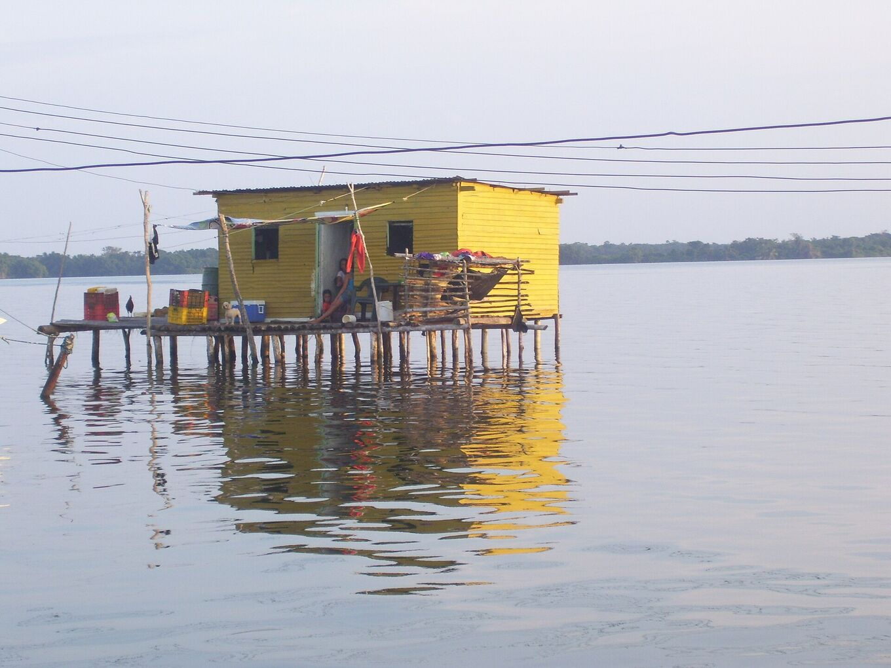

## Excursions guidées

L'excursion dure en général deux ou trois jours, avec le trajet en voiture jusqu'à l'embarcadère, le bateau sur la rivière et le lac, puis une nuit dans une maison sur pilotis face à l'orage. Avec un opérateur local, elle est plus simple et plus sûre.

*[Yinette Bracho Padilla · Wikimedia Commons · CC BY-SA 4.0](https://commons.wikimedia.org/wiki/File:Palafito_en_medio_del_Parque_nacional.jpg)*

### Avant de réserver, demandez

- Ce que comprend le prix, comme les transferts, le bateau, les repas, l'eau potable et où l'on dort (hamac ou lit).
- D'où part l'excursion et quand elle revient. Beaucoup partent de Mérida.
- Quelles mesures de sécurité sont prévues, comme des gilets de sauvetage pour tous et un bateau en bon état, et ce qui se passe si l'orage approche ou si le vent se lève.
- Si l'opérateur respecte les règles du parc national et travaille avec les communautés des maisons sur pilotis.
- Quelles langues parle le guide et quelle est la taille du groupe.
- Dans quelle monnaie on paie, si la carte est acceptée ou seulement les espèces, et ce qui se passe si la météo oblige à annuler.
- Ce qui se passe si la nuit est calme et qu'il n'y a pas d'éclairs. Personne ne peut promettre l'orage.
- Ce qu'il y a sur place (toilettes, eau potable, électricité pour recharger) et comment appeler à l'aide sans réseau.
- S'ils sont inscrits au Registre national du tourisme du Venezuela (RTN).

### Signaux d'alerte

- Un prix très inférieur à celui des autres.
- Pas de gilets de sauvetage, ou pas assez pour tout le groupe.
- Des offres pour naviguer sous l'orage et faire de meilleures photos.
- Une pression pour tout payer d'avance, en espèces, sans reçu.
- Aucun plan clair en cas de mauvais temps.

## Institutions et partenaires

Organismes publics et entreprises qui œuvrent pour le tourisme au sud du lac :

- **Tourisme :** INATUR Zulia (Institut national du tourisme) et la Corporación Zuliana de Turismo.
- **Science et environnement :** l'UNESUR (Universidad Nacional Experimental Sur del Lago), l'ICLAM (Institut pour la conservation du lac Maracaibo), le MINEC (ministère de l'Écosocialisme) et la [Fondation Finnova](https://www.finnova.com/).
- **Transport aérien :** l'INAC (Institut national de l'aviation civile).
- **Entreprises :** YessTravels, Grupo San Simón, Junior Mall Hotel et Hotel Tibisay.
