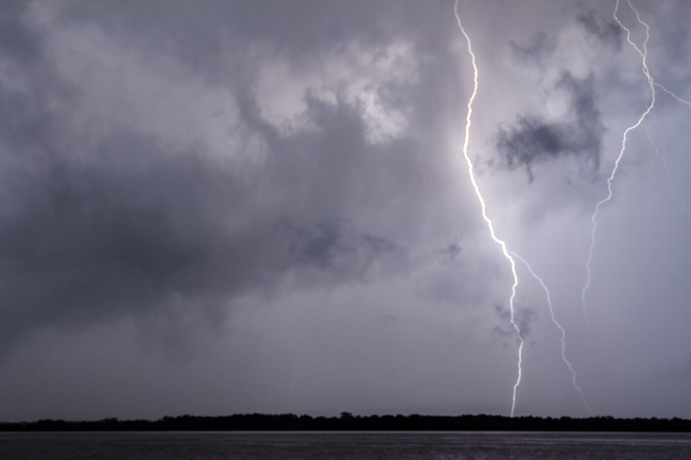
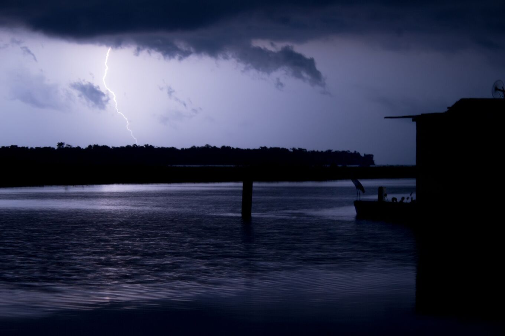
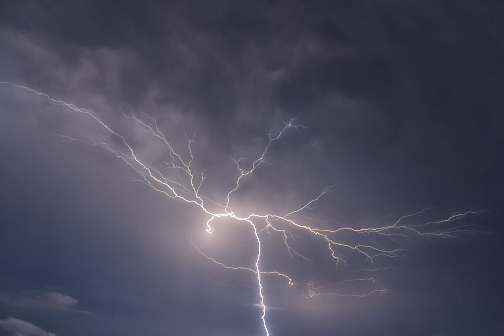

## Un orage qui revient presque chaque nuit.

La foudre de Catatumbo (Relámpago del Catatumbo) est un orage qui se forme la nuit au-dessus du sud-ouest du lac Maracaibo et des marais proches de l’embouchure du río Catatumbo. Depuis la rive, on dirait une lueur presque continue dans les nuages, souvent sans tonnerre audible parce que l’orage est loin.

Ce n’est pas un spectacle programmé : chaque nuit est différente. Certaines nuits apportent des centaines d’éclairs, d’autres sont calmes. L’activité dépend du vent, de l’humidité et de la saison.

*[Fernando Flores · Wikimedia Commons · CC BY-SA 2.0](https://commons.wikimedia.org/wiki/File:Catatumbo_Lightning_-_Rayo_del_Catatumbo_%2825385580334%29.jpg)*

| Chiffre | Ce qu’il signifie |
| --- | --- |
| 140–160 | Nuits avec activité par an |
| 16–40 | Éclairs par minute |
| ≈ 9 h | Durée typique par nuit |
| 12–15 km | Hauteur atteinte par les nuages d’orage |
| 232,5 | Éclairs par km² et par an (NASA LIS, 2016) |

## Plusieurs orages, un seul nom.

Les chercheurs de l’université du Zulia préfèrent parler *des* éclairs du Catatumbo : chaque nuit, plusieurs cellules orageuses se forment en différents points du delta et du sud-ouest du lac. De loin, elles se fondent en une seule lueur.

Les nuages sont des cumulonimbus, les plus hauts des nuages d’orage, qui montent jusqu’au sommet de la troposphère tropicale. La plupart des éclairs restent dans les nuages ou passent de l’un à l’autre et les illuminent de l’intérieur. D’autres frappent le sol ou l’eau.

La lumière porte bien plus loin que le son. Le tonnerre s’entend rarement à plus de 20 km environ, alors que la lueur se voit de beaucoup plus loin. C’est pourquoi, depuis Maracaibo ou la rive, la foudre semble muette. Sous l’orage, le tonnerre est presque permanent.

*[Fernando Flores · Wikimedia Commons · CC BY 3.0](https://commons.wikimedia.org/wiki/File:Catatumbo_Lightning_%28127737829%29.jpeg)*

## Comment elle se forme.

### L’humidité

Le lac est chaud et évapore beaucoup d’eau. Les alizés des Caraïbes poussent cet air humide vers le sud du bassin.

### Le relief

Le bassin est fermé par la Sierra de Perijá à l’ouest et la cordillère de Mérida au sud-est. L’air est enfermé entre des montagnes de plus de 3 000 m.

### La convergence nocturne

La nuit, l’air frais qui descend des montagnes rencontre l’air chaud du lac. Ce courant force l’air humide à monter et forme des nuages d’orage presque au même endroit.

### Le vent de la nuit

Un courant de vent, le jet nocturne de basse altitude du lac Maracaibo, traverse le bassin la nuit. Quand il souffle fort et que l’air contient beaucoup d’énergie orageuse (ce que les météorologues appellent CAPE), il y a plus d’éclairs. En 2016, une équipe de l’université du Zulia s’est servie de ce lien pour publier la première prévision saisonnière de la foudre au monde, des mois à l’avance.

> Pendant des années, on a attribué le phénomène au méthane des marais et du pétrole. Les études récentes l’expliquent surtout par le vent et le relief ; le rôle du méthane reste débattu.

Le modèle du méthane échoue aussi à un test simple : il prédit plus d’éclairs en saison sèche, et les mesures montrent l’inverse.

## L’année de la foudre.

De septembre à novembre, ce sont en général les mois les plus actifs ; janvier et février, les plus calmes. Ce n’est qu’une tendance : en 2010, une sécheresse a éteint la foudre de janvier à mars.

Le rythme suit les pluies. La ceinture de pluies tropicales se déplace vers le nord et vers le sud au fil de l’année et apporte deux saisons plus humides : une première en avril et mai, une plus forte dans la seconde moitié de l’année, avec un pic vers septembre et octobre. Des phénomènes climatiques comme El Niño la décalent d’une année à l’autre : le silence de 2010 est survenu pendant une sécheresse liée à El Niño.

Au cours d’une nuit, l’activité commence en général au crépuscule, augmente après la tombée de la nuit et culmine vers minuit et au petit matin. Pendant les mois plus secs, elle peut prendre la forme d’orages secs, sans pluie.

*[Fernando Flores · Wikimedia Commons · CC BY-SA 2.0](https://commons.wikimedia.org/wiki/File:Catatumbo_Lightning_-_Rayo_del_Catatumbo_%2822668686290%29.jpg)*

## Ce qu’elle n’est pas.

### « Elle régénère la couche d’ozone »

Faux. La foudre produit de l’ozone dans la basse atmosphère, la troposphère. La couche d’ozone se trouve dans la stratosphère, vers 25 km d’altitude sous les tropiques. L’ozone de l’orage se disperse et ne la répare pas. Aucune étude ne soutient cette idée.

### « C’est une foudre silencieuse »

Non. Le tonnerre existe ; il n’atteint simplement pas qui regarde à des dizaines de kilomètres.

### « L’uranium du sous-sol en est la cause »

Une hypothèse des années 1990 qui n’a jamais été prouvée.
