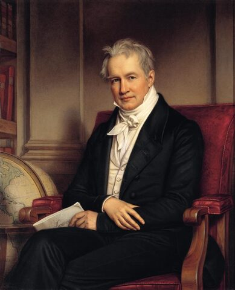
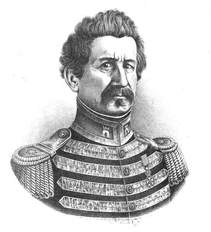
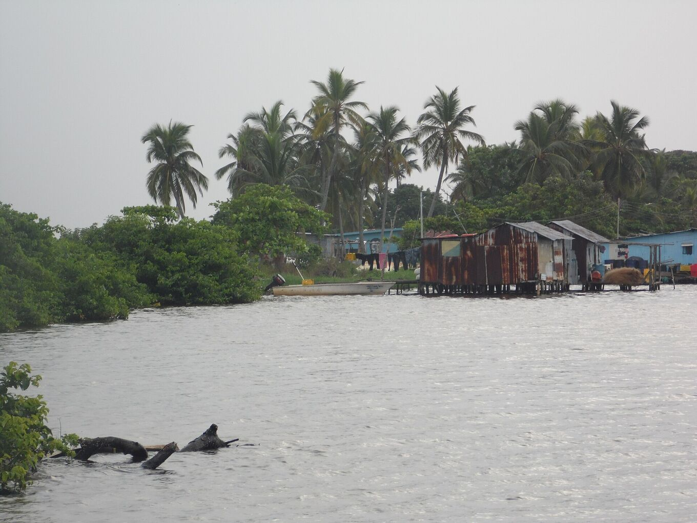
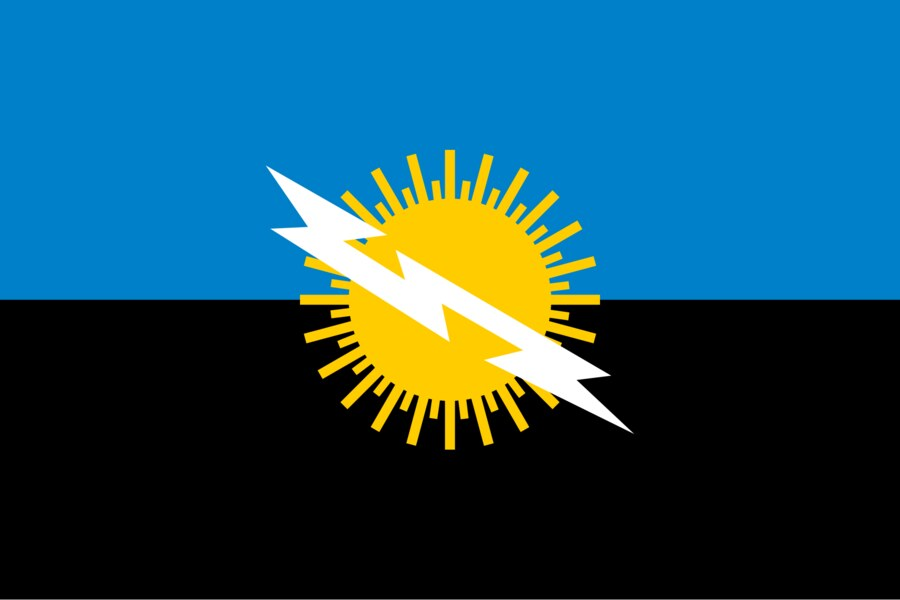

## Quatre siècles tournés vers le sud.

Navigateurs, voyageurs et scientifiques ont laissé des traces de la lueur du sud du lac. Voici une brève chronologie de ce qui est documenté.

### 1822 · Le phare de Maracaibo

Alexander Walker recueille les noms que lui donnaient les navigateurs : « Phare de Maracaibo » et « Lanternes de saint Antoine ». La lueur servait de repère pour s’orienter la nuit dans le golfe et sur le lac.

### 1826 · Humboldt

Alexander von Humboldt décrit le phénomène dans son récit de voyage, d’après les rapports de M. Palacios. C’est l’une des premières descriptions à circuler en Europe.

Il parle d’« explosions électriques qui sont comme des lueurs phosphorescentes », d’après le livre de Palacios *Viage de Varinas*.

*[Joseph Karl Stieler · Wikimedia Commons · Domaine public](https://commons.wikimedia.org/wiki/File:Stieler,_Joseph_Karl_-_Alexander_von_Humboldt_-_1843.jpg)*

### 1841 · « Comme un éclair continu »

Le géographe Agustín Codazzi le décrit comme « un éclair continu » visible de loin au-dessus du río Catatumbo. Son œuvre fixe le phénomène dans la cartographie du Venezuela.

Il ajoute que sa position, presque sur le méridien de l’entrée du lac, guide les navigateurs comme un phare.

*[Wikimedia Commons · Domaine public](https://commons.wikimedia.org/wiki/File:Retrato_Agust%C3%ADn_Codazzi.jpg)*

### 1966–1970 · Premières expéditions

Le scientifique Andrés Zavrotsky et une équipe de l’université des Andes mènent trois expéditions à Santa Bárbara del Zulia. Ils situent les foyers de l’orage dans les marais de Juan Manuel, à l’ouest du lac.

### 1997–2000 · L’hypothèse du méthane

Une équipe de l’université de Carabobo dirigée par Nelson Falcón atteint le cœur des marais et propose le méthane comme l’une des causes principales. Aucune mesure n’a encore confirmé la présence de méthane dans les nuages d’orage.

### 2005 · Patrimoine naturel

L’État de Zulia déclare la foudre patrimoine naturel le 27 septembre 2005. Certains demandent toujours pour la zone l’inscription au patrimoine mondial de l’UNESCO.

### 2010 · Le silence

De janvier à mars 2010, la foudre a cessé, apparemment à cause d’une forte sécheresse. On a spéculé sur sa disparition ; l’activité est revenue avec les pluies.

### 2014 · Un record Guinness

Le 28 janvier 2014, jour du Zulia, le Guinness World Records reconnaît la zone comme l’endroit qui compte le plus d’éclairs par kilomètre carré et par an.

### 2016 · Le plus grand foyer de foudre de la planète

Une étude utilisant les données du capteur LIS de la NASA (Albrecht et al., 2016) place le lac Maracaibo au premier rang mondial, avec environ 232,5 éclairs par km² et par an. Le Guinness l’avait déjà reconnu comme la plus forte concentration de foudre.

La même année, une équipe de l’université du Zulia publie la première prévision saisonnière de la foudre, fondée sur le vent nocturne du lac.

### 2018 · Des villages qui se déplacent

L’envasement entoure de terre les maisons sur pilotis de Congo Mirador. La plupart des habitants partent et plusieurs maisons sont remorquées en bateau jusqu’à Ologá, qui devient la base des visiteurs.

*[Yoser Linares · Wikimedia Commons · CC BY-SA 4.0](https://commons.wikimedia.org/wiki/File:Comunidad_de_Olog%C3%A1.jpg)*

## La maison du tonnerre.

En langue barí, Catatumbo se traduit par « maison du tonnerre ». Un récit attribué au peuple barí raconte que les lumières du ciel sont des cocuyos, des lucioles, qui se rassemblent chaque nuit pour rendre hommage à Sabaseba, le créateur qui a mis le monde en ordre. C’est un récit, pas une explication météorologique.

Les Barí vivent dans le bassin du Catatumbo, des deux côtés de la frontière entre le Venezuela et la Colombie. Ils ont résisté pendant des siècles aux expéditions espagnoles. Depuis, leur territoire s’est réduit, sous la pression des colons et des forages pétroliers.

## D’autres récits du lac.

### Les lucioles de Sabaseba

*Récit barí*

Les lumières du ciel seraient des millions de lucioles réunies au-dessus du lac pour honorer le créateur. On le raconte comme un récit du peuple barí, qui vit dans le bassin du Catatumbo.

### Un signe de la nature

*Tradition wayuu*

Pour le peuple wayuu, la foudre est un signe de la nature qui demande le respect et transmet de la force. Elle figure aussi sur le drapeau et les armoiries de l’État de Zulia.

Des récits wayuu et yukpa y voient aussi les esprits de Wayuu tombés, qui brillent dans le ciel comme un message.

*[Wikimedia Commons · Domaine public](https://commons.wikimedia.org/wiki/File:Flag_of_Zulia_State.svg)*

### Drake et la nuit illuminée

*Légende · contredite par les documents*

On répète qu’en 1595 la foudre a trahi la flotte de Francis Drake devant Maracaibo, et que Lope de Vega l’a chantée dans « La Dragontea ». Cette lueur venait en réalité de navires en flammes à San Juan de Porto Rico.

### La bataille du lac

*Récit populaire*

Un récit répandu dit que, lors de la bataille navale du lac Maracaibo en 1823, les éclairs ont montré à la flotte patriote la position des navires royalistes. C’est une mémoire populaire, pas un fait documenté.

La bataille elle-même est documentée : le 24 juillet 1823, la flotte de José Prudencio Padilla vainquit l’escadre espagnole et scella l’indépendance du Venezuela et de la Nouvelle-Grenade. Les deux pays fêtent encore cette date comme jour de la Marine.

### Dans les chansons

La foudre apparaît dans l’hymne de l’État de Zulia, d’Udón Pérez, et dans de nombreuses gaitas, la musique du Zulia.

> Ces récits sont recueillis comme mémoire culturelle, avec leur source quand elle est connue. Quand un récit contredit les documents, nous le signalons.
