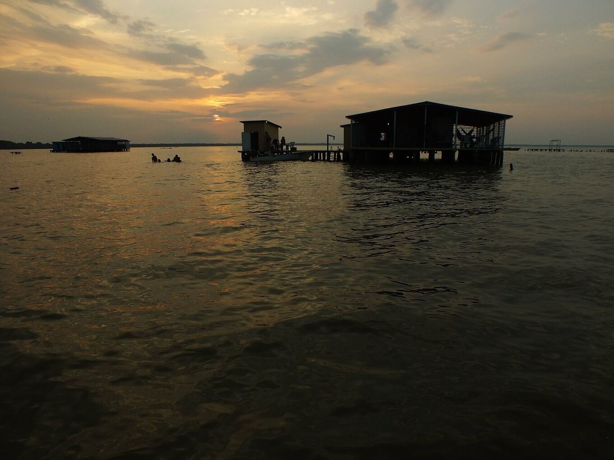
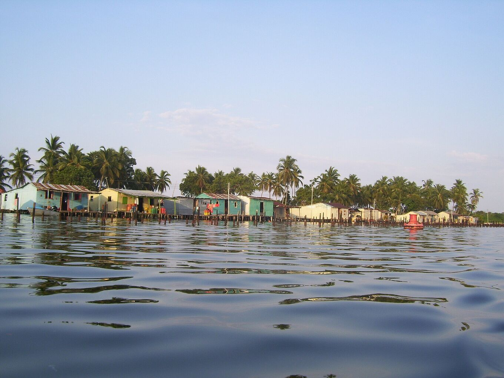
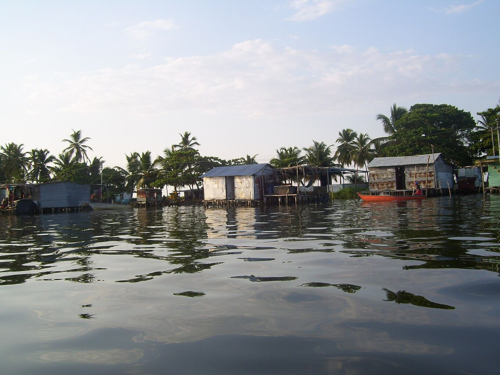
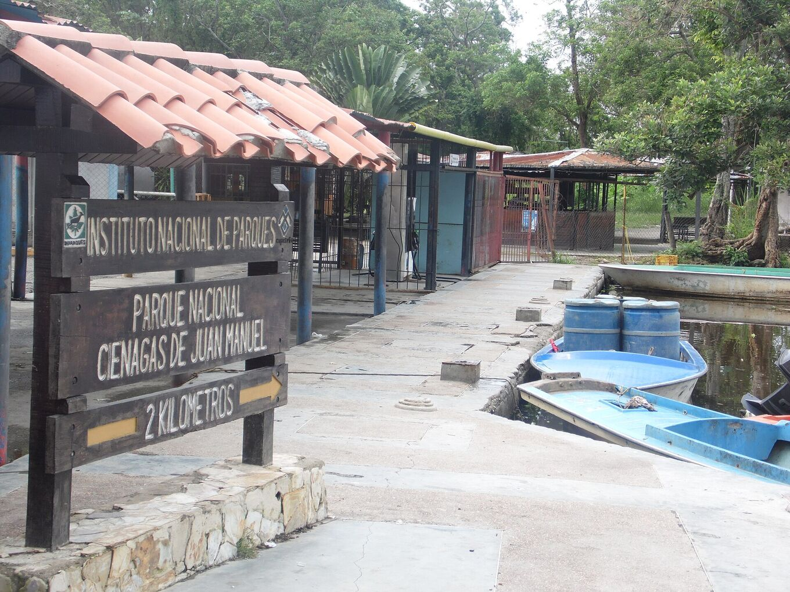

## Un lac, plusieurs rives.

Les lieux institutionnels et communautaires qui structurent une visite : la zone protégée où naît l’orage, les villages sur pilotis d’où on l’observe et l’embarcadère d’où partent les bateaux.

Le lac Maracaibo couvre environ 13 500 km². Il communique avec la mer des Caraïbes par un étroit détroit au nord, et des dizaines de rivières l’alimentent au sud. La plus grande, le Catatumbo, apporte plus de la moitié de son eau.

## Le sud du lac

### Parc national Ciénagas de Juan Manuel

*Zone protégée · Inparques*

Zones humides, mangroves et chenaux dans le delta du Catatumbo, au sud-ouest du lac. C’est là que se forme l’orage. Il est géré par l’Institut national des parcs (Inparques) ; les visites se font avec des guides agréés. [Wikipédia](https://es.wikipedia.org/wiki/Parque_nacional_Ci%C3%A9nagas_de_Juan_Manuel)

On l’appelle aussi Ciénagas del Catatumbo, ou Aguas Blancas et Aguas Negras. Une plaine plate et inondée entre la Sierra de Perijá et le lac, avec des températures de 22–32 °C et une humidité très forte. Les oiseaux sont partout : grandes aigrettes, aigrettes bleues, jabirus, canards, mouettes, sternes et caracaras.

*[Juan Pablo Bottaro · Wikimedia Commons · CC BY-SA 4.0](https://commons.wikimedia.org/wiki/File:Lago_en_llamas.jpg)*

### Ologá

*Communauté du lac · pilotis*

Village sur pilotis à une dizaine de minutes en bateau de Congo Mirador. C’est aujourd’hui la principale base pour observer la foudre, avec des campements et des maisons d’hôtes simples au-dessus de l’eau.

Certaines de ses maisons viennent de Congo Mirador : posées sur pilotis, elles pouvaient être hissées sur deux bateaux et déplacées jusqu’ici.

*[Yinette Bracho Padilla · Wikimedia Commons · CC BY-SA 4.0](https://commons.wikimedia.org/wiki/File:Palafitos_del_pueblo_de_Olog%C3%A1.jpg)*

### Congo Mirador

*Communauté du lac · pilotis*

Ce fut le village le plus connu pour voir la foudre. L’envasement du lac et la crise économique l’ont vidé : vers 2018, près de 90 % des habitants étaient partis et de nombreuses maisons avaient été déplacées à Ologá. [Wikipédia](https://es.wikipedia.org/wiki/Congo_Mirador)

Le village a au moins 200 ans et vivait de la pêche, puis des visiteurs. Il comptait environ 930 habitants à la fin des années 1970 et près d’un millier en 2013. Les habitants attribuent l’envasement à un chenal de trois kilomètres ouvert depuis le río Bravo en 1991, le « Caño J ». En 2021, il restait environ cinq personnes. Son histoire est racontée dans le documentaire *Once Upon a Time in Venezuela* (2020), d’Anabel Rodríguez Ríos.

*[Yinette Bracho Padilla · Wikimedia Commons · CC BY-SA 4.0](https://commons.wikimedia.org/wiki/File:Palafitos_de_Congo_Mirador.jpg)*

### Puerto Concha

*Embarcadère · point de départ*

Embarcadère proche de Santa Bárbara del Zulia, d’où partent les bateaux vers Ologá et le delta. On y accède par la route depuis l’aéroport d’El Vigía.

Santa Bárbara est la ville d’élevage du sud du lac, connue pour son fromage et ses bananes plantains. Faites-y le plein d’espèces, d’eau et de provisions : il n’y a pas de magasins sur l’eau.

*[Yoser Linares · Wikimedia Commons · CC BY-SA 4.0](https://commons.wikimedia.org/wiki/File:Puerto_Concha.jpg)*
