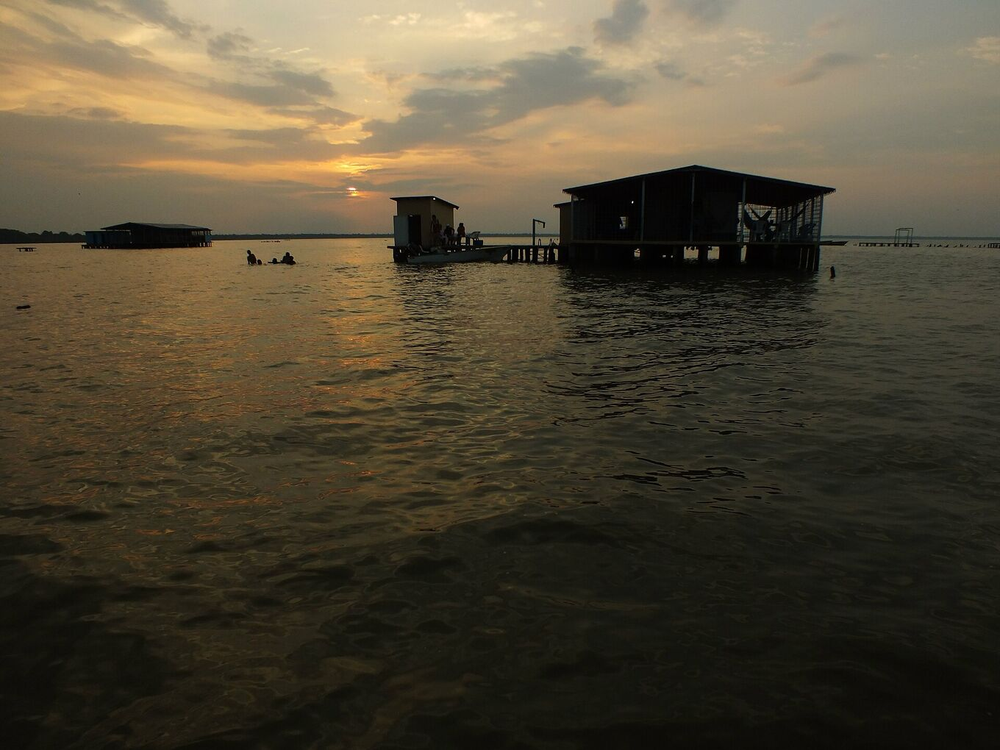
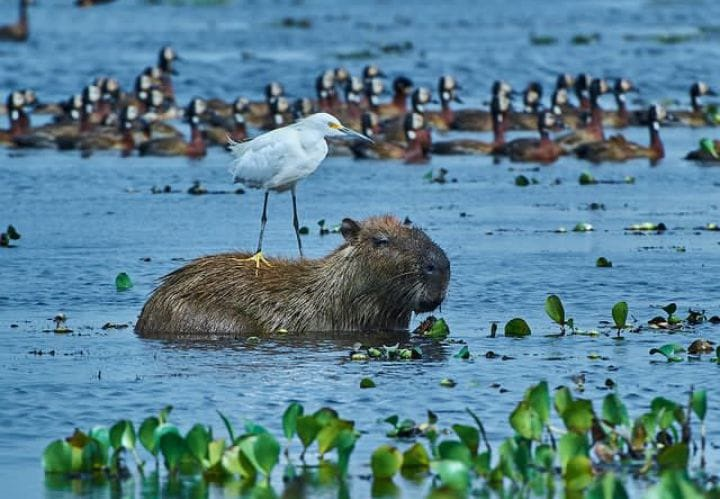

## Là où naît l'orage

Zones humides, mangroves et chenaux dans le delta du Catatumbo, au sud-ouest du lac Maracaibo. C'est au-dessus de cette zone que l'orage se forme presque chaque nuit. Il est géré par l'Institut national des parcs (Inparques) ; les visites se font avec des guides agréés.

On l'appelle aussi Ciénagas de Juan Manuel, ou Aguas Blancas et Aguas Negras. Une plaine plate et inondée entre la Sierra de Perijá et le lac, sans collines ni pentes, avec des températures de 22–32 °C et une humidité très forte.

*[Juan Pablo Bottaro · Wikimedia Commons · CC BY-SA 4.0](https://commons.wikimedia.org/wiki/File:Lago_en_llamas.jpg)*

| Chiffre | Ce qu'il signifie |
| --- | --- |
| 1991 | Année de sa création comme parc national |
| ≈ 2 260 km² | Superficie, en deux secteurs |
| 212 | Espèces d'oiseaux recensées |
| 22–32 °C | Température habituelle |
| 2 m | Hauteur que peut gagner l'eau à la saison des pluies |

## Rivières et lagunes

Le parc occupe la plaine du delta, à peine au-dessus du niveau du lac. Des rivières d'eaux blanches, troubles du sédiment descendu des montagnes, le traversent, dont le Catatumbo, le Bravo et le Santa Ana. Entre elles s'étendent des lagunes d'eaux noires, sombres de matière végétale, comme La Estrella, El Congo et Ologá.

À la saison des pluies, l'eau monte jusqu'à deux mètres et la plaine est inondée. L'essentiel du parc est couvert de prairies marécageuses. Sur les rives poussent des mangroves de palétuviers rouges et des forêts inondées avec des palmiers ; des forêts-galeries bordent le Catatumbo.

À côté du parc se trouve une seconde zone protégée, la réserve de faune Ciénagas de Juan Manuel, Aguas Blancas y Aguas Negras. Toutes deux figurent parmi les Zones clés pour la biodiversité.

## Faune

### Oiseaux

Le parc compte 212 espèces d'oiseaux recensées. Depuis le bateau, on voit des grandes aigrettes, des aigrettes bleues, des jabirus, des canards, des mouettes, des sternes et des caracaras. Cherchez aussi le kamichi à collier (*Chauna chavaria*), grand oiseau des marais qui ne vit que dans les bassins du lac Maracaibo et du río Magdalena, et le kamichi cornu (*Anhima cornuta*).

### Dans l'eau

Le lamantin (*Trichechus manatus*) et le crocodile américain (*Crocodylus acutus*), deux espèces menacées, vivent dans les chenaux et les lagunes. On voit des dauphins de Guyane (*Sotalia guianensis*) près de l'embouchure du Catatumbo. Il y a aussi des caïmans à lunettes, des iguanes et des loutres.

### Sur la rive

Sur les berges, on voit des capybaras, le plus grand rongeur du monde, et on entend des singes hurleurs dans les arbres. Les inventaires de faune citent aussi le jaguar, l'ocelot et la loutre géante. Ils sont difficiles à voir, alors ne comptez pas les croiser.

## Menaces

Les marées noires qui atteignent la rive sont la menace la plus grave. S'y ajoutent l'abattage d'arbres pour construire et ouvrir des pâturages, les incendies, les digues qui modifient le drainage naturel et la chasse illégale. Une partie du tourisme n'y est pas réglementée. Choisissez donc des opérateurs qui respectent les règles du parc.

## Visiter le parc

On y entre en bateau depuis Puerto Concha, près de Santa Bárbara del Zulia. L'itinéraire suit les chenaux et les mangroves du parc puis débouche sur le lac en direction d'Ologá. La plupart des excursions vers la foudre le traversent déjà.

- Allez-y toujours avec un guide agréé et portez le gilet de sauvetage à chaque trajet.
- Remportez vos déchets, car sur l'eau, il n'y a nulle part où les laisser.
- Ne faites pas de feu. Les incendies sont l'une des menaces du parc.
- Ne nourrissez pas et ne poursuivez pas les animaux. Gardez vos distances avec les lamantins et les crocodiles.
- N'achetez ni animaux sauvages ni produits qui en sont faits.

## Sources

Superficie et espèces d'après Inparques (1996), repris par Key Biodiversity Areas. D'autres sources donnent des chiffres légèrement différents.

- [Wikipedia · Ciénagas del Catatumbo National Park](https://en.wikipedia.org/wiki/Ci%C3%A9nagas_del_Catatumbo_National_Park)
- [Key Biodiversity Areas · Parque Nacional Ciénagas de Juan Manuel](https://www.keybiodiversityareas.org/site/factsheet/14955)
- [Key Biodiversity Areas · Reserva de Fauna Silvestre Ciénagas de Juan Manuel](https://www.keybiodiversityareas.org/site/factsheet/14956)
- [IMMA · Maracaibo Lake System](https://www.marinemammalhabitat.org/wp-content/uploads/imma-factsheets/NorthWestAtlanticOceanWiderCaribbean/Maracaibo-Lake-System-NorthWestAtlanticOceanWiderCaribbean.pdf)
