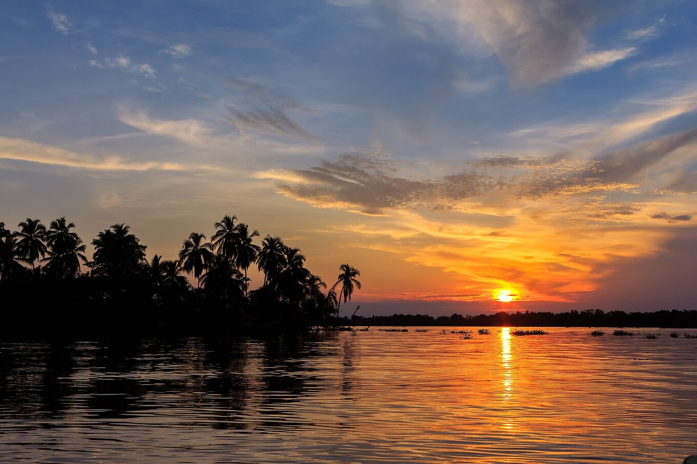
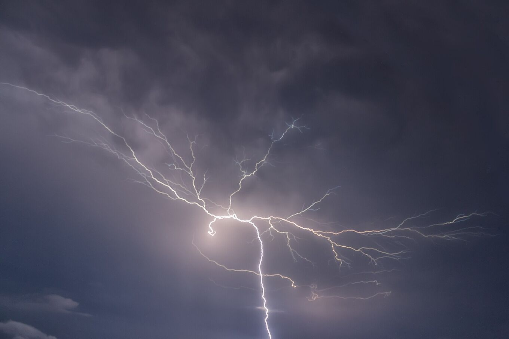

## Quand partir

L'orage commence à la tombée de la nuit et dure en général jusqu'au petit matin. De septembre à novembre, ce sont les mois les plus actifs. Consultez la météo l'après-midi de votre excursion.

Avril et mai apportent un second pic, plus faible. Janvier et février sont les mois les plus calmes, avec moins d'orages, mais des journées plus sèches et une eau plus calme. Arrivez avant le coucher du soleil, car le crépuscule sur le lac fait partie du spectacle.

De passage à Maracaibo en novembre ? La Feria de la Chinita, du 11 au 18 novembre, remplit la ville de gaitas, de processions et de monde.

*[Fernando Flores · Wikimedia Commons · CC BY-SA 2.0](https://commons.wikimedia.org/wiki/File:Sunset_at_Congo_Mirador_%2823978940929%29.jpg)*

## L'année de la foudre

Le rythme suit les pluies. La ceinture de pluies tropicales se déplace vers le nord et vers le sud au fil de l'année et apporte deux saisons plus humides, une première en avril et mai, une plus forte dans la seconde moitié de l'année, avec un pic vers septembre et octobre. Des phénomènes climatiques comme El Niño la décalent d'une année à l'autre. La sécheresse qui a éteint la foudre de janvier à mars 2010 était liée à El Niño.

Au cours d'une nuit, l'activité commence en général au crépuscule, augmente après la tombée de la nuit et culmine vers minuit et au petit matin. Pendant les mois plus secs, elle peut prendre la forme d'orages secs, sans pluie.

*[Fernando Flores · Wikimedia Commons · CC BY-SA 2.0](https://commons.wikimedia.org/wiki/File:Catatumbo_Lightning_-_Rayo_del_Catatumbo_%2822668686290%29.jpg)*
