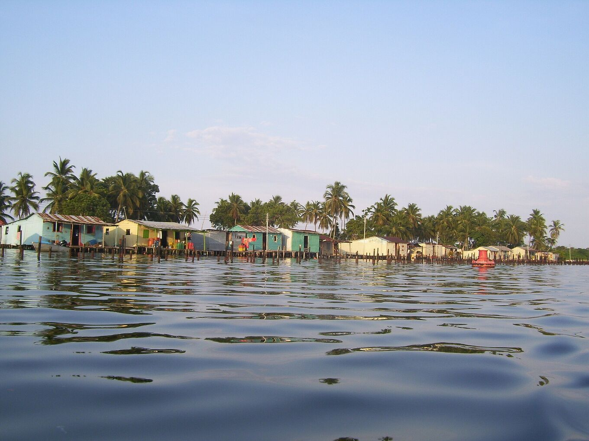
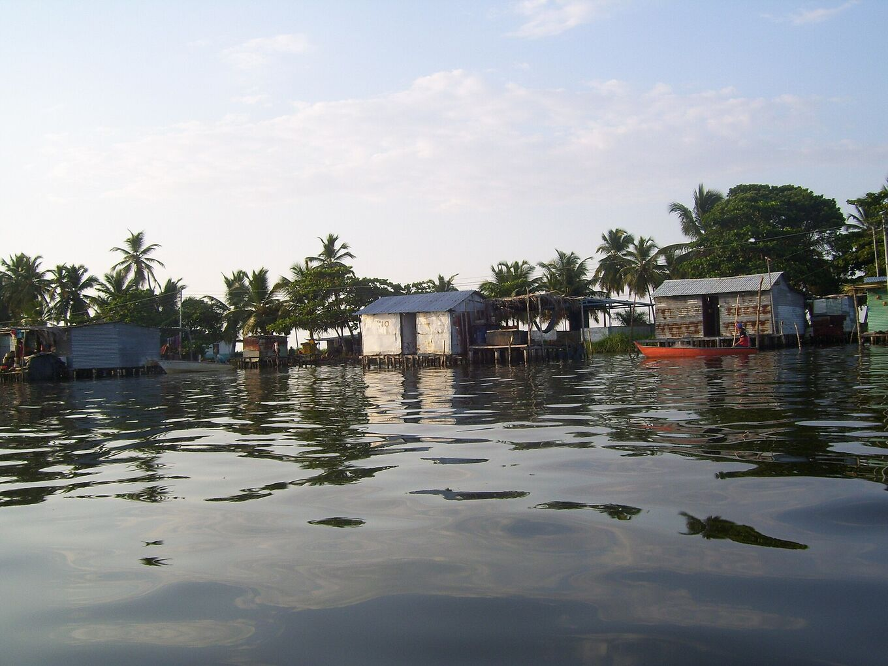
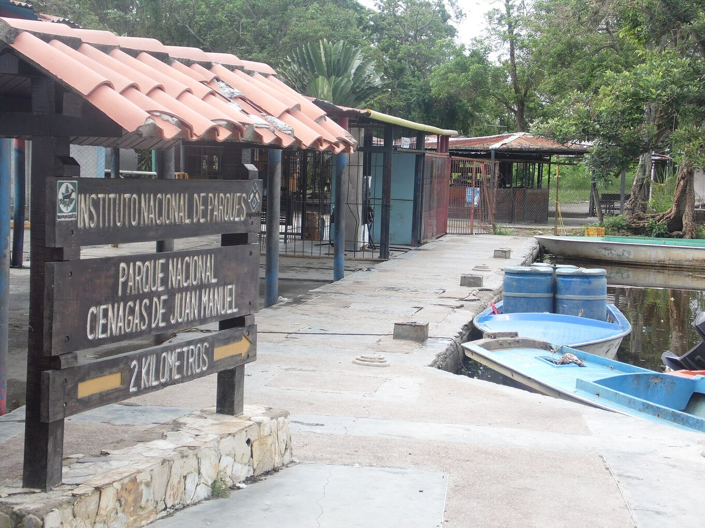
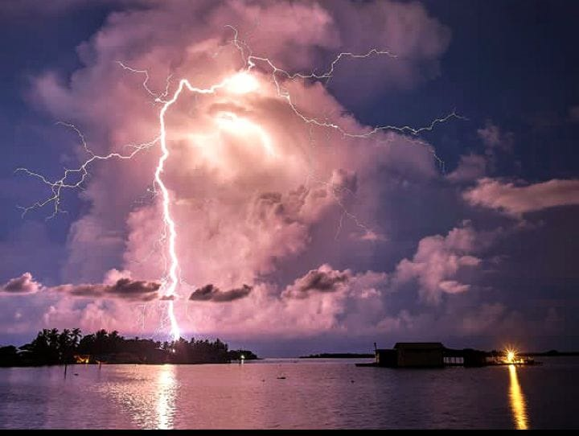

## Le lac Maracaibo

Les villages sur pilotis d'où l'on observe l'orage et l'embarcadère d'où partent les bateaux. La zone protégée où naît l'orage, le parc national Ciénagas del Catatumbo, a sa propre page.

Le lac Maracaibo couvre environ 13 500 km². Il communique avec la mer des Caraïbes par un étroit détroit au nord, et des dizaines de rivières l'alimentent au sud. La plus grande, le Catatumbo, apporte plus de la moitié de son eau.

Vivre sur l'eau est une tradition ancienne ici. Les Añú, peuple autochtone du lac, construisaient déjà des maisons sur pilotis à l'arrivée des Espagnols en 1499.

## Le sud du lac

### Ologá

*Communauté du lac · pilotis*

Village sur pilotis à une dizaine de minutes en bateau de Congo Mirador. C'est aujourd'hui la principale base pour observer la foudre, avec des campements et des maisons d'hôtes simples au-dessus de l'eau.

Certaines de ses maisons viennent de Congo Mirador. Posées sur pilotis, elles pouvaient être hissées sur deux bateaux et déplacées jusqu'ici.

*[Yinette Bracho Padilla · Wikimedia Commons · CC BY-SA 4.0](https://commons.wikimedia.org/wiki/File:Palafitos_del_pueblo_de_Olog%C3%A1.jpg)*

### Congo Mirador

*Communauté du lac · pilotis*

Ce fut le village le plus connu pour voir la foudre. L'envasement du lac et la crise économique l'ont vidé. Vers 2018, près de 90 % des habitants étaient partis et de nombreuses maisons avaient été déplacées à Ologá. [Wikipédia](https://es.wikipedia.org/wiki/Congo_Mirador)

Le village a au moins 200 ans et vivait de la pêche, puis des visiteurs. Il comptait environ 930 habitants à la fin des années 1970 et près d'un millier en 2013. Les habitants attribuent l'envasement à un chenal de trois kilomètres ouvert depuis le río Bravo en 1991, le "Caño J". En 2021, il restait environ cinq personnes. Son histoire est racontée dans le documentaire *Once Upon a Time in Venezuela* (2020), d'Anabel Rodríguez Ríos.

*[Yinette Bracho Padilla · Wikimedia Commons · CC BY-SA 4.0](https://commons.wikimedia.org/wiki/File:Palafitos_de_Congo_Mirador.jpg)*

### Puerto Concha

*Embarcadère · point de départ*

Embarcadère proche de Santa Bárbara del Zulia, d'où partent les bateaux vers Ologá et le delta. On y accède par la route depuis l'aéroport d'El Vigía.

Santa Bárbara est la ville d'élevage du sud du lac, connue pour son fromage et ses bananes plantains. Retirez-y des espèces et achetez de l'eau et des provisions, car il n'y a pas de magasins sur l'eau.

*[Yoser Linares · Wikimedia Commons · CC BY-SA 4.0](https://commons.wikimedia.org/wiki/File:Puerto_Concha.jpg)*

## La vie sur l'eau

Ologá, dans la paroisse d'Encontrados de la municipalité de Catatumbo, est l'un des lieux les plus isolés du sud du lac. C'est d'ici que le monde regarde la foudre, mais ses habitants vivent avec très peu.

- Il n'y a ni réseau d'eau potable ni assainissement. L'eau douce arrive en bateau depuis la terre ferme.
- L'électricité vient de groupes électrogènes privés qui tournent quelques heures, et internet est presque absent.
- Le dispensaire manque de personnel et de médicaments. Une urgence impose un long trajet en bateau.
- La pêche artisanale est le principal moyen de subsistance. Les intermédiaires fixent le prix du poisson, et l'essence, rare et chère, paralyse la pêche.
- L'argent du tourisme arrive par saisons et reste surtout chez des opérateurs extérieurs.

C'est pourquoi il importe d'engager des bateliers, des guides et des cuisinières de la communauté (voir Voyage responsable).

