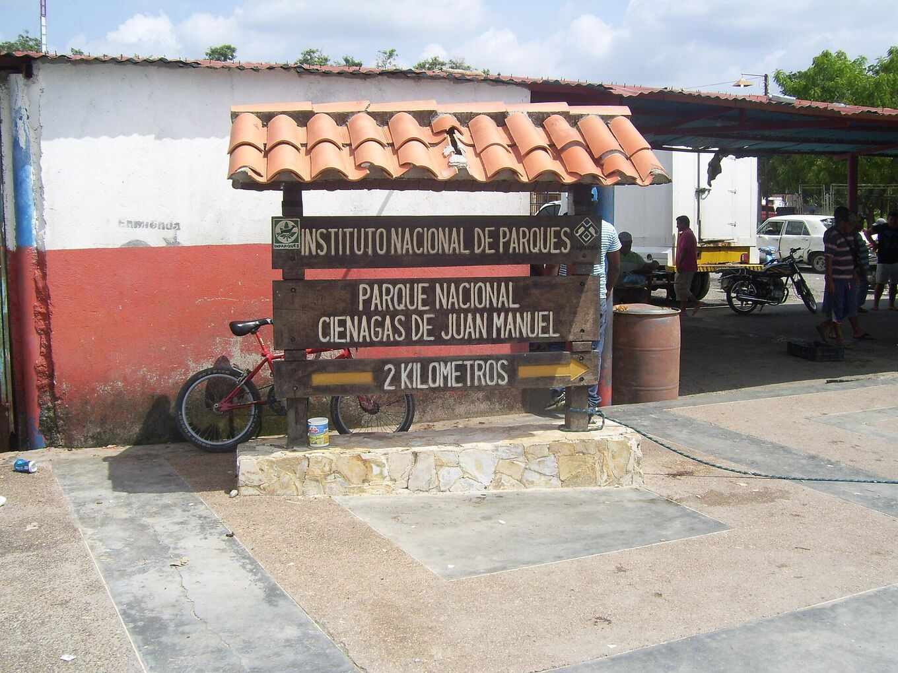
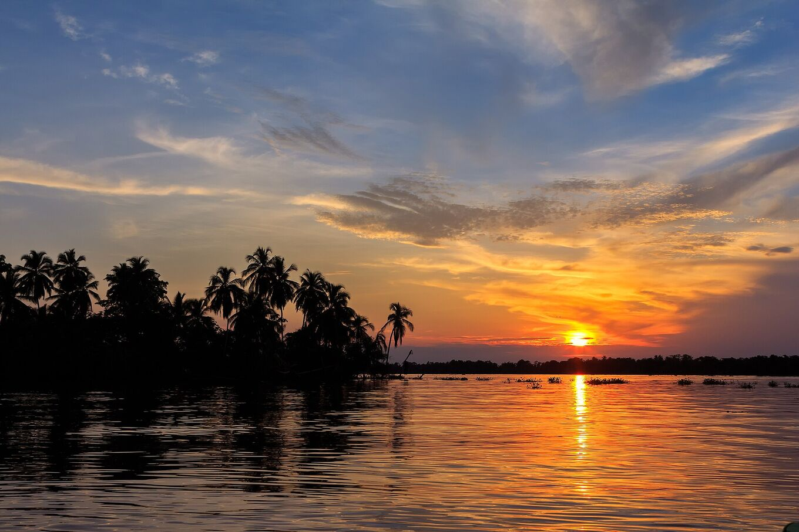
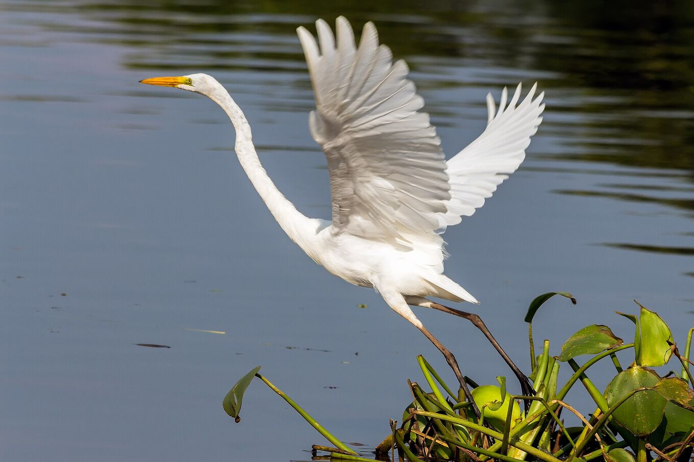

## Prenez votre temps. Soyez prudent.

### Y aller

La plupart des excursions partent en bateau de Puerto Concha, près de Santa Bárbara del Zulia, vers Ologá. L’aéroport le plus proche est El Vigía ; Maracaibo est à plusieurs heures de route. De nombreuses agences organisent l’excursion depuis Mérida.

Depuis Mérida, la route descend des Andes vers les plaines du sud du lac, entre bananeraies et élevages : environ quatre heures jusqu’à l’embarcadère. À partir de Puerto Concha, le bateau suit des chenaux et des mangroves jusqu’au parc national, puis sort sur le lac. La traversée dure une à deux heures selon l’itinéraire et le niveau de l’eau.

Ayez votre passeport ou une pièce d’identité : il y a des contrôles de police et de l’armée sur les routes.

*[Yinette Bracho Padilla · Wikimedia Commons · CC BY-SA 4.0](https://commons.wikimedia.org/wiki/File:Entrada_al_parque_nacional.jpg)*

### Quand partir

L’orage commence à la tombée de la nuit et dure en général jusqu’au petit matin. De septembre à novembre, ce sont les mois les plus actifs. Consultez la météo l’après-midi de votre excursion.

Avril et mai apportent un second pic, plus faible. Janvier et février sont les mois les plus calmes : moins d’orages, mais des journées plus sèches et une eau plus calme. Arrivez avant le coucher du soleil : le crépuscule sur le lac fait partie du spectacle.

De passage à Maracaibo en novembre ? La Feria de la Chinita, du 11 au 18 novembre, remplit la ville de gaitas, de processions et de monde.

*[Fernando Flores · Wikimedia Commons · CC BY-SA 2.0](https://commons.wikimedia.org/wiki/File:Sunset_at_Congo_Mirador_%2823978940929%29.jpg)*

### Quoi emporter

Anti-moustique, manches longues, imperméable, lampe frontale, espèces, eau potable et un sac étanche pour le téléphone et l’appareil photo. Dans les villages sur pilotis, l’électricité et le réseau sont limités.

Aussi: chapeau et crème solaire pour le bateau, vêtements légers à séchage rapide, une batterie externe, de quoi grignoter et vos médicaments. Le courant vient souvent d’un groupe électrogène, et seulement quelques heures.

### Santé

Le sud du lac est chaud et très humide : 22–32 °C. Buvez souvent. Les moustiques sortent au crépuscule.

Consultez un centre de médecine des voyages quelques semaines avant le départ et renseignez-vous sur le vaccin contre la fièvre jaune et la prévention du paludisme dans la région. Ne buvez pas l’eau du lac et ne vous y baignez pas : certaines parties sont polluées.

### Sécurité

Les orages comportent des risques. Suivez les alertes météo et les conseils des guides locaux. Ne naviguez pas sous l’orage et ne vous abritez pas sous un arbre isolé. Urgences : **VEN 911**.

Sur l’eau, un bateau est le point le plus haut. Si vous entendez le tonnerre, l’orage est assez proche pour vous frapper : quittez l’eau et mettez-vous à l’abri sous un toit. Portez le gilet de sauvetage à chaque trajet.

Consultez les conseils aux voyageurs de votre pays avant de réserver. Plusieurs pays déconseillent les voyages au Venezuela ou dans les zones proches de la frontière colombienne. Prenez une assurance voyage qui couvre ce cas.

### Photographier la foudre

- **Appareil stable :** un trépied sur la terrasse de la maison sur pilotis. Depuis le bateau, les photos sont floues.
- **Mise au point :** manuelle, sur l’infini. L’autofocus échoue dans le noir.
- **Exposition :** 10–30 s, ISO 800–3200, ouverture f/2,8–f/5,6. Déclenchez en continu et gardez les meilleures.
- **Téléphone :** mode nuit, calé contre un support ferme.
- **Lumière :** flash coupé, lampe frontale en rouge. Vos voisins regardent aussi.
- Rangez l’appareil dans le sac étanche quand la pluie arrive.

### Respect

Ologá et Congo Mirador sont des lieux de vie, pas des décors. Demandez la permission avant de photographier les gens, faites appel aux services locaux et remportez vos déchets. Le parc national a des règles d’usage : respectez-les.

Les familles des maisons sur pilotis vivent de la pêche et des visiteurs. Achetez leurs repas et leur artisanat. Restez discret la nuit. Demandez avant de faire voler un drone. Ne nourrissez pas et ne poursuivez pas les animaux.

*[Fernando Flores · Wikimedia Commons · CC BY-SA 2.0](https://commons.wikimedia.org/wiki/File:Great_Egret_Garza_Real_%28Ardea_alba_egretta%29_%2824754473973%29.jpg)*

> Les transferts, horaires et prix changent selon les itinéraires, le niveau de l’eau et les disponibilités locales. Confirmez-les auprès d’opérateurs locaux avant de partir.

## Sources et lectures complémentaires

- [Albrecht et al. · BAMS 2016](https://doi.org/10.1175/BAMS-D-14-00193.1)
- [Muñoz et al. · Atmospheric Research 2016 · prévision saisonnière de la foudre](https://doi.org/10.1016/j.atmosres.2015.12.018)
- [Wikipédia · Foudre de Catatumbo](https://fr.wikipedia.org/wiki/Foudre_de_Catatumbo)
- [Wikipédia · Lac Maracaibo](https://fr.wikipedia.org/wiki/Lac_Maracaibo)
- [Wikipédia · Congo Mirador (espagnol)](https://es.wikipedia.org/wiki/Congo_Mirador)
- [Blitzortung · éclairs en temps réel](https://www.blitzortung.org/)
