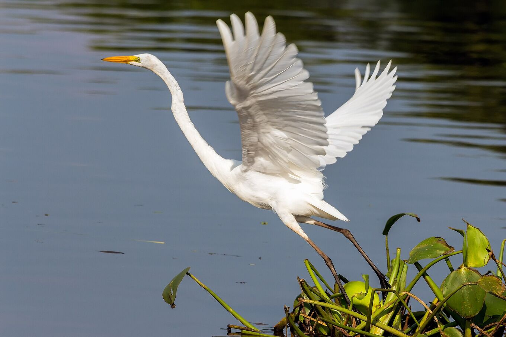

## Respect

Des gens vivent à Ologá et à Congo Mirador. Demandez la permission avant de photographier les gens, faites appel aux services locaux et remportez vos déchets. Respectez les règles d'usage du parc national.

Les familles des maisons sur pilotis vivent de la pêche et des visiteurs. Achetez leurs repas et leur artisanat. Restez discret la nuit. Demandez avant de faire voler un drone. Ne nourrissez pas et ne poursuivez pas les animaux.

*[Fernando Flores · Wikimedia Commons · CC BY-SA 2.0](https://commons.wikimedia.org/wiki/File:Great_Egret_Garza_Real_%28Ardea_alba_egretta%29_%2824754473973%29.jpg)*

## Choisissez des services locaux

Engager des guides, des bateliers et des hébergements de la région laisse l'argent aux communautés qui vivent à côté de la foudre.

Demandez si les bateliers et les cuisiniers viennent d'Ologá ou des villages voisins. Mangez ce que cuisinent les familles et laissez un pourboire aux guides et aux bateliers si le service était bon.

## Projets dans les villages

Un projet d'agrotourisme, « Vers la foudre du Catatumbo, par le fleuve Catatumbo », veut améliorer la vie à Ologá et Congo Mirador avec la [Fondation Finnova](https://www.finnova.com/). Parmi ses objectifs :

- Des panneaux solaires sur les maisons sur pilotis pour remplacer 90 % des groupes électrogènes à essence.
- Des biodigesteurs et des zones humides artificielles pour traiter les eaux usées.
- Réhabiliter 25 maisons sur pilotis dans chaque village.
- Des bateaux à faible tirant d'eau et peu bruyants, et un centre de recyclage fondé sur le « zéro déchet ».
- Former 100 habitants comme guides, avec l'INATUR, et garder au moins 30 % des dépenses des visiteurs dans les villages.
- Une station biologique, avec l'UNESUR, pour étudier le changement climatique, l'envasement du Catatumbo et la pollution.

Un bateau-ambulance a aussi été annoncé pour les deux villages, par la Fundación Azul Ambientalistas et Venemergencia, avec évacuations d'urgence et télémédecine.

Vous pouvez aider dès maintenant. Triez vos déchets et rapportez-les sur la terre ferme, car il n'y a pas de collecte sur les pilotis.
