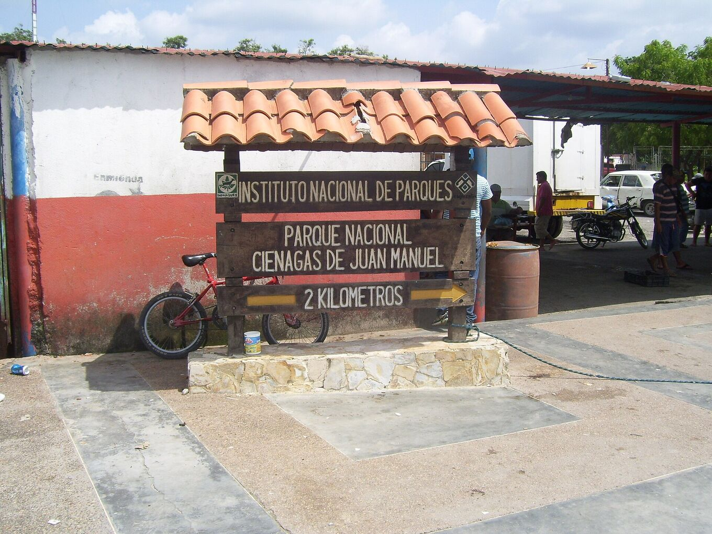

## Par la route et en bateau

La plupart des excursions partent en bateau de Puerto Concha, près de Santa Bárbara del Zulia, vers Ologá. L'aéroport le plus proche est El Vigía ; Maracaibo est à plusieurs heures de route. De nombreuses agences organisent l'excursion depuis Mérida.

Depuis Mérida, la route descend des Andes vers les plaines du sud du lac, entre bananeraies et élevages. Il faut environ quatre heures jusqu'à l'embarcadère. À partir de Puerto Concha, le bateau suit des chenaux et des mangroves jusqu'au parc national, puis sort sur le lac. La traversée dure une à deux heures selon l'itinéraire et le niveau de l'eau.

Ayez votre passeport ou une pièce d'identité, car il y a des contrôles de police et de l'armée sur les routes.

*[Yinette Bracho Padilla · Wikimedia Commons · CC BY-SA 4.0](https://commons.wikimedia.org/wiki/File:Entrada_al_parque_nacional.jpg)*

Les transferts, horaires et prix changent selon les itinéraires, le niveau de l'eau et les disponibilités locales. Confirmez-les donc auprès d'opérateurs locaux avant de partir.

## Itinéraires en bateau vers Ologá

Un projet d'agrotourisme local décrit quatre itinéraires. Les durées sont approximatives.

| Départ | Durée | Arrêt |
| --- | --- | --- |
| Puerto Concha | ≈ 1 h | Maison sur pilotis de Corpozulia |
| Canal Escalante, depuis Curva de Colón | ≈ 2 h | Congo Mirador |
| Port de pêche d'Encontrados, par le Catatumbo | ≈ 2 h 30 | Caña Dulce |
| Puerto La Maroma, à Concha | ≈ 2 h 30 | Maison sur pilotis de Corpozulia |

Quand le fleuve est très bas ou en crue, certains itinéraires ne sont pas navigables. Si vous arrivez la veille, la page Où dormir liste des hôtels proches de l'embarcadère.
