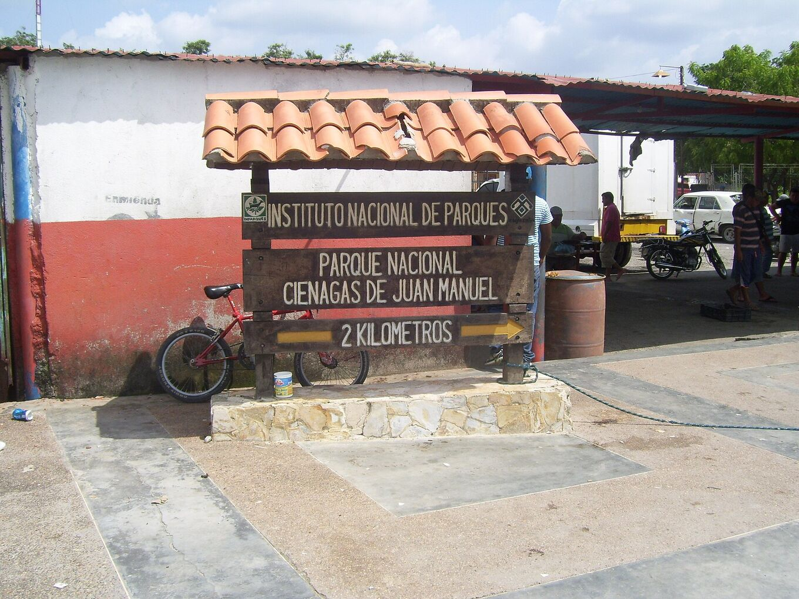

## In auto e in barca

La maggior parte delle visite parte in barca da Puerto Concha, vicino a Santa Bárbara del Zulia, verso Ologá. L'aeroporto più vicino è El Vigía; Maracaibo è a diverse ore di strada. Molte agenzie organizzano l'escursione da Mérida.

Da Mérida la strada scende dalle Ande verso le pianure del sud del lago, tra piantagioni di platano e allevamenti di bestiame. Ci vogliono circa quattro ore fino all'imbarcadero. Da Puerto Concha la barca segue canali e mangrovie fino al parco nazionale ed esce sul lago. Il tragitto dura da una a due ore, secondo il percorso e il livello dell'acqua.

Porta con te il passaporto o un documento, perché sulle strade ci sono posti di controllo della polizia e dell'esercito.

*[Yinette Bracho Padilla · Wikimedia Commons · CC BY-SA 4.0](https://commons.wikimedia.org/wiki/File:Entrada_al_parque_nacional.jpg)*

Trasferimenti, orari e prezzi cambiano con i percorsi, il livello dell'acqua e la disponibilità locale, quindi confermali con gli operatori della zona prima di partire.

## Percorsi in barca verso Ologá

Un progetto di agriturismo della zona descrive quattro percorsi. I tempi sono indicativi.

| Partenza | Durata | Sosta |
| --- | --- | --- |
| Puerto Concha | ≈ 1 h | Palafitta di Corpozulia |
| Canale Escalante, dal settore Curva de Colón | ≈ 2 h | Congo Mirador |
| Porto peschereccio di Encontrados, lungo il Catatumbo | ≈ 2 h 30 min | Caña Dulce |
| Puerto La Maroma, a Concha | ≈ 2 h 30 min | Palafitta di Corpozulia |

Quando il fiume è molto basso o in piena, alcuni percorsi non sono navigabili. Se arrivi il giorno prima, la pagina Dove dormire elenca gli hotel vicini all'imbarcadero.
