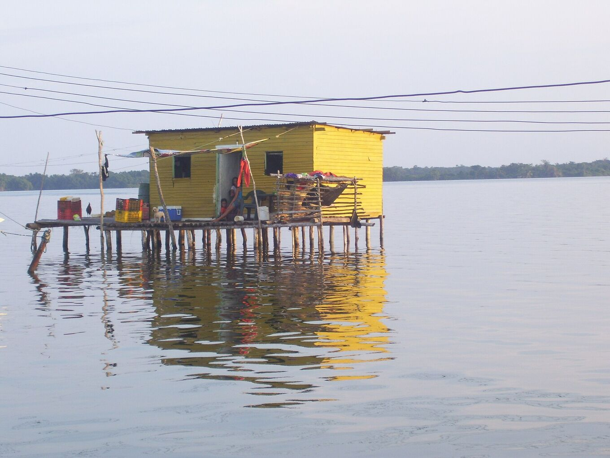
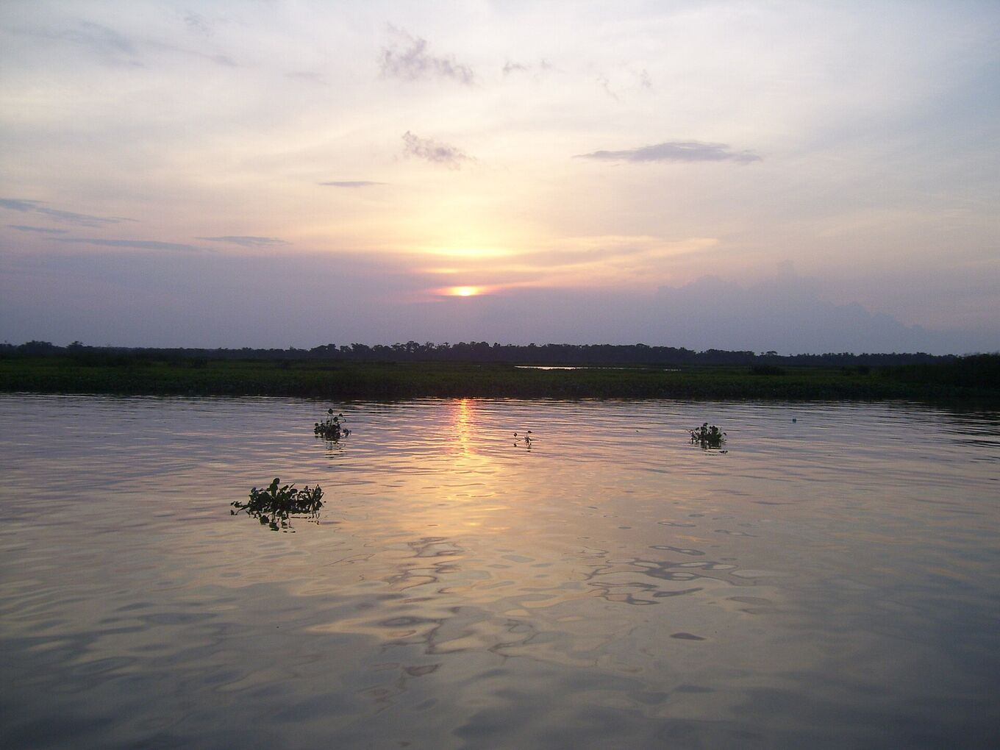

## Vai con chi conosce il lago.

L’escursione dura di solito due o tre giorni: strada fino all’imbarcadero, barca lungo il fiume e sul lago, e una notte in una palafitta davanti al temporale. Con un operatore locale è più semplice e più sicura.

*[Yinette Bracho Padilla · Wikimedia Commons · CC BY-SA 4.0](https://commons.wikimedia.org/wiki/File:Palafito_en_medio_del_Parque_nacional.jpg)*

### Un’escursione tipo

Ogni operatore ha il suo programma. Su due giorni, spesso è così:

- **Giorno 1, mattina:** partenza presto da Mérida, o accoglienza all’aeroporto di El Vigía. Strada fino a Puerto Concha.
- **Giorno 1, pomeriggio:** barca nei canali e nelle mangrovie del parco nazionale. Aironi, garzette e altri uccelli acquatici lungo il percorso. Arrivo a Ologá prima del tramonto.
- **Giorno 1, notte:** cena, spesso pesce del lago. Poi il temporale, dalla terrazza o dalla barca a distanza di sicurezza. Si dorme in amaca o in letto, in una palafitta.
- **Giorno 2:** alba sul lago, barca di ritorno all’imbarcadero e strada di ritorno nel pomeriggio.

Le escursioni di tre giorni aggiungono più tempo sull’acqua, una seconda notte di fulmini o una sosta sulle Ande.

### Prima di prenotare, chiedi

- **Che cosa è incluso:** trasferimenti, barca, pasti, acqua potabile e dove si dorme (amaca o letto).
- **Da dove si parte** e quando si torna. Molte escursioni partono da Mérida.
- **Sicurezza:** giubbotti di salvataggio per tutti, una barca in buono stato e che cosa fanno se il temporale si avvicina o il vento aumenta.
- **Permessi:** che rispettino le regole del parco nazionale e lavorino d’accordo con le comunità delle palafitte.
- **Lingue** della guida e dimensione del gruppo.
- **Pagamento e cancellazione:** in quale valuta, se accettano carte o solo contanti, e che cosa succede se il meteo costringe ad annullare.
- **Se non c’è il fulmine:** che cosa succede se la notte è calma. Nessuno può promettere il temporale.
- **Sul posto:** bagni, acqua potabile, corrente per ricaricare e come chiedono aiuto senza segnale telefonico.
- **Registrazione:** se sono iscritti al Registro nazionale del turismo del Venezuela (RTN).

### Segnali d’allarme

- Un prezzo molto più basso di tutti gli altri.
- Niente giubbotti di salvataggio, o non abbastanza per tutto il gruppo.
- Offerte di navigare sotto il temporale per fare foto migliori.
- Pressioni per pagare tutto in anticipo, in contanti e senza ricevuta.
- Nessun piano chiaro in caso di maltempo.

### Scegli servizi locali

Ingaggiare guide, barcaioli e alloggi della zona lascia il denaro nelle comunità che vivono accanto al fulmine.

Chiedi se i barcaioli e chi cucina vengono da Ologá o dai villaggi vicini. Mangia quello che cucinano le famiglie e lascia una mancia a guide e barcaioli se il servizio è stato buono.

*[Yinette Bracho Padilla · Wikimedia Commons · CC BY-SA 4.0](https://commons.wikimedia.org/wiki/File:Lago_de_Maracaibo_desde_el_Parque_nacional.jpg)*
