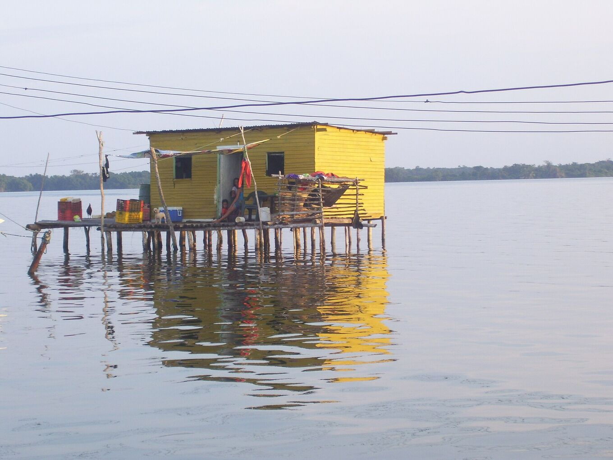

## Escursioni guidate

L'escursione dura di solito due o tre giorni, con la strada fino all'imbarcadero, la barca lungo il fiume e sul lago e una notte in una palafitta davanti al temporale. Con un operatore locale è più semplice e più sicura.

*[Yinette Bracho Padilla · Wikimedia Commons · CC BY-SA 4.0](https://commons.wikimedia.org/wiki/File:Palafito_en_medio_del_Parque_nacional.jpg)*

### Prima di prenotare, chiedi

- Che cosa include il prezzo, come trasferimenti, barca, pasti, acqua potabile e dove si dorme (amaca o letto).
- Da dove si parte e quando si torna. Molte escursioni partono da Mérida.
- Quali misure di sicurezza adottano, come giubbotti di salvataggio per tutti e una barca in buono stato, e che cosa fanno se il temporale si avvicina o il vento aumenta.
- Se rispettano le regole del parco nazionale e lavorano d'accordo con le comunità delle palafitte.
- Quali lingue parla la guida e quanto è grande il gruppo.
- In quale valuta si paga, se accettano carte o solo contanti, e che cosa succede se il meteo costringe ad annullare.
- Che cosa succede se la notte è calma e non c'è il fulmine. Nessuno può promettere il temporale.
- Che cosa c'è sul posto (bagni, acqua potabile, corrente per ricaricare) e come chiedono aiuto senza segnale telefonico.
- Se sono iscritti al Registro nazionale del turismo del Venezuela (RTN).

### Segnali d'allarme

- Un prezzo molto più basso di tutti gli altri.
- Niente giubbotti di salvataggio, o non abbastanza per tutto il gruppo.
- Offerte di navigare sotto il temporale per fare foto migliori.
- Pressioni per pagare tutto in anticipo, in contanti e senza ricevuta.
- Nessun piano chiaro in caso di maltempo.

## Istituzioni e partner

Enti pubblici e aziende che lavorano per il turismo nel sud del lago:

- **Turismo:** INATUR Zulia (Istituto nazionale del turismo) e la Corporación Zuliana de Turismo.
- **Scienza e ambiente:** l'UNESUR (Universidad Nacional Experimental Sur del Lago), l'ICLAM (Istituto per la conservazione del lago di Maracaibo), il MINEC (Ministero dell'Ecosocialismo) e la [Fondazione Finnova](https://www.finnova.com/).
- **Trasporto aereo:** l'INAC (Istituto nazionale dell'aviazione civile).
- **Aziende:** YessTravels, Grupo San Simón, Junior Mall Hotel e Hotel Tibisay.
